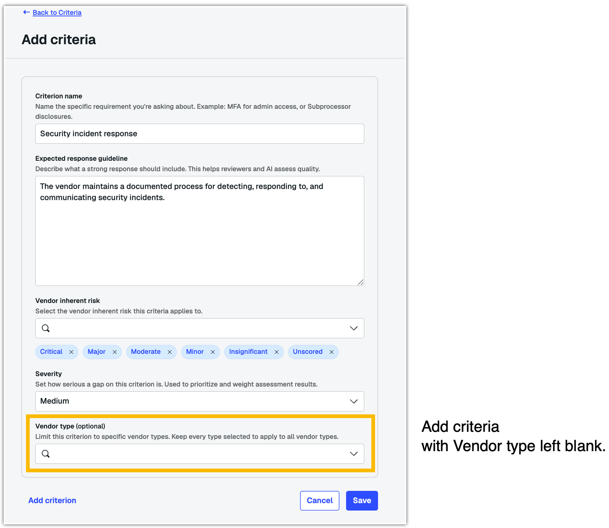
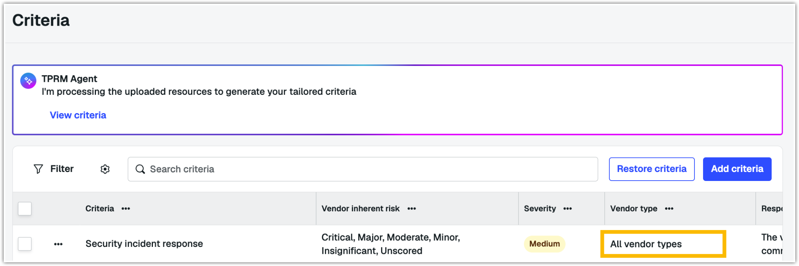
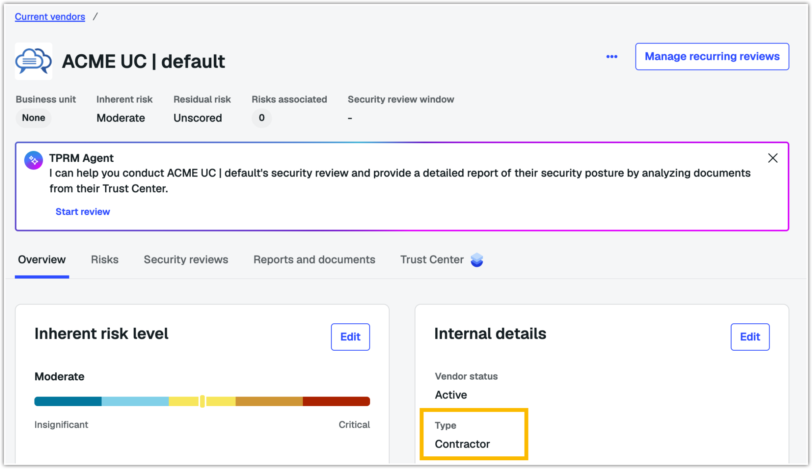
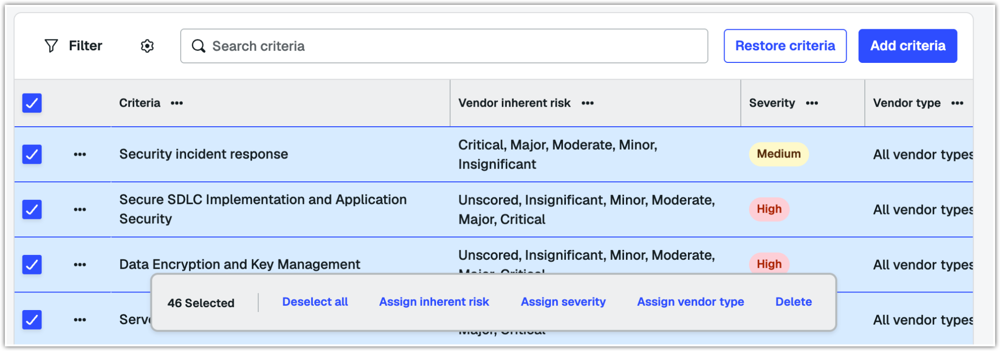
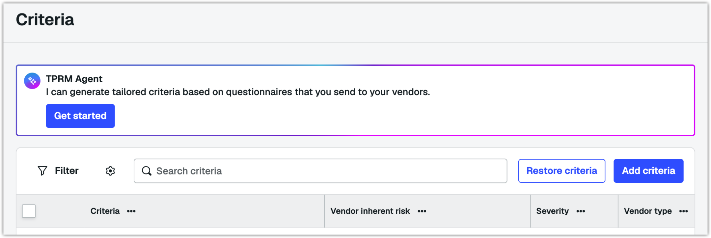
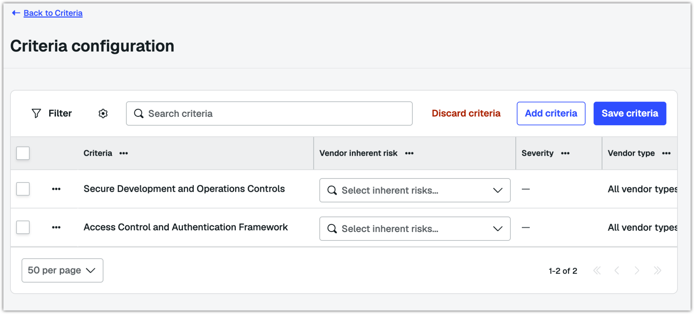
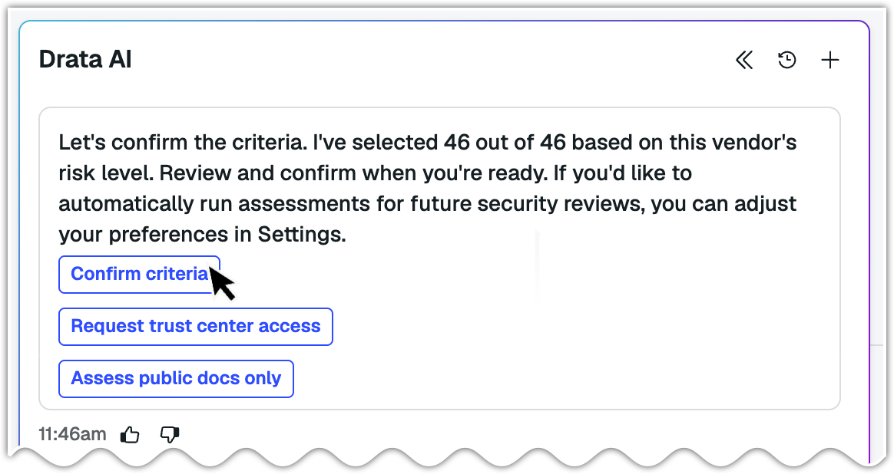
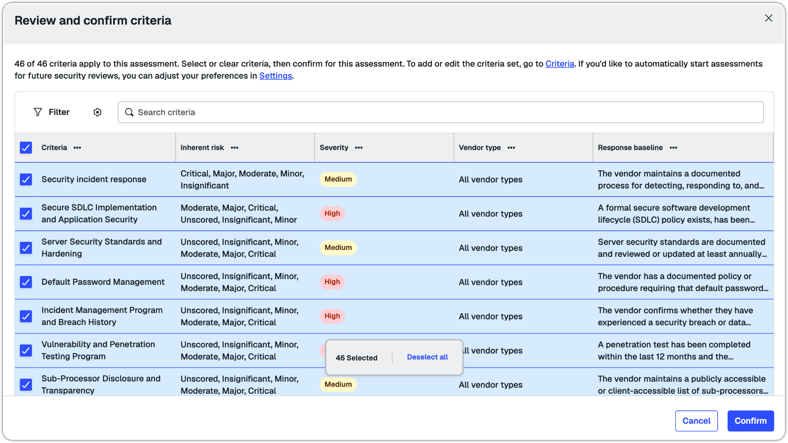

# TPRM Agent: Create a Criteria

Source: https://help.drata.com/en/articles/16880318-tprm-agent-create-a-criteria
Collection: Understand the Drata Platform › Vendors › TPRM Agent
Updated: 2026-09-09
Fetched: 2026-11-22
Description: Learn how to configure the evaluation criteria the TPRM Agent uses to assess vendors — including inherent risk mapping, severity weighting, and vendor type scoping.

## Article text

This article explains how to set up and manage the criteria that drive vendor security reviews in Drata.

Criteria are the evaluation standards the TPRM Agent applies when it assesses a vendor. Each criterion describes something you need to know about a vendor's security posture, along with what a good answer looks like. When the agent runs a review, it evaluates the vendor's documentation against the criteria that apply to that vendor and reports what it found, with sources.

Three fields on each criterion control its scope and weighting:

- **Vendor inherent risk** determines which vendors the criterion applies to.
- **Vendor type** narrows the criterion to specific kinds of vendors.
- **Severity** tells Drata how serious a gap on that criterion is, which weights the residual risk score.

After following this article, you'll be able to:

- Understand what criteria are and how the agent uses them
- Map criteria to inherent risk levels, vendor types, and severity
- Edit a single criterion, or update many at once with bulk actions
- Create new criteria manually or generate them from an existing questionnaire
- Confirm and adjust the criteria set for an individual assessment
- Restore Drata's default criteria

---

## Prerequisites

Before using the TPRM Agent, make sure the following are in place:

- **TPRM Agent entitlement is enabled on your account.** Access to the TPRM Agent is not included with TPRM Pro alone — it requires a separate Agentic TPRM Assessment entitlement, either through a paid add-on or an eligible promotion (for example, the '100 Assessments' program). If you're unsure whether your account is provisioned, reach out to your Drata representative.
- **TPRM Pro entitlement is active.** Your account must have the TPRM Pro package enabled. This is a base requirement for accessing the TPRM Agent.
- **Drata AI Data Share is enabled.** This account-level entitlement in site admin allows your data to be sent to Drata's AI infrastructure. It is enabled by default for all customers. If your organization has explicitly opted out of AI data sharing, the TPRM Agent will not be available.
- **AI Experiences are turned on.** Individual users must opt in under **Settings > AI Settings**. This controls whether AI-powered features are visible to you.
- **Vendors are set up in Drata.** You'll need at least one vendor configured with relevant details before starting a review.

**Expected outcome:** You can open the **Criteria** page and view your criteria list. Depending on your entitlements, the page may appear under **Vendors > Criteria**. If the page isn’t available, one or more required entitlements are missing.

---

## What are criteria?

Criteria are the evaluation standards the agent uses to assess a vendor's security posture. Each criterion describes a specific requirement and the response that would satisfy it.

Each criterion has:

- **Criterion name** — the specific requirement you're asking about. For example, *MFA for admin access* or *Subprocessor disclosures*.
- **Expected response guideline** — a description of what a strong response should include. This is what the agent measures the vendor's documentation against, and what reviewers use to judge quality. On the criteria list, this appears as the **Response baseline**.
- **Vendor inherent risk** — which inherent risk levels this criterion applies to.
- **Severity** — how serious a gap on this criterion is.
- **Vendor type** — which vendor types this criterion applies to.

#### Why use criteria instead of questionnaires?

Traditional questionnaire-based reviews can involve reading hundreds of self-reported answers. Criteria offer several advantages:

- **Faster time-to-decision.** Grouped requirements let you quickly see what matters, rather than scanning individual question-and-answer pairs.
- **More accurate assessments.** Specific, objective requirements give the agent clear targets to evaluate, reducing ambiguity.
- **Better alignment with how you actually use vendors.** Criteria can be tailored to your organization's risk appetite and to the context in which you use each vendor.

#### Drata's default criteria

Every account with the agent enabled receives a default set of criteria developed in collaboration with Drata's internal GRC team. These are inspired by the SIG Lite questionnaire and cover security, privacy, ESG, and other common evaluation domains.

Default criteria are mapped to every inherent risk level and apply to all vendor types out of the box, and each one arrives with a severity already assigned. You can modify, delete, or restore the defaults at any time.

---

## How the agent decides which criteria to apply

When the agent runs a review, it doesn't use every criterion in your list. It selects the ones that apply to that particular vendor, based on two dimensions. Make sure each criterion is mapped to at least one inherent risk level or a vendor type. A criterion mapped to neither will not be used during assessments.

A criterion is applied to a vendor if it matches **either**:

- the vendor's **inherent risk level**, **or**
- the vendor's **type**

For example, if you select Moderate under Vendor inherent risk and Contractor under Vendor type, the criterion applies to vendors with Moderate inherent risk or the Contractor type. It doesn’t require both matches.

#### Vendor inherent risk

Select the vendor inherent risk levels that this criterion applies to.

**Tip:** If your organization doesn't use Drata's inherent risk framework, select the **Unscored** option. This acts as a catch-all and applies the criterion to any vendor that hasn't been scored yet.

#### Vendor type

Vendor type lets you scope a criterion to specific kinds of third parties. Drata ships with a default list — Vendor, Supplier, Contractor, Partner, Other, and Subprocessor — but vendor types are fully customizable at the Vendor Settings page. See [Customize vendor types](customize-vendor-types-new-experience.md).

Vendor type is optional. Leave it blank to apply the criterion to all vendor types. The criteria list displays these as “All vendor types.”

A vendor's type is set on the vendor profile under **Internal details**.

#### Severity

Severity tells Drata how serious a gap on a given criterion is, relative to the other criteria at the same risk level. It has three values — **Low**, **Medium**, and **High** — and it is a **required field** on every criterion.

Severity does three things:

- **Weigh the residual risk score.** Severity sets each criterion's weight in the residual risk calculation: Low counts as 1, Medium as 2, and High as 3. Drata handles the scoring — you only need to set the severity.
- **Prioritizes results**, so you can see which gaps matter most.
- **Informs Drata AI.** The agent understands severity, so you can ask it to prioritize its analysis, commentary, and suggested observations by how severe the gaps are.

Because severity drives the weighting behind the residual risk recommendation, criteria left at an inaccurate severity will skew that score. See [Residual Risk in Security Reviews](conducting-a-security-review-legacy.md) for how the score is calculated.

#### How Drata assigned default severities

Drata's default criteria ship with a severity already assigned to each one, so you don't have to start from scratch.

These assignments were informed by the **NIST Cybersecurity Framework (CSF) 2.0**. Each criterion was mapped to its primary CSF function — Govern, Identify, Protect, Detect, Respond, or Recover — with **NIST SP 800-53 Rev. 5** control-family references where useful, and the **NIST AI Risk Management Framework** for AI governance criteria. Severity then follows from the function:

| **Severity** | **What it covers** | **Primary CSF functions** |
|---|---|---|
| **High** | Preventive and response controls | Protect, Respond |
| **Medium** | Governance, detective, and infrastructure functions | Govern, Identify, Detect |
| **Low** | Scoping and disclosure items | — |

Treat these as a well-reasoned starting point rather than a fixed standard. Your organization's risk appetite and the way you actually use vendors may justify weighting some criteria differently, and you can change any of them.

**Expected outcome:** For any vendor, you can predict which criteria the agent will assess by checking the vendor's inherent risk level and type against your criteria list.

---

## Viewing and filtering your criteria

Go to **Vendors > Criteria** to see your full criteria set. The list shows:

| **Column** | **What it shows** |
|---|---|
| **Criteria** | The criterion name |
| **Vendor inherent risk** | The inherent risk levels the criterion is mapped to |
| **Severity** | Low, Medium, or High |
| **Vendor type** | The vendor types the criterion applies to |

Use **Search criteria** to find a specific criterion by name, or **Filter** to narrow the list. Sort by selecting the column headers.

**Expected outcome:** The criteria list displays every criterion in your set with its inherent risk mapping, severity, and vendor type, and the pagination footer shows your total count.

---

## Editing a single criterion

1. Go to **Vendors > Criteria**.
2. Select the **ellipsis (…)** menu for the criterion you want to edit, then select **Edit criterion**.
3. Update any of the following:
   - **Expected response guideline** — what a strong response should include.
   - **Vendor inherent risk** — select the levels this criterion maps to. Selected levels appear as removable chips beneath the field.
   - **Severity** — choose Low, Medium, or High. Required.
   - **Vendor type** — select specific types, or leave empty to apply to all vendor types. Optional.
4. Select **Save**.

**Expected outcome:** A *Criteria updated successfully* confirmation appears, the dialog closes, and the criterion's row in the list reflects your changes.

---

## Updating multiple criteria at once

When you're rolling out severity across a default criteria set, or scoping a group of criteria to a vendor type, bulk actions are faster than editing one at a time.

1. Go to **Vendors > Criteria**.
2. Select the checkbox on each criterion you want to change, or use the header checkbox to select all criteria on the page.
   

A bulk action bar appears showing the number selected, with the following options:

- **Deselect all**
- **Assign inherent risk**
- **Assign severity**
- **Assign vendor type**
- **Delete**

**Expected outcome:** Every selected criterion reflects the new value in its row, and the selection clears. The bulk action bar shows the count you selected before applying, so you can confirm the change covered the intended criteria.

---

## Creating a criterion manually

1. Go to **Vendors > Criteria** and select **Add criteria**.
2. Complete the fields:
   - **Criterion name** — name the specific requirement you're asking about. For example, *MFA for admin access* or *Subprocessor disclosures*.
   - **Expected response guideline** — describe what a strong response should include. This helps reviewers and the agent assess quality.
   - **Vendor inherent risk** — select the inherent risk levels this criterion applies to.
   - **Severity** — set how serious a gap on this criterion is. Required.
   - **Vendor type** — limit the criterion to specific vendor types, or leave empty to apply to all vendor types. Optional.
3. To add more than one criterion in the same session, select **Add criterion** and complete the next set of fields.
4. Select **Save**.

**Expected outcome:** The new criterion appears in your criteria list with the inherent risk, severity, and vendor type you assigned, and is included in future assessments for vendors that match.

---

## Generating criteria from a questionnaire

If your organization already uses internal questionnaires, you can use them to generate custom criteria.

Note: This takes 10–15 minutes depending on the size of the questionnaire. You can navigate away and return — progress is preserved.

1. Go to the **Criteria** page and select **Get Started**.
   
2. Upload one or more completed questionnaires — or internal runbooks — that represent a good vendor response.
3. The agent extracts questions and answers, groups related items, and generates criteria with expected response guidelines.
4. Review each generated criterion before saving:
   - **Assign inherent risk to every criterion.** This is required before saving.
   - **Set severity and vendor type.** Generated criteria won't reflect your weighting or scoping until you set these.
   - **Edit as needed.** Modify names and guidelines, or delete criteria entirely.
   - **Review the source.** Each generated criterion includes the original question — and answer, if provided — that produced it, so you can verify the output.

**Important:** This replaces your entire existing criteria set, including Drata's defaults. You can restore the defaults at any time using **Restore criteria** on the Criteria page.

**Expected outcome:** Your criteria list contains the generated set, every criterion has an inherent risk assignment, and the previous set — including defaults — has been replaced. If the result isn't what you wanted, **Restore criteria** returns Drata's defaults.

---

## Confirming criteria for an individual assessment

Your criteria list is the standing configuration. Each security review also gives you a chance to adjust the set for that one assessment, without changing your global configuration.

When you start a review, the agent presents a **Confirm criteria** step showing how many criteria apply to the assessment:

Agent Text: *[N] of [N] criteria apply to this assessment. Select or clear criteria, then confirm for this assessment. To add or edit the criteria set, go to Criteria. If you'd like to automatically start assessments for future security reviews, you can adjust your preferences in Settings.*

1. Review the criteria listed. Each row shows the **Criteria** name, **Inherent risk**, **Severity**, **Vendor type**, and **Response baseline**.
   
2. Clear the checkbox on any criterion that isn't relevant to this vendor, or use **Deselect all** and then **Select all** to start from a clean slate.
3. Use **Filter** or **Search criteria** to find specific criteria in a long list.
4. Select **Confirm**.

Changes here apply to this assessment only. To change your standing set, go to **Vendors > Criteria**. To adjust agent defaults, go to **Vendors > Settings** and select **Edit TPRM Agent**.

**Expected outcome:** The assessment runs against only the criteria you confirmed, and the review's summary cards count out of that number rather than your full criteria set. Your global criteria list is unchanged.

---

## Reviewing how the agent evaluated your criteria

After you save your criteria, those criteria are used during a vendor's security review. To see how the agent evaluated them, open the vendor's security review and select a criterion on the **Assessment** tab.

If the vendor hasn't been assessed yet, run the assessment first.

For each criterion you'll see:

1. The criterion's status and name
2. A summary of what the agent found — what the evidence supports, any gaps or limitations in coverage, and why the criterion received its status
3. Any related sources, if available

**Expected outcome:** Each assessed criterion shows a status, an analysis summary explaining the determination, and — where the agent found supporting text — the source documents it drew from.

---

## Tips

- **Start from Drata's default severities, then tune.** The defaults ship with severity already assigned, so treat them as a baseline and adjust the criteria where your organization's priorities differ. Bulk actions make this quick.
- **Use vendor type for criteria that don't fit the risk model.** Some requirements apply because of what a third party *is* rather than how risky they are — subprocessor disclosures, for example. Vendor type scoping handles these without inflating your criteria set for every vendor.
- **Settle your vendor type taxonomy before scoping criteria to it.** Since vendor types are customizable and deleting one clears it from the vendors using it, it's worth agreeing on the list with your procurement and TPRM teams first.
- **Keep vendor inherent risk and type accurate on the vendor record.** Criteria selection depends entirely on these two fields, so an inaccurate vendor record produces an assessment against the wrong criteria.
- **Trim criteria at the assessment step rather than deleting them globally.** If a criterion doesn't apply to one vendor, clear it during the confirmation step instead of removing it from your standing set.
- **Review generated criteria before saving.** Questionnaire-generated criteria arrive without your severity and vendor type conventions applied.

---

## FAQ

**What happens if a criterion has no inherent risk and no vendor type?** It won't be used during assessments. Make sure every criterion is mapped to at least one inherent risk level or vendor type.

**Does vendor type replace inherent risk?** No. A criterion applies if it matches the vendor's inherent risk level *or* the vendor's type. Vendor type adds a second way for a criterion to come into scope.

**What does severity actually change?** Three things: it weights the residual risk score — Low counts as 1, Medium as 2, High as 3 — it prioritizes results so you can see which gaps matter most, and it gives Drata AI a way to rank its analysis and suggested observations when you ask it to focus on the most severe gaps.

**How did Drata decide the default severities?** They were informed by the NIST Cybersecurity Framework 2.0. Each default criterion was mapped to its primary CSF function, with NIST SP 800-53 Rev. 5 control-family references where useful and the NIST AI Risk Management Framework for AI governance criteria. Preventive and response controls anchor High, governance and detective functions anchor Medium, and scoping or disclosure items are Low. You can change any of them.

**Are severity and vendor type required?** Severity is required on every criterion. Vendor type is optional — leaving it empty applies the criterion to all vendor types.

**How do I apply criteria to all vendor types?** Leave the vendor type field empty. Those criteria display as *All vendor types* in the list. Selecting every type individually has the same effect, but leaving the field empty is clearer.

**Where is a vendor's type set?** On the vendor profile, under **Internal details**.

**Can I use my own vendor types?** Yes. Vendor types are customizable at **Vendors > Vendor settings > Types** — add, rename, or delete them to match your taxonomy. Your custom types then appear as options when scoping criteria. See [Customize vendor types](customize-vendor-types-new-experience.md).

**What happens to my criteria if I delete a vendor type?** Vendors using that type are re-assigned to **None**, so criteria scoped to the deleted type stop matching them. Those vendors will then be assessed against criteria selected by inherent risk alone. Review any affected criteria after deleting a type.

**Does saving custom criteria remove my default criteria?** Yes. Saving a custom set replaces all existing criteria. Use **Restore criteria** to bring Drata's defaults back at any time.

**Can I import criteria in bulk?** There isn't a manual bulk import, but you can upload a questionnaire or file for the agent to use to generate criteria.

**Can I change the criteria used for one vendor without changing my global set?** Yes. Use the **Review and confirm criteria** step at the start of the assessment. Changes there apply to that assessment only.

## Images

- [image 01] ../../images/ux/vendors/tprm-agent-create-a-criteria--01.png
- [image 02] ../../images/ux/vendors/tprm-agent-create-a-criteria--02.png
- [image 03] ../../images/ux/vendors/tprm-agent-create-a-criteria--03.png
- [image 04] ../../images/ux/vendors/tprm-agent-create-a-criteria--04.png
- [image 05] ../../images/ux/vendors/tprm-agent-create-a-criteria--05.png
- [image 06] ../../images/ux/vendors/tprm-agent-create-a-criteria--06.png
- [image 07] ../../images/ux/ai/tprm-agent-create-a-criteria--07.png
- [image 08] ../../images/ux/vendors/tprm-agent-create-a-criteria--08.png

## Related articles

- [(Legacy) TPRM Agent: Create a Criteria](legacy-tprm-agent-create-a-criteria.md)
- [Training Video: Conducting an End-to-End Vendor Review with the Drata TPRM Agent (New Experience)](training-video-conducting-an-end-to-end-vendor-review-with-the-drata-tprm-agent-new-experience.md)
- [Getting started with the TPRM Agent](getting-started-with-the-tprm-agent.md)
- [TPRM Agent Autonomy Settings](tprm-agent-autonomy-settings.md)
- [Conducting a Security Review](conducting-a-security-review.md)
