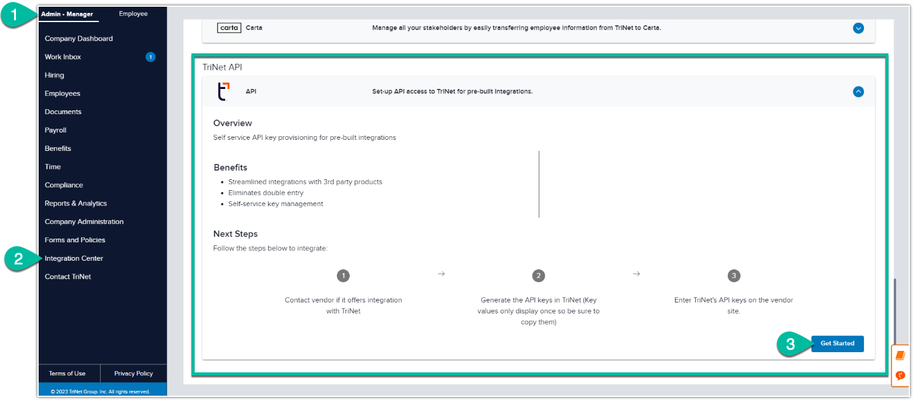
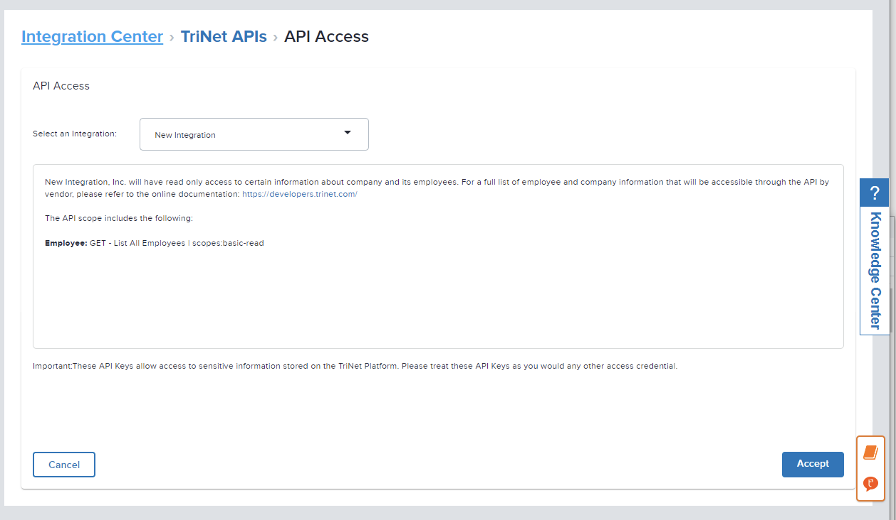
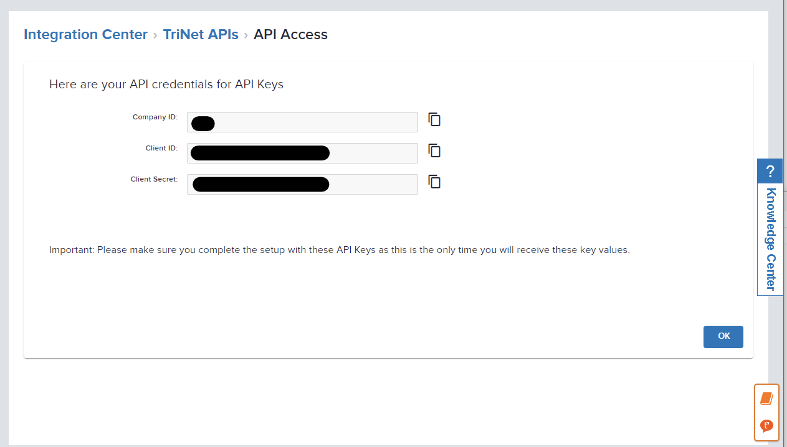
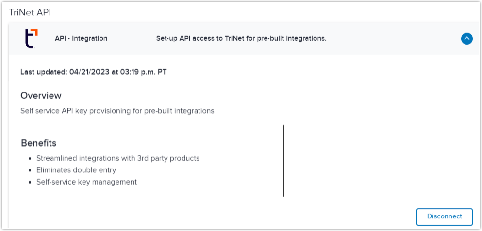

# TriNet Integration Guide

Source: https://help.drata.com/en/articles/5455179-trinet-integration-guide
Collection: Connection Support › Other Guidance
Updated: 2026-08-05
Fetched: 2026-11-22
Description: Making the initial connection to Trinet

## Article text

Connecting TriNet to Drata allows for automated checks and evidence collection to provide details on personnel hire and separation dates as well as their employment status.

## Key Capabilities

- Synchronization of employee hire, termination, and employment status
- Accurate tracking of personnel changes for compliance reporting
- Continuous monitoring of onboarding and offboarding events

## Prerequisites & Data Access

- Administrative access to your organization’s TriNet account.
- You must be assigned the TriNet role of **Integration Administrator** (or work with someone who has this role) to request the API key.
- Must be assigned one of the following Drata roles: **Admin, Workspace Managers, DevOps Engineer**.
- If you have the **Access Reviewer** role, you can only view the Connections page.

### Service Date vs. Effective Date

- Service Date: The date the employee began with TriNet
- Effective Date: The employee's first hire date with the employer.
- Drata syncs with Effective Date for personnel details.

### Permissions & Data Table

| Permission / Scope | Why It’s Needed | Data Accessed (Read Only) |
|---|---|---|
| Company ID, Client ID, Client Secret | Required for Drata to authenticate to the TriNet API | Employee metadata, hire dates, separation dates, employment status |
| Integration access grant (TriNet API access) | Authorizes Drata to retrieve personnel information | HR profile data required for compliance automation and monitoring |

## Step-by-Step Setup

### Step 1: Request API Credentials in TriNet

1. Sign in to TriNet ([https://identity.trinet.com/](https://identity.trinet.com/))
2. From the left side bar, select the Admin • Manger tab. Then select **Integration Center**
3. Select **Get Started** button from the **TriNet API** section.
   
4. From the **Select an Integration** drop-down:
   - Choose the Drata.
   - Review the level of access being granted to the API key.
5. Select **Accept**.
   
6. Copy the following values:
   - **Company ID**
   - **Client ID**
   - **Client Secret**

⚠️ **Important:** Do not navigate away from this screen before pasting these credentials into Drata (or the third-party integration page). These credentials **cannot be accessed again** from TriNet once you leave the page.

**Expected outcome:** You have a valid Company ID, Client ID, and Client Secret ready to paste into Drata.

### Step 2: Configure Integration Settings in Drata

1. In Drata, navigate to the**Connections** page.
2. Locate the **TriNet** tile and click **Connect**.
3. During the connection process:
   - Enter the **Company ID**.
   - Enter the **Client ID**.
   - Enter the **Client Secret**.
4. Review the details and make sure each field is copied exactly as shown in TriNet.

**Expected outcome:** The TriNet connection panel in Drata is fully populated with valid API credentials.

## Revoke or Regenerate Access

Access to the TriNet API can be revoked at any time from within the **My Connected Apps** section of TriNet:

1. Login to `identity.trinet.com`
2. Navigate to` Admin • Manager > Integration Center > My Connected Apps`
3. From this page, select **Disconnect** to immediately revoke Drata’s access.
   

If you need to generate new credentials (for example, if the existing key was lost, rotated, or compromised):

1. Disconnect the existing connection from **My Connected Apps**.
2. Repeat the API Key request steps to generate a new **Company ID**, **Client ID**, and **Client Secret**.

**Reminder:** TriNet API credentials are only shown once at the time of creation. If they are not entered into Drata before navigating away from the page, they cannot be viewed again and a new key must be generated.

## Images

- [image 01] ../../images/integrations/trinet/trinet-integration-guide--01.png
- [image 02] ../../images/integrations/trinet/trinet-integration-guide--02.png
- [image 03] ../../images/integrations/trinet/trinet-integration-guide--03.png
- [image 04] ../../images/integrations/trinet/trinet-integration-guide--04.png

## Related articles

- [BambooHR Integration Guide](bamboohr-integration-guide.md)
- [Freshteam Integration Guide](freshteam-integration-guide.md)
- [Paylocity Integration Guide](paylocity-integration-guide.md)
- [HR Cloud Integration Guide](hr-cloud-integration-guide.md)
- [Workday Integration Guide (HRIS)](workday-integration-guide-hris.md)
