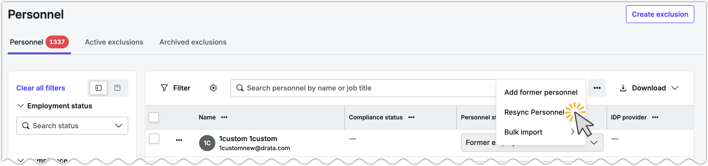
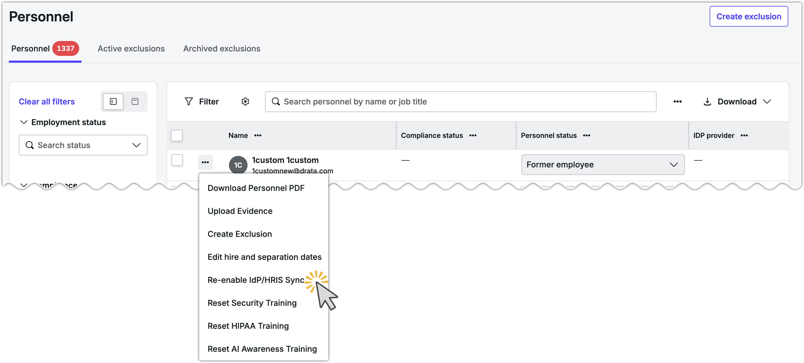

# Troubleshoot employment status issues in Drata

Source: https://help.drata.com/en/articles/15086075-troubleshoot-employment-status-issues-in-drata
Collection: Understand the Drata Platform › Personnel
Updated: 2026-11-09
Fetched: 2026-11-22
Description: Why am I not receiving authentication or login emails from Drata, and how can I resolve this?

## Article text

Employment status issues in Drata—such as users appearing as **Unknown**, **Former**, or **Future Hire** instead of **Current**—usually stem from data mismatches, manual overrides, or sync disruptions between your connected HRIS and identity provider (IdP). This article explains the common causes and how to resolve them.

---

## Users appear as "Unknown"

Drata maps HRIS records to IdP records using matching email addresses or matching first and last names. If Drata can't confidently match a record, it marks the personnel entry as **Unknown** on the Personnel page.

Common causes:

- The user's record is missing or incomplete in the HRIS (for example, missing email address, first name, or last name)
- The email address or name in the HRIS doesn't exactly match the IdP record—spelling, spacing, capitalization, and punctuation all matter
- The HRIS or IdP connection is inactive, failing, or has expired credentials

## Users appear as "Former" instead of "Current"

Drata uses the HRIS as the source of truth for employment status. A user can appear as **Former** when:

- Their status in the HRIS reflects a separation date or terminated state, even if they're still active in the IdP
- Someone manually changed their employment status in Drata, which pauses automated syncing—the record no longer updates from your HRIS or IdP until sync is re-enabled
- An Okta group scoping configuration removed the user from the synced group, which causes Drata to mark them as Former

## Users remain in "Future Hire" status

A person is assigned **Future Hire** status when their start date in Drata is set to a future date—either manually or through an HRIS sync. Future hires are treated the same as Out of Scope personnel and are excluded from compliance checks and monitoring tests.

This status persists until:

- The start date arrives naturally, or
- You change the start date to todayor a past date, then update their employment status manually

**Note:** You can't change a person's employment status while their start date is still in the future.

## Transitioning between employee and contractor status

Drata allows you to manually change employment status from the Personnel page. However, making a manual change **pauses IdP and HRIS syncing** for that individual. This means future updates from your connected systems won't apply until sync is re-enabled.

If you need to change a person's status and preserve automated syncing, update the status in the HRIS first and wait for the next sync.

**Note:** The statuses **Future hire**, **Former employee (manually added)**, and **Former contractor (manually added)** can't be updated directly.

---

## Resolve employment status issues

### Resolve "Unknown" status

1. Verify that the user's record exists in the HRIS and that all required fields are filled in (name, email, employment status).
2. Confirm that the email address and name in the HRIS exactly match the IdP record.
3. Check that your HRIS and IdP connections are active and healthy on the **Connections** page.
4. Force a manual sync:
   - Go to **Governance** > **Personnel** >> **Resync Personnel**.
      

After resyncing, allow up to 24 hours for changes to appear.

### Resolve "Former" status for an active employee

1. Verify that the user's employment status and separation date in the HRIS are correct. The HRIS is the source of truth—fix the record there first.
2. If the user's Drata record shows **"Not syncing due to manual updates in Drata"** in the Sync Status column, re-enable their sync:

**New experience:**

1. Go to **Governance** > **Personnel**.
2. Select the person.
3. Select the ellipsis menu, then select **Re-enable IdP/HRIS sync**.
   
4. Confirm the action.

**Note:** Re-enabling sync overwrites any manual changes with the values from your connected systems.

1. If you use Okta with group scoping, confirm the user is still a member of all groups configured on the Drata Okta connection.

### Resolve "Future Hire" status

1. Update the user's start date in the HRIS to today or a past date, then wait for the next daily sync.
2. If the start date was set manually in Drata, update it directly on the Personnel page:

**New experience:**

1. Go to **Governance** > **Personnel**.
2. Select the person.
3. In the Details section, select **Edit**.
4. Change the hire date to today or a past date and select **Submit**.
5. Update the employment status as needed.

**Note:** Manually changing a start date in Drata stops the HRIS from syncing hire date information for that person. To restore automated syncing, re-enable the HRIS sync for that individual.

### Transition a user between employee and contractor status

1. Update the user's status in the HRIS and wait for the next sync—this is the preferred approach.
2. If you need to make the change manually in Drata:

**New experience:**

1. Go to **Governance** > **Personnel**.
2. Select the user.
3. Select **Change employment status**, choose the new status, and confirm.

**Important:** Making a manual status change pauses IdP/HRIS syncing for that individual. To restore automated updates, re-enable their sync after the change.

### Re-enable IdP/HRIS sync in bulk

If multiple personnel records have stopped syncing, you can re-enable sync for all of them at once.

1. Go to **Governance** > **Personnel**.
2. Use the **Sync status** filter to find records that aren't syncing.
3. Select the checkboxes next to the affected individuals.
4. Select **More** > **Re-enable IdP/HRIS sync**.

---

## Best practices for accurate employment status

- **Keep HRIS records current.** Drata uses your HRIS as the source of truth for employment status, start dates, and separation dates. Always update these values in your HRIS first.
- **Audit for data mismatches regularly.** Check that email addresses and names match exactly between your HRIS and IdP.
- **Avoid unnecessary manual updates.** Manual changes to personnel records pause HRIS and IdP syncing. Use them only when your connected systems can't reflect the correct data.
- **Monitor sync status.** Use the **Sync status** filter on the Personnel page to identify records that are no longer syncing.
- **Use group scoping intentionally.** If you restrict sync to specific IdP groups, removing a user from a group marks them as Former in Drata.

---

### Frequently asked questions

**Why does a user appear as Unknown even though the HRIS connection is active?**

A healthy HRIS connection doesn't guarantee a successful match. Drata maps records using email addresses or first and last names. If the values in your HRIS don't exactly match the IdP record—including spelling and capitalization—Drata can't make a match and marks the user as Unknown. Correct the mismatch in the HRIS and run a manual resync.

**Why can't I change a person's employment status from the Personnel page dropdown?**

The statuses **Future hire**, **Former employee (manually added)**, and **Former contractor (manually added)** can't be updated directly via the status dropdown. To update a Future hire, change their start date to today or a past date first, then update the status.

**If I manually update a person's status in Drata, will the HRIS override it?**

Not right away. When you make a manual change, Drata pauses syncing for that individual to prevent your manual update from being overwritten. The HRIS won't override the record until you re-enable IdP/HRIS sync for that person.

## Images

- [image 01] ../../images/ux/personnel/troubleshoot-employment-status-issues-in-drata--01.png
- [image 02] ../../images/ux/personnel/troubleshoot-employment-status-issues-in-drata--02.png
- [image 03] ../../images/ux/personnel/troubleshoot-employment-status-issues-in-drata--03.png

## Related articles

- [Populating and Managing Personnel Data in Drata (Concept Guide)](populating-and-managing-personnel-data-in-drata-concept-guide.md)
- [Connect your HRIS to Drata](connect-your-hris-to-drata.md)
- [Why active employees may appear as former employees in Drata? (Concept Guide)](why-active-employees-may-appear-as-former-employees-in-drata-concept-guide.md)
- [How Drata Uses HRIS Data](how-drata-uses-hris-data.md)
- [Troubleshooting Identity Sync Issues in Drata](troubleshooting-identity-sync-issues-in-drata.md)
