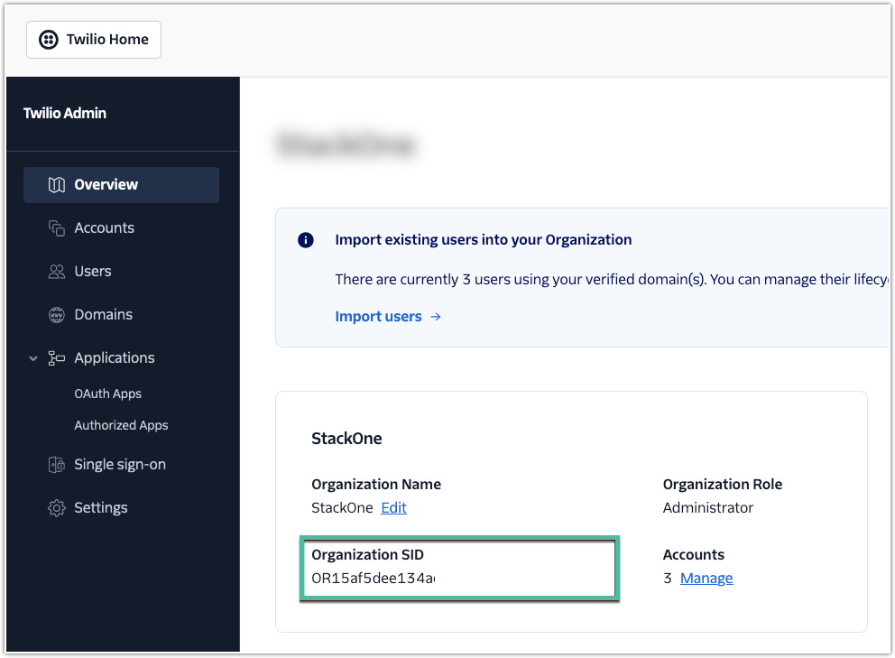
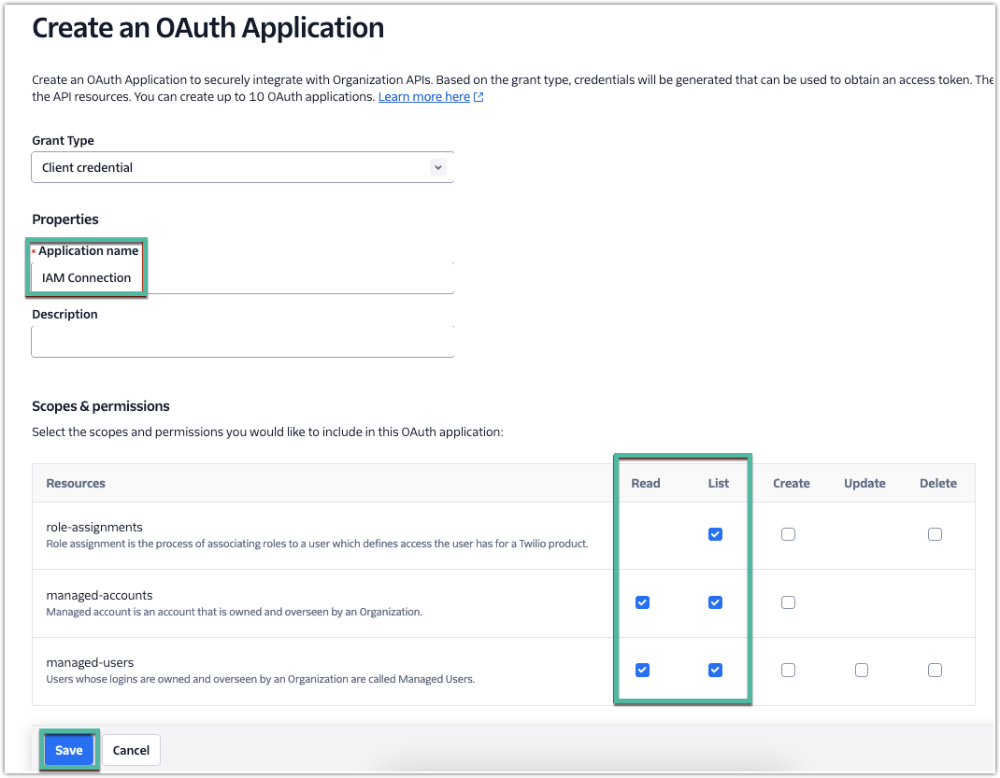

# Twilio Integration Guide

Source: https://help.drata.com/en/articles/10302032-twilio-integration-guide
Collection: Connection Support › Other Guidance
Updated: 2026-11-14
Fetched: 2026-11-22
Description: Follow these steps to connect Twilio to Drata.

## Article text

Integrating Twilio with Drata automates your user access reviews, saving time and reducing errors by syncing user data directly from Twilio.

**Important:** Twilio’s Organizations API is currently in **private beta**. You must request access from your Twilio account executive or Twilio Support before connecting.

## Key Capabilities

- **Access retrieval**: Retrieves users and assigned roles from connected systems.
- **Review enablement**: Makes this access data available for review in Drata’s Access Reviews feature.
- **Account mapping support**: Allows external accounts to be mapped to Drata personnel for accurate review and tracking.

## Prerequisites & Data Access

- Twilio **Organization Owner** or **Organization Admin** role
- Twilio **Organizations API** enabled (private beta)
- Ability to:
   - Retrieve your **Organization SID**
   - Create a **Twilio OAuth application**
- Must be assigned one of the following Drata roles: **Admin, Workspace Managers, DevOps Engineer**.
- If you have the **Access Reviewer** Drata role, you can only view the Connections page.

### Permissions & Data Table

| Permission / Scope | Why It’s Needed | Data Accessed (Read Only) |
|---|---|---|
| Organization SID | Identifies your Twilio organization | Organization-scoped IAM data |
| OAuth Client ID & Client Secret | Authenticate the connection | Users and role metadata |
| role-assignments (List) | Retrieve role assignments | User-to-role mappings |
| managed-accounts (Read, List) | Retrieve account relationships | Managed account associations |
| managed-users (Read, List) | Retrieve users | User identities |

## Step-by-Step Setup

### Step 1: Copy your Organization SID

1. Log in to Twilio using an **Organization Owner** or **Organization Admin** account.
2. Select **Organization → Twilio Admin**.
3. On the **Overview** page of the Twilio Admin Dashboard, locate the **Organization SID**.
   
4. Copy and store the value securely.

**Expected outcome:**
You have your Twilio Organization SID.

### Step 3: Create a Twilio OAuth application

1. In the Admin Dashboard, go to **Applications → OAuth Apps**.
2. Select **Create OAuth application**.
3. Configure the app:
   - **Grant Type:** Client credentials
   - **Application name:** (e.g., Drata)
   - **Scopes & permissions:**
      - `role-assignments`: List
      - `managed-accounts`: Read, List
      - `managed-users`: Read, List
   
4. Save the application.

### Step 4: Connect Twilio in Drata

1. In Drata, navigate to **Connections → Available Connections**.
2. Select **Twilio**.
3. Enter:
   - Organization SID
   - Client ID
   - Client Secret
4. Select **Connect**.

**Expected outcome:**
Drata successfully connects to Twilio.

## Images

- [image 01] ../../images/integrations/twilio/twilio-integration-guide--01.png
- [image 02] ../../images/integrations/twilio/twilio-integration-guide--02.png

## Related articles

- [Xero Integration Guide (UAR)](xero-integration-guide-uar.md)
- [Lever Integration Guide](lever-integration-guide.md)
- [Webex Integration Guide](webex-integration-guide.md)
- [RingCentral Integration Guide](ringcentral-integration-guide.md)
- [Box Integration Guide](box-integration-guide.md)
