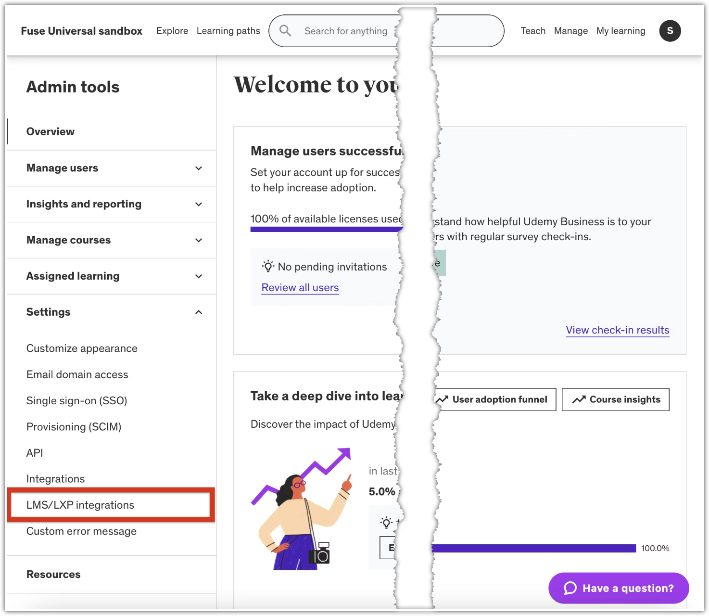
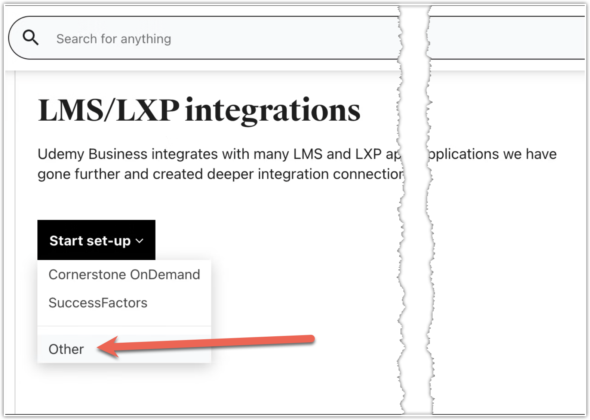
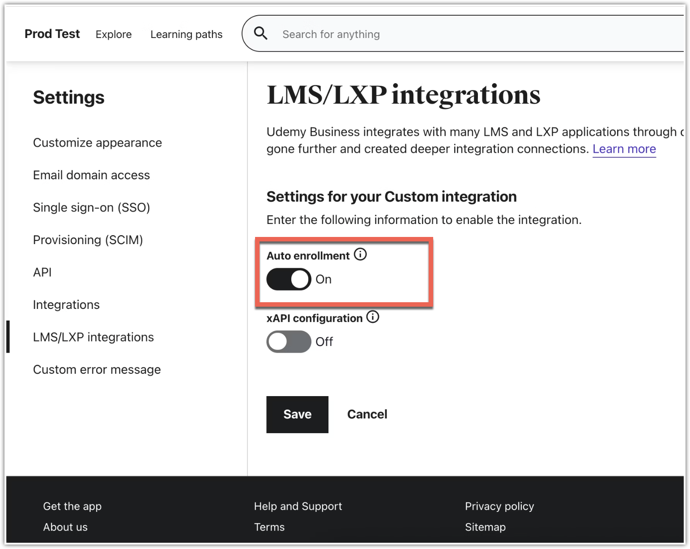
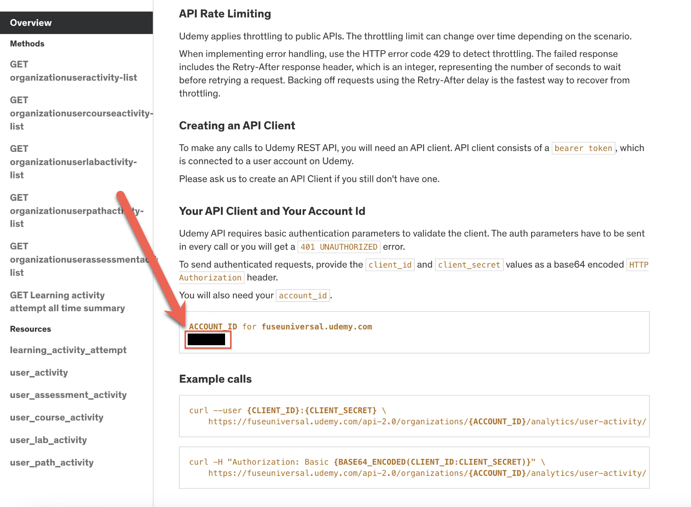

# Udemy Integration Guide

Source: https://help.drata.com/en/articles/12702488-udemy-integration-guide
Collection: Connection Support › Other Guidance
Updated: 2025-10-30
Fetched: 2026-11-22

## Article text

The **Udemy** integration enables **administrators and compliance teams** to connect Udemy Business to Drata, allowing user and training data to be automatically synchronized for compliance and access verification.

It connects Drata to your **Udemy Business** environment via API credentials so your team can automate evidence collection for training completion and user provisioning.

## Key Capabilities

- **User Data Sync:** Syncs Udemy user information for access and provisioning verification.
- **Training Completion Tracking:** Allows compliance evidence based on course participation and completion.

## Prerequisites & Data Access

- Must have **Admin privileges** within your **Udemy Business** account.
- Must be able to create a **Custom Integration** app in the **LMX/LXP Integrations** section.
- Must have access to your **Udemy Business dashboard** to retrieve **subdomain** and **account ID**.
- If **SSO** is enabled, **SCIM provisioning** must be configured with your Identity Provider (IdP).

### Permissions & Data Table

| **Permission/Scope** | **Why It’s Needed** | **Data Accessed ** |
|---|---|---|
| **Client ID & Client Secret** | Authenticate Drata to securely connect with Udemy’s API. | Integration credentials |
| **Company Subdomain** | Identifies your organization’s unique Udemy Business environment. | Organization metadata |
| **Account ID** | Enables Drata to link the correct Udemy Business account. | Account identification data |
| **SCIM Provisioning (if applicable)** | Allows automated provisioning when SSO is enabled. | User provisioning data |

## Step-by-Step Setup

### Step 1: Create an Integrations App in Udemy

1. Log in to your **Udemy account**.
2. Navigate to **Settings → LMX/LXP Integrations** in the **Admin Tools** menu.
   
3. From the **Start Setup** dropdown, select **Other**.
   
4. Toggle **Auto Enrollment** and click **Save** to create the custom app.
   
5. Copy and save the Client ID and Secret. After saving, note the following credentials displayed on-screen:
   - **Client ID**
   - **Client Secret**

### Step 2: Find Company Subdomain and Account ID

1. Log in to your **Udemy Business dashboard** and copy and locate your **Company Subdomain**:
   - Example: for `mycompany.udemy.com`, the subdomain is `mycompany`.
2. In the Udemy Business dashboard, navigate to **Manage → Settings → API → API Documentation**.
3. Scroll down to the **Your API Client and Your Account ID** section to find your **Account ID**.
   

### Step 3: Configure SCIM for User Provisioning (if applicable)

1. If **SSO** is enabled, you must use SCIM for provisioning:
   - Navigate to **Manage → Settings → Single Sign-On (SSO)** and verify your IdP connection.
2. Go to **Manage → Settings → Provisioning (SCIM)**.
3. Set up SCIM provisioning with your Identity Provider, following the Udemy SCIM configuration steps.

Follow the **[Udemy SSO Configuration](https://business-support.udemy.com/hc/en-us/articles/115008213828-Overview-of-Udemy-Business-SSO-Core-Features)** steps if configuration required.

### Step 4: Connect Inside Drata

1. In Drata, go to **Connections → Available Connections**.
2. Search for **Udemy** and select **Connect**.
3. In the modal, enter your credentials:

| **Drata Field** | **Udemy Value** |
|---|---|
| **Client ID** | Your Udemy Client ID |
| **Client Secret** | Your Udemy Client Secret |
| **Company Subdomain** | Your Udemy subdomain (e.g., `mycompany`) |
| **Account ID** | Your Udemy Business Account ID |

Click **Connect** to establish the connection.

## Images

- [image 01] ../../images/integrations/udemy/udemy-integration-guide--01.png
- [image 02] ../../images/integrations/udemy/udemy-integration-guide--02.png
- [image 03] ../../images/integrations/udemy/udemy-integration-guide--03.png
- [image 04] ../../images/integrations/udemy/udemy-integration-guide--04.png

## Related articles

- [Canva Integration Guide](canva-integration-guide.md)
- [CyberArk Integration Guide](cyberark-integration-guide.md)
- [PingOne Integration Guide](pingone-integration-guide.md)
- [Docebo Integration Guide](docebo-integration-guide.md)
- [Enterprise SCIM Integration Guide](enterprise-scim-integration-guide.md)
