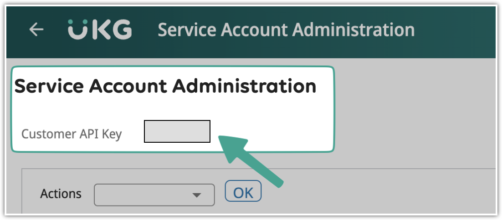
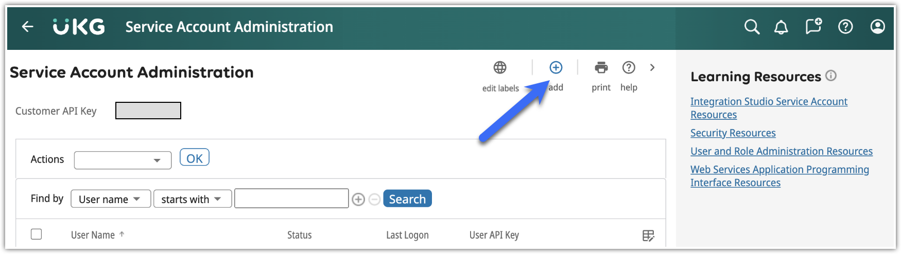
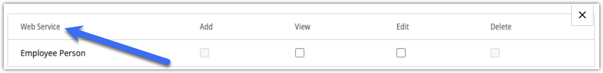

# UKG Pro Integration Guide

Source: https://help.drata.com/en/articles/6994418-ukg-pro-integration-guide
Collection: Connection Support › Other Guidance
Updated: 2026-08-05
Fetched: 2026-11-22
Description: Making the initial connection to UKG Pro

## Article text

Connecting UKG Pro to Drata allows for automated checks and evidence collection to provide details on personnel hire and separation dates as well as their employment status.

## Key Capabilities

- **Personnel synchronization:** Syncs employment status, hire dates, and key personnel attributes from the HRIS.
- **Lifecycle classification:** Uses HRIS data to detect hire and termination events that support onboarding and offboarding compliance requirements.
- **Read-only ingestion:** Retrieves HR data using read-only access without modifying information in the HRIS system.

## Prerequisites & Data Access

- Admin access to your company’s **UKG Pro** account
- **Customer API Key** generated from the UKG Pro
- **Service account username**
- **Service account password**

## Step-by-Step Setup

### Step 1: Generate the Customer API Key

1. Search for **Service Account Administration** in the UKG Pro search bar.
2. Locate and copy the **Customer API Key** shown on the **Service Account Administration** page.
   

**Expected outcome:** You have the API key required to connect UKG Pro to Drata.

---

### Step 2: Create a UKG Pro service account

1. On the **Service Account Administration** Page, select **+ Add**.
   
2. For the username and email, enter your admin account username and email.
3. On the same page, scroll down under **Web Service** table.
   
4. Enable **View** for** Employee Person Details** permission. This is **REQUIRED.**
5. The following permissions are recommended to be enabled for view access.
   - Company Configuration Integration is **suggested**
   - Personnel Integration is **suggested**
   - Employee Job History Details is **suggested**
6. Click **Save** and your new password will pop up
7. You will enter the **username** and **password** during the connection process.

**Expected outcome:**
A new service account is created, and a password is generated.

**Important:** Save the generated password in a secure location. It will not be shown again.

---

### Step 3: Obtain the Web Services URL

1. In UKG Pro, search for **Web Services** using the top-right search bar.
2. Copy one of the available Web Services URLs.

Your URL should look similar to:
`http://Service.ultipro.com/services/BIDataService`

**Expected outcome:**
You have the full Web Services URL required for the connection.

---

### Step 4: Connect UKG Pro in Drata

1. In Drata, click **Connections**.
2. Search and select **UKG Pro** to **Connect**.
3. Paste the **Customer API Key**, service account username, password, and url into the connection modal.
4. Click **Submit**.

**Expected outcome:** The connection status shows as **Active**.

Finally, click the ‘Submit’ button to establish an active UKG Pro connection with Drata and begin the automatic syncing of HRIS data to the user data already present.

## Images

- [image 01] ../../images/integrations/ukg-pro/ukg-pro-integration-guide--01.png
- [image 02] ../../images/integrations/ukg-pro/ukg-pro-integration-guide--02.png
- [image 03] ../../images/integrations/ukg-pro/ukg-pro-integration-guide--03.png

## Related articles

- [Gusto Integration Guide](gusto-integration-guide.md)
- [BambooHR Integration Guide](bamboohr-integration-guide.md)
- [HR Cloud Integration Guide](hr-cloud-integration-guide.md)
- [Workday Integration Guide (HRIS)](workday-integration-guide-hris.md)
- [UKG Ready Integration Guide](ukg-ready-integration-guide.md)
