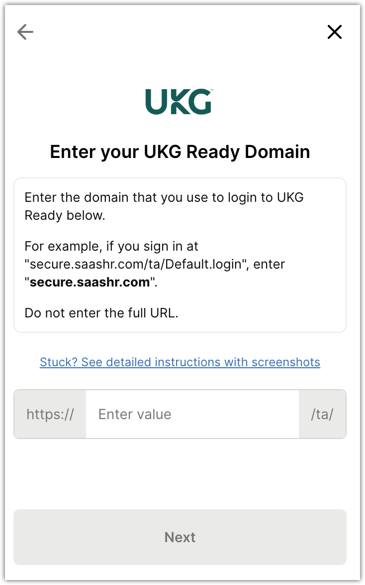
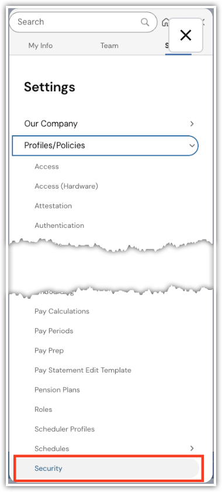

# UKG Ready Integration Guide

Source: https://help.drata.com/en/articles/14229348-ukg-ready-integration-guide
Collection: Connection Support › Other Guidance
Updated: 2026-03-25
Fetched: 2026-11-22
Description: Learn how to connect UKG Ready to Drata to sync personnel data from your HRIS. This connection supports the following types: HRIS.

## Article text

The **UKG Ready** integration enables HR, IT, and compliance teams to sync personnel data (such as start dates, separation dates, and employment status) from UKG Ready into Drata so you can monitor the right personnel for compliance and automate access-related workflows.

## Key Capabilities

- **Sync personnel records from UKG Ready into Drata** (names, emails, employment status, and key HR attributes needed for compliance monitoring).
- **Reduce “Unknown” personnel statuses** in Drata by using HRIS as a source of truth for employment state, including former employees and leaves of absence.
- **Support automated HRIS-related tests and reviews** that rely on accurate hire dates, termination dates, and employment status for in-scope personnel.

## Prerequisites & Data Access

- **Required Drata role**
   - Admin
   - Workspace Manager
   - DevOps Engineer
   - Access Reviewers can view the Connections page but cannot make changes.
- **Before you start in Drata**
   - Your identity provider (IdP) should already be connected so personnel records can be matched and linked correctly.
- **Required access in UKG Ready**
   - Administrator (or equivalent) access in your UKG Ready tenant.
   - Permission to configure:
      - **Security Profiles**
      - **Service Accounts**
      - **REST API Resources** and related HR/Payroll permissions

## Step-by-Step Setup

### Step 1: Collect required UKG Ready information

When you start the UKG Ready connection in Drata, you’ll be asked for:

- **Domain**
- **Company Short Name**
- **API Key**
- **Service Account User ID**
- **Service Account Password**

You’ll gather or create each of these in the following steps.

---

### Step 2: Enter your Domain in the Drata linking flow

1. Determine the domain you use to sign in to UKG Ready.
   - Example: if you sign in at `acme.com/ta/Default.login`, your domain is `acme.com`.
2. Enter this **Domain** value in the corresponding field.

---

### Step 3: Find your Company Short Name

1. Sign in to **UKG Ready**.
2. In the upper-left, open the **main menu**.
3. Select the **settings** icon.
4. Go to **Global Setup → Company Setup**.
5. Open **Company Info**.
6. Scroll to the **Company Address** section and locate **Company Short Name**.
7. Copy your **Company Short Name**.
8. Paste the Company Short Name into the UKG Ready connection in Drata and select **Submit**.

---

### Step 4: Find or generate your API Key

1. From the same **Company Setup** page in UKG Ready, select **Login Config**.
2. Scroll to **API Keys**.
3. If an API key already exists:
   - Select the **eye** icon to reveal the key.
   - Copy the **API Key** and store it in a secure location.
4. If no API key exists:
   - Select **Generate** to create a new key.
   - **Important:** If other integrations already rely on an existing key, do **not** regenerate it; coordinate with your internal owners before making changes.
5. Paste the API Key into the UKG Ready connection in Drata and select **Submit**.

---

### Step 5: Configure a UKG Ready Security Profile for Drata

Create a dedicated **Security Profile** that contains all permissions required for the integration.

1. In the left navigation, go to **Settings → Profiles/Policies → Security**.
   
2. Select **New Security Profile** in the upper-right.
3. Configure the following permissions within this profile (labels may vary slightly by environment):

**HR tab**

- Under **Employee Management**:
   - **Base Remuneration** → set to **View**.
   - **Benefit Management (Plans)** → **View**.
   - **Cost Centres** → **View**.
   - **Total Compensation** → **View**.
   - **HR Custom Values** → **View**.

**TLM (Time & Labor Management)** – if you want time-off data

- Navigate to **Time Off Requests** and enable the recommended view/manage permissions for your use case.
- Under **Leave of Absence Management** (near the bottom), select **Manage Requests**, if applicable.

**Modules tab (if available)**

- Under **Rest API Resources**, enable the following resources:
   - **Employee Demographics**
   - **Employee HR Custom Fields**
   - **Employee Profiles**
   - **Employee Pay Information**
   - **Employees**
   - **Employees (Changed)**
   - **Employees (me)**
- Under **Accruals**, set **Accrual Balances (2.0)** to **View**.

**Global tab (if available)**

- Under **Global Setup**, set the following to **View**:
   - **Company Country/Legal Divisions**
   - **Cost Centre Definitions**
   - **Leave of Absence Custom Fields Definitions**
- Under **Object Lists**, set **View** for:
   - **Company EINs**
   - **Cost Centers**
   - **Leave of Absence Categories**
   - **Pay Period Profile**

**Payroll tab (if applicable)**

- In the **Payroll** section:
   - Enable **Create/Edit Payroll** and **View/Edit/Add** next to **payroll adjustment** (as required by your UKG Ready configuration).
   - Select **Payroll Prep Process**.

Note: If you restrict or remove some of the compensation- or payroll-related permissions above, Merge and Drata may receive 403 errors and fail to sync key employment data (for example, employment status). Coordinate with your security and compliance teams before changing the scope of this profile.

Save the Security Profile when you’re finished.

---

### Step 6: Create a service account in UKG Ready

1. In UKG Ready, go to **Settings → Global Setup → Company Setup**.
2. Select **Edit Tabs**.
3. In the **Available Windows** list (right side), scroll to **Service Accounts**.
4. Drag **Service Accounts** into the **Top** section in the middle layout.
5. Select **Save**.
6. Back in **Company Setup**, open the new **Service Accounts** section.
7. Select **Add Service Account** and configure:
   - **Username** and **Password** for the service account.
   - **Security Profile**: choose the Security Profile you created for Drata.
   - **Account Groups**: select the magnifying glass and choose **All Company Employees** (or the group that includes all in-scope employees).
8. Save the service account.

---

### Step 7: Connect UKG Ready in Drata

1. In Drata, open the left navigation and go to **Connections**.
2. Select the **HRIS** category, then the **Available** tab.
3. Search for **UKG Ready** and start the connection flow.
4. In the UKG Ready connection drawer, enter:
   - **Domain** (from Step 2)
   - **Company Short Name** (from Step 3)
   - **API Key** (from Step 4)
   - **Service Account User ID** (from Step 6)
   - **Service Account Password** (from Step 6)
5. Submit the form to complete the connection.

**Expected outcome:** The UKG Ready connection appears as **Connected** in Drata, and personnel data begins syncing from UKG Ready on the next scheduled HRIS sync.

## Images

- [image 01] ../../images/integrations/ukg-ready/ukg-ready-integration-guide--01.png
- [image 02] ../../images/integrations/ukg-ready/ukg-ready-integration-guide--02.png

## Related articles

- [Justworks Integration Guide](justworks-integration-guide.md)
- [Populating and Managing Personnel Data in Drata (Concept Guide)](populating-and-managing-personnel-data-in-drata-concept-guide.md)
- [TriNet Integration Guide](trinet-integration-guide.md)
- [UKG Pro Integration Guide](ukg-pro-integration-guide.md)
- [Lever Integration Guide](lever-integration-guide.md)
