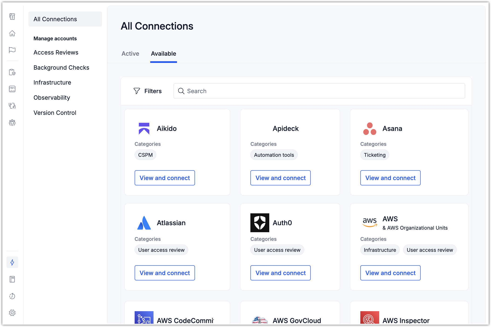
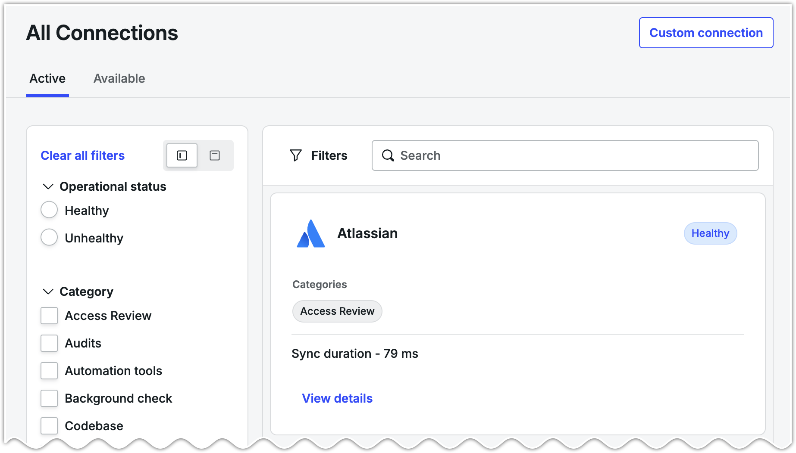
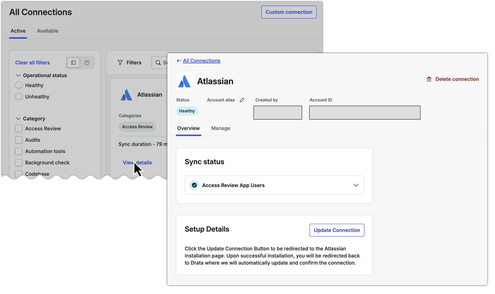
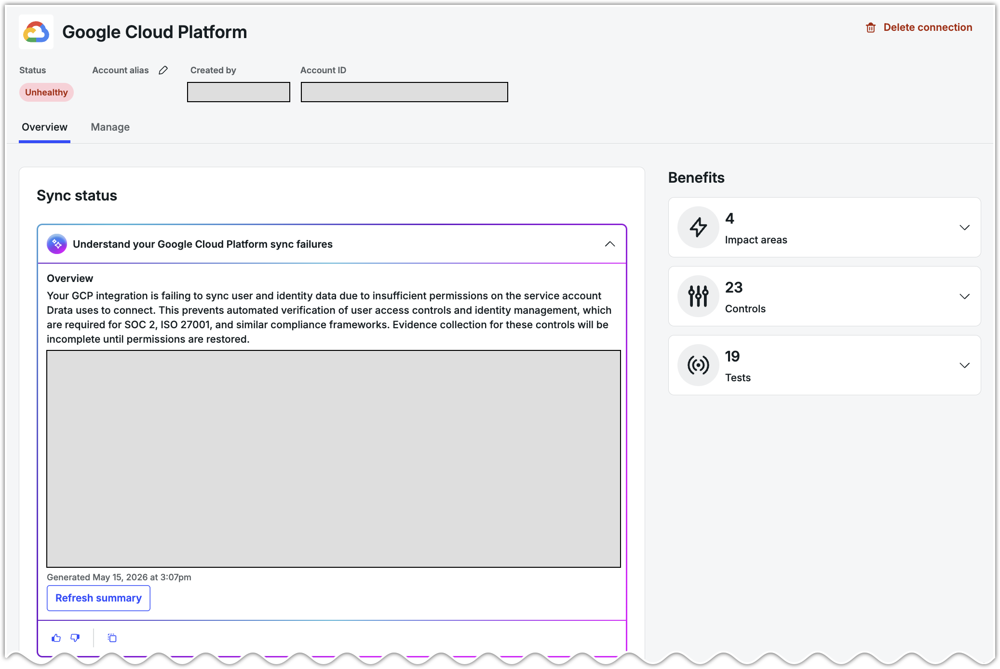

# Understanding Connections in Drata

Source: https://help.drata.com/en/articles/13273728-understanding-connections-in-drata
Collection: Understand the Drata Platform › Connections
Updated: 2026-11-09
Fetched: 2026-11-22
Description: Connections in Drata integrate your identity, HRIS, infrastructure, and development tools to automate evidence collection and continuously support compliance.

## Article text

Connections allow Drata to collect evidence, monitor compliance signals, and reduce manual work by integrating with the systems your organization already uses.

This article explains **what connections are**, **why they matter**, and **how to think about them** before you configure anything.

The Connections page is where you integrate Drata with third-party applications. Connections automate evidence collection, reduce manual work, and help maintain continuous compliance.

The Connections page includes:

- **Active tab**: Integrations your organization has already enabled. Edit, refresh, or disconnect them as needed.
- **Available tab**: All integrations your organization can add, organized by category.
- **Manage Account pages**: These pages let you view and manage which accounts are included in ongoing monitoring and evidence collection. For the following connection categories:
   - **Access Reviews**: Used to manage accounts synced through the **User Access Review** connection
   - **Background Checks**: Used to manage connected background check providers
   - **Infrastructure**: Used to manage connected cloud or infrastructure accounts
   - **Observability**: Used to manage connected monitoring and logging accounts
   - **Version Control**: Used to manage connected repositories and organizations

## How connections are grouped

Connections in Drata are organized into **categories** based on the type of system they integrate with.

Each category represents a different type of compliance signal, such as identity data, infrastructure configuration, or operational activity.

Common connection categories include:

- Automation tools
- Background check
- Codebase
- Communication
- CRM
- CSPM
- Custom
- Cyber insurance
- Digital signature
- EDR
- Enterprise SSO
- External policy
- HRIS
- Identity
- Infrastructure
- MDM
- Observability
- Security reviews
- Security training
- Ticketing
- User access review
- Version control
- Vulnerability

You may see additional or fewer categories depending on your plan and frameworks. Learn more at [Unlock the Power Of Compliance Automation](https://drata.com/platform/integrations?utm_campaign=CL_cap_goog_all_all-brand-drata-integrations_AMS_NA_USCA_demo_requestdemo&utm_source=google&utm_medium=paidsearch&utm_term=drata%20integrations&utm_content=brand-prod_txt_v1&utm_campaignid=21002599114&utm_adgroup=161056365560&utm_creative=731245157170&utm_targetid=kwd-1407849379573&gad_source=1&gad_campaignid=21002599114&gbraid=0AAAAABpLT4-N_tgrbsq3V4oxrF-SQr5gK&gclid=Cj0KCQiA9t3KBhCQARIsAJOcR7ylOKyd22vUd9AFyOhMaSqZMczQZxE8y82evcl93V7cu_sFpXgiozYaAl9eEALw_wcB).

You do **not** need to connect every possible system to be compliant.

### Recommended connection order

Most customers connect systems in this general order:

1. **Identity provider**
2. **Infrastructure**
3. **Version control**
4. **Ticketing**

This sequence helps establish access, asset scope, and operational workflows early. For a guided onboarding flow, see the **[Quick Start Guide (New Experience)](quick-start-guide.md)**.

## What you typically need to connect a system

Most connections in Drata require **read-only access** to an external system so Drata can collect evidence without making changes. In many cases, this access is provided through a **service account** or a dedicated integration user created in the source system.

A service account:

- Is used by Drata, not an individual employee
- Remains active even when team members change roles or leave
- Is limited to only the permissions needed to collect evidence

Depending on the system you're connecting, you may need:

- Admin or elevated permissions to create the service account within the 3rd party system
- Drata Admin role
- Approval from IT or Security teams
- API access or authentication tokens

Drata does not require full administrative access to your systems, but exact permissions vary by integration. When you're ready to connect a system, the setup guide for that integration lists the specific requirements. Learn more about [Connections setup guides.](https://help.drata.com/en/collections/16397047-connection-support)

## Why connections matter for compliance

Most compliance requirements depend on signals that live outside Drata, including:

- Who has access to systems
- Which employees are in scope
- How infrastructure is configured
- Whether policies and processes are being followed

Connections generally allow Drata to:

- Pull information directly from source systems
- Validate requirements continuously instead of at a point in time
- Surface gaps or risks as they occur

Without connections, Drata can still function, but more evidence must be collected and maintained manually.

### How connections relate to frameworks, controls, and tests

Connections support your compliance structure but do not define it. In general:

- **Frameworks** define *what* standards you're meeting
- **Controls** define *how* requirements are satisfied
- **Tests and evidence** validate that controls are operating as intended
- **Connections** supply the system data that tests and evidence rely on

This is a useful mental model to keep in mind as you configure integrations.

### Automated vs. manual evidence

Connections primarily support **automated evidence collection**, but automation is not required for every requirement. If a system is not connected:

- Evidence may be required to be uploaded manually
- Some tests may rely on periodic review instead of continuous monitoring
- Certain controls may use attestations rather than system data

Connecting a system generally increases automation, but compliance outcomes depend on **how the system is used**, not just whether it's connected.

## Monitoring connection health

Connection Insights gives you visibility into how each of your active connections is performing. You can see whether a connection is syncing successfully, review the details of any errors, and use AI-generated guidance to help resolve issues.

**Note:** Connection Insights is available in the New Experience only.

### Connection health states

Each active connection displays a health state chip on the **Active** tab:

- **Healthy**: All sync steps for this connection have completed successfully.
- **Unhealthy**: One or more sync steps have encountered an error.

If a connection does not yet have recorded sync steps, the health state is derived from its prior operational status.

The **Operational status** filter on the Active tab lets you filter your connections by Healthy or Unhealthy to quickly find connections that need attention.

### Viewing sync step details

To view detailed sync information for a connection:

1. In the left navigation, select **Connections**.
2. On the **Active** tab, select the connection you want to review.
3. On the connection's detail page, open the **Overview** tab.

If the connection has sync step data, a **Sync Status** section appears at the top of the Overview tab.

### Using AI to diagnose connection errors

When a connection is Unhealthy, an **AI Summary** card appears on the connection detail page. This card helps you understand why the connection is failing and what steps you can take to fix it.

To use the AI Summary:

1. In the left navigation, select **Connections**.
2. On the **Active** tab, select the connection you want to review.
3. On the connection's detail page, open the **Overview** tab.
4. Under the Sync status section, Drata generates an AI-powered summary that explains the failed sync steps and provides actionable remediation suggestions.
5. After a summary has been generated, select **Refresh** to generate a new summary based on the latest sync data.

You can provide feedback on the summary using the thumbs up or thumbs down icons.

**Note:** The AI Summary card only appears when a connection has erroring sync steps. It is not shown for connections that are Healthy.

If new sync data is recorded after a summary has been generated, the summary is invalidated automatically. The **Generate summary** button reappears so you can request an updated diagnosis.

### Limitations

- **Connection Insights is not retroactive.** A connection must complete at least one sync after the feature was enabled before sync step data appears. Connections that were misconfigured before the feature was released may not display sync data until they are reconfigured and complete a new sync.
- Health state and sync step data do **not** update in real time. Refresh the page to see the latest state.

## Learn more

- [Quick Start Guide](quick-start-guide.md)
- [Identity connections](https://help.drata.com/en/collections/16504711-identity-idp-guidance)
- [Infrastructure connections](https://help.drata.com/en/collections/16505277-infrastructure-guidance)
- [Version control connections](https://help.drata.com/en/collections/16505285-version-control-guidance)
- [Ticketing connections](https://help.drata.com/en/collections/16504775-ticketing-guidance)

> 🎓 **Want to learn more?** Dive deeper into this topic and see it in action! Check out our dedicated Connections course over at the **[Drata Academy](https://academy.drata.com/connections-course)**.

## Images

- [image 01] ../../images/ux/connections/understanding-connections-in-drata--01.png
- [image 02] ../../images/ux/connections/understanding-connections-in-drata--02.png
- [image 03] ../../images/ux/connections/understanding-connections-in-drata--03.png
- [image 04] ../../images/ux/connections/understanding-connections-in-drata--04.png

## Related articles

- [Connect your HRIS to Drata](connect-your-hris-to-drata.md)
- [Integrate Multiple Identity and HRIS Connections](integrate-multiple-identity-and-hris-connections.md)
- [Drata Evidence Library Sync](drata-evidence-library-sync.md)
- [Drata Connections Training Video (New Experience)](drata-connections-training-video-new-experience.md)
- [Troubleshooting Identity Sync Issues in Drata](troubleshooting-identity-sync-issues-in-drata.md)
