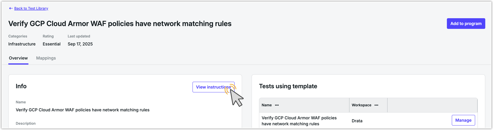
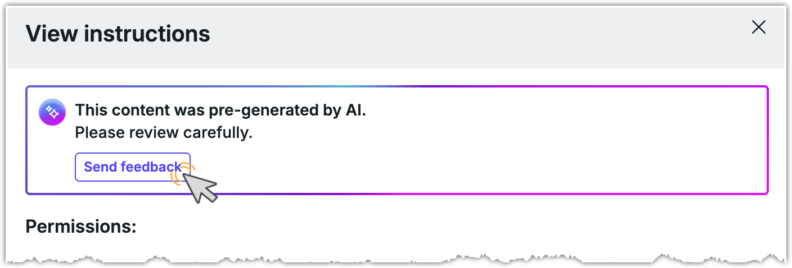
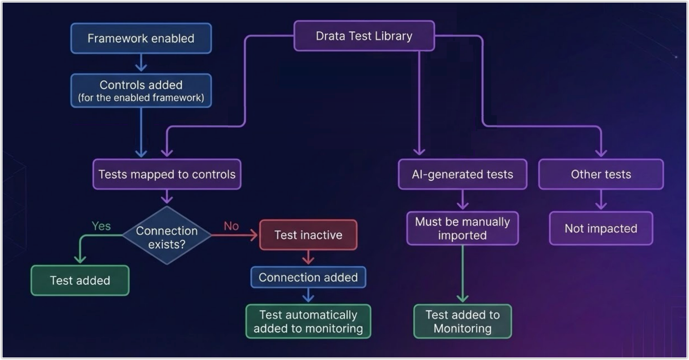

# Understanding Test Provisioning and the Test Library (New Experience)

Source: https://help.drata.com/en/articles/13948946-understanding-test-provisioning-and-the-test-library-new-experience
Collection: Understand the Drata Platform › Monitoring
Updated: 2026-07-01
Fetched: 2026-11-22

## Article text

## How tests are provisioned in Drata

Tests in Drata can appear in your environment in two ways:

1. **Automatically provisioned** when a **framework is enabled**
2. **Manually imported** from the **Test Library**

### Drata-owned tests (framework-driven)

Most of the tests visible in **Compliance → Monitoring** are Drata-owned tests. These tests are automatically provisioned when you enable a framework, such as SOC 2 or any ISO framework.

Frameworks contain controls, and Drata provisions the monitoring tests mapped to those controls when the framework is enabled.

If the required connection for a test (for example AWS, Azure, or GCP) does not exist yet, the test remains inactive. The test activates automatically once the required connection is established. Because of this behavior, it is expected to see tests become enabled after creating a new connection.

### Test Library (manually imported tests)

**Prerequisite: **The required connection must already exist in the workspace before a test can be imported from the Test Library.

The Test Library is the broader catalog of tests supported by Drata. It includes:

- All Drata-owned tests
- Approximately 1,000+ AI-generated Infrastructure tests

Tests in the Test Library are not automatically added to your environment unless they are provisioned through framework enablement. New AI-generated Infrastructure tests must **always** be manually imported from the Test Library.

> **Important:** AI-generated tests are experimental and may be subject to variation. In some cases, test logic may not fully align with third-party provider behavior or may produce inaccurate results. Customers should independently review AI-generated test results and confirm accuracy before relying on them as evidence of compliance.
>
> To know if a test is AI-generated:
>
> 1. From the Test page, select the test and click **View Instructions**.
>    
> 2. The modal indicates whether the test was **generated by AI** and allows you to **submit feedback**.
>    

Drata-owned tests can also be manually imported from the Test Library if you want to:

- Create an additional copy that you can fully customize
- Access additional tests associated with frameworks that are not currently enabled in your environment
- Use them for custom frameworks. After importing a test, you can map it to custom controls within your custom framework to support your compliance monitoring requirements.

## Summary

- Drata-owned tests are automatically provisioned when a framework is enabled. Subsequent copies of these tests can be imported from the Test Library.
- If the required connection does not exist, the test remains inactive until the connection is added.
- AI-generated tests are never automatically provisioned and must be manually imported from the Test Library.

*The following diagram visualizes how this workflow determines which tests are added to your monitoring:*

## Images

- [image 01] ../../images/ux/monitoring/test-library-new-experience--04.png
- [image 02] ../../images/ux/monitoring/test-library-new-experience--05.png
- [image 03] ../../images/documentation/understanding-test-provisioning-and-the-test-library-new-experience--03.png

## Related articles

- [Filter and search tests in Monitoring (New Experience)](filter-and-search-tests-in-monitoring-new-experience.md)
- [Test Library (New experience)](test-library-new-experience.md)
- [Roles and permissions overview (New Experience)](roles-and-permissions-overview-new-experience.md)
- [Ticket Automation (Jira-only) (New experience)](ticket-automation-jira-only-new-experience.md)
- [Add tests from the Test Library to a workspace (New Experience)](add-tests-from-the-test-library-to-a-workspace-new-experience.md)
