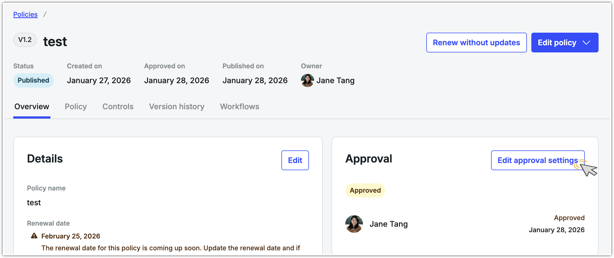

# Understanding the Approval Process

Source: https://help.drata.com/en/articles/13549900-understanding-the-approval-process
Collection: Understand the Drata Platform › Policies
Updated: 2026-11-09
Fetched: 2026-11-22
Description: Learn how policy approvals work in Drata, how to configure approvers and tiers, and how to publish a policy once approval is complete.

## Article text

Policies must be reviewed and approved before they can be published in Drata. Approval workflows help ensure policies are reviewed by the right stakeholders and remain audit-ready.

## What is policy approval?

Policy approval is the process where assigned approvers review and confirm that a policy is ready to be published. You can:

- Assign one or more approvers per policy
- Require **all** or **any one** approver to approve
- Organize approvers into tiers to control review order

Once all required approvals are complete, the policy can be published.

**Note**: Approval settings can be edited at any time, but changes only apply to future approval cycles. Ongoing cycles continue uninterrupted.

The following table describes the main stages in the policy approval workflow:

| **Stage** | **Description** |
|---|---|
| **New (or Not started)** | The policy draft has not been finalized; approval has not begun. |
| **Needs Approval** | The draft is finalized and waiting for one or more approvers to approve. |
| **Approved** | If the policy requires multiple tiers of approval, Tier 1 must approve it first. Then, it moves to Tier 2. Once all required approvers have approved, the policy is ready to publish. |
| **Changes Requested** | An approver requested changes; the policy is in Needs Approval status. The Policy Owner can either edit the policy, creating a draft that can be finalized and resubmitted for approval, or override the policy approval to move the policy forward as-is. |

### What is a tier?

You can create up to six tiers for any policy. A **tier** is a step in the approval process. Tiers allow you to organize approvers in a specific order—useful when input is needed from multiple departments.

When configuring a tier, you can:

- Assign a name (e.g., "Legal Review")
- Choose the approvers
- Set the level of approval (all approvers vs. one approver required)
- Set a time to approve (in days)

**Example: Remote Work Policy**

Let's say you're publishing a **Remote Work Policy**. You want:

- **Tier 1**: HR to approve the policy language and employee requirements
- **Tier 2**: Legal to approve compliance-related concerns
- **Tier 3**: IT to approve technology and VPN access guidelines

Each tier must approve before the next group is notified. Once all tiers approve, the policy is ready to publish.

## Prerequisites

Before starting approval:

- The policy must have a **Policy Owner**
- The policy must be **Finalized**
- Policies in **Needs approval** status cannot be edited

### Roles and actions

| **Action** | **Who can perform it** |
|---|---|
| Approve a policy | Approver |
| Request changes | Approver |
| Cancel approval | Policy Owner |
| Override approval | Policy Owner, Admin |
| Publish a policy | Policy Owner |

## Configure approval settings

You can configure approval settings before or after finalizing a draft.

1. Open **Governance → Policies**.
2. Select a policy.
3. Open the policy and go to the **Overview** tab.
4. In **Approval section**, select **Edit approval settings**.
   
5. Add approvers.
6. Choose the approval rule:
   - All approvers must approve, or
   - Only one approver must approve
7. (Optional) Add tiers and set approval timelines.
8. Save your changes.

## Approvers review the policy

After the policy is finalized, approvers must approve or request changes. Approvers are notified when it's their turn to review. Approvers can select **Approve** or **Request changes** and enter feedback.

If changes are requested:

- Other approvers in the same tier cannot approve
- The Policy Owner receives a notification
- The Policy Owner can edit and re-finalize the policy or override approval

## Cancel approval

Only Policy Owners can cancel an approval cycle. To cancel an approval request:

1. Navigate to the relevant policy in the Policy Center.
2. Click on the ellipsis (three dots) in the upper-right corner of the screen.
3. Select **Cancel Approval** from the menu options.
4. The policy will return to an editable state, allowing you to complete your edits.

- Canceling returns the policy to **Draft**
- Any related approval tasks are removed

**Note:** If the policy is in **Changes requested** status, you must edit the policy to move it back to Draft, then re-finalize it to start the approval cycle.

## Override approval

Overrides allow a Policy Owner or Admin to bypass approvals when necessary.

When overridden:

- The policy is marked **Approved**
- Remaining approval tasks are removed
- The override is recorded in the approval history and version history

You can override:

- The current tier only, or
- The entire approval cycle

## When can you edit a policy?

Editing rules depend on policy status:

| **Policy status** | **Who can edit** | **What happens** |
|---|---|---|
| **Needs approval** | No one | Policy is locked |
| **Approved** | Policy Owner | Editing requires classifying the change |
| **Published** | Anyone | Editing a published policy creates a new Draft |

## Who can publish policies?

Only Policy Owners can publish policies.

1. After all required approvals are complete, the policy status becomes **Approved**.
2. Open the policy.
3. Select **Publish**.

Once published:

- The policy becomes available in **My Drata** for acknowledgment
- Policy acknowledgments and status can affect compliance monitoring and audits

## Images

- [image 01] ../../images/ux/policies/understanding-the-approval-process--01.png

## Related articles

- [Manage and Configure Policy Controls in Drata](manage-and-configure-policy-controls-in-drata.md)
- [Manage Required Approval and Control Readiness](manage-required-approval-and-control-readiness.md)
- [Policy Center Overview](policy-center-overview.md)
- [View and edit a policy](view-and-edit-a-policy.md)
- [Policy Management in Drata Training Video (New Experience)](policy-management-in-drata-training-video-new-experience.md)
