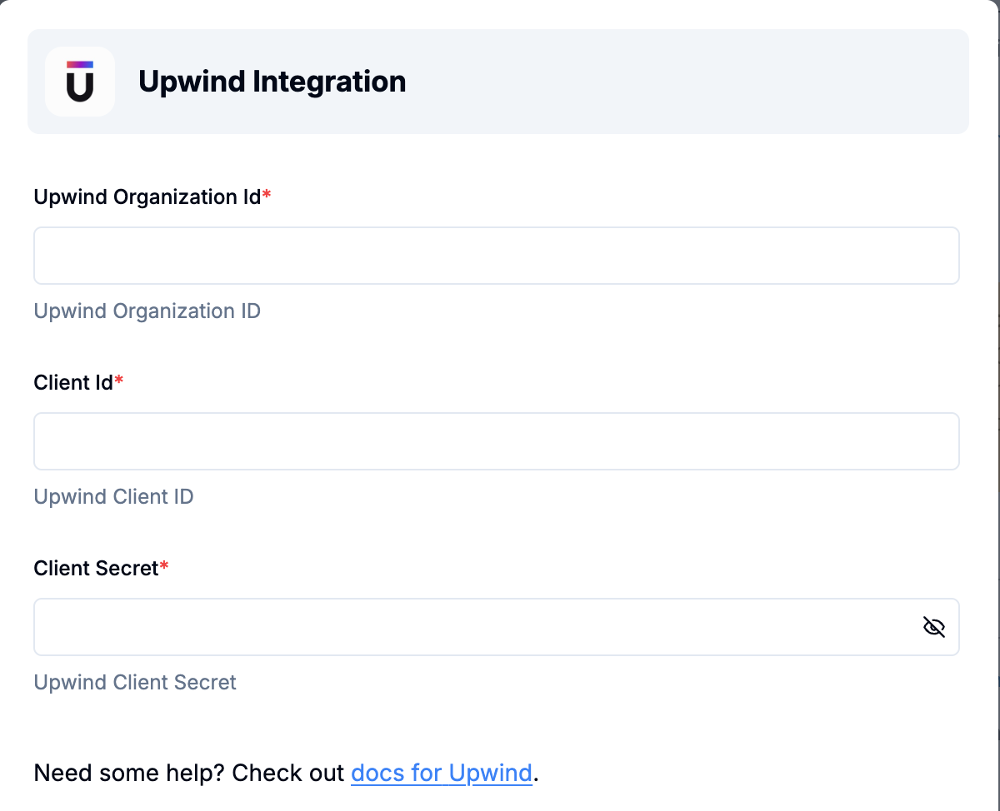

# Upwind Integration Guide

Source: https://help.drata.com/en/articles/13170986-upwind-integration-guide
Collection: Connection Support › Other Guidance
Updated: 2026-07-27
Fetched: 2026-11-22

## Article text

The Upwind integration enables Drata to import vulnerability findings from your Upwind Security platform. These findings support Drata’s vulnerability scanning tests and help maintain continuous visibility into security issues across your environment.

## Key Capabilities

- **Automated Data Retrieval**: Imports findings from supported scanning tools
- **Evidence support**: Provides vulnerability data used in Drata’s automated evidence collection for vulnerability scanning tests mapped to DCF-18.
- **Read-only access**: Retrieves vulnerability metadata without triggering or modifying scans

## Prerequisites & Data Access

### Upwind Requirements

- Access to the Upwind Console
- Permission to generate API credentials
- Access to your Organization ID

### Drata Requirements

- Must be assigned one of the following Drata roles: Admin, Workspace Managers, DevOps Engineer.
- If you have the Access Reviewer Drata role, you can only view the Connections page.

**Sync Notes:**

- The initial sync may take additional time depending on how many vulnerabilities exist in your environment.
- Drata retrieves up to 1,000 new findings per day. If your environment contains more than 1,000 findings, only the first 1,000 will be included in each daily sync, based on the scope you configured when connecting.
- Any remaining findings are synced (up to a 1,000) during the next daily update. The order in which findings sync is determined by the scope you configured during the connection setup.

### Permissions & Data Table

| Permission / Credential | Why It’s Needed | Data Accessed (Read Only) |
|---|---|---|
| Client ID & Client Secret | Used to authenticate API requests to Upwind | Vulnerability findings and resource data |
| Organization ID | Identifies the Upwind organization | Organization-scoped data |

## Step-by-Step Setup

### Step 1: Locate your Organization ID

1. Log in to the Upwind Console
2. Click the Settings icon in the bottom-left corner
3. Select the Credentials tab or navigate directly to the API Keys page
4. Locate the Organization ID displayed in the top-left corner of the page

**Expected outcome:**

You have identified your Organization ID.

### Step 2: Generate API credentials

1. From the Credentials tab, click Generate Credential
2. Select the API tab
3. Enter a name for the credential
4. Click Generate
5. Record the following values:
   - Client ID
   - Client Secret
6. Click Save

The Client Secret is only visible at creation time and is not shown again after the credential window is closed.

**Expected outcome:**

An API credential is created and saved in Upwind.

### Step 3: Enter credentials in Drata

1. In Drata, go to Connections.
2. Select the Available tab.
3. Search for Upwind and choose Connect.
4. Select the following configurations:
   - Severity of vulnerabilities: Choose the severity levels you want to import (Critical, High, Medium, Low).
   - First seen on: Select the date from which vulnerabilities should be pulled.
5. Select Connect Upwind Vulnerability Management and enter:
   - Organization ID
   - Client ID
   - Client Secret
6. Create and test the connection.

**Expected outcome:**

Drata attempts to connect to Upwind using the provided credentials.

---

### Step 4: Validate the connection

After the connection is established, Drata can retrieve supported data from Upwind.

You can navigate to the Vulnerabilities page to confirm findings are being populated and validate that only scoped resources appear, if you restrict the API token's access.

Drata shows *findings*, which are instances of *vulnerabilities* (an individual but higher-level CVE) against specific resources. This may reflect as higher finding counts in Drata vs. your Upwind dashboard.

## Images

- [image 01] ../../images/integrations/upwind/upwind-integration-guide--01.png

## Related articles

- [Tenable Vulnerability Management Integration Guide](tenable-vulnerability-management-integration-guide.md)
- [CrowdStrike Falcon Exposure Management Integration Guide](crowdstrike-falcon-exposure-management-integration-guide.md)
- [Aikido Integration Guide](aikido-integration-guide.md)
- [Wiz Code Integration Guide (Vulnerability Scanning)](wiz-code-integration-guide-vulnerability-scanning.md)
- [Wiz (Vulnerability Scanning) Integration Guide](wiz-vulnerability-scanning-integration-guide.md)
