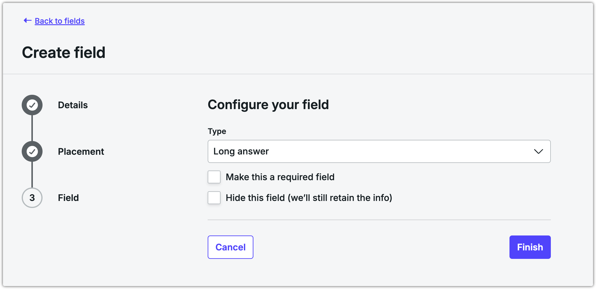
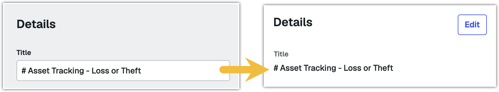
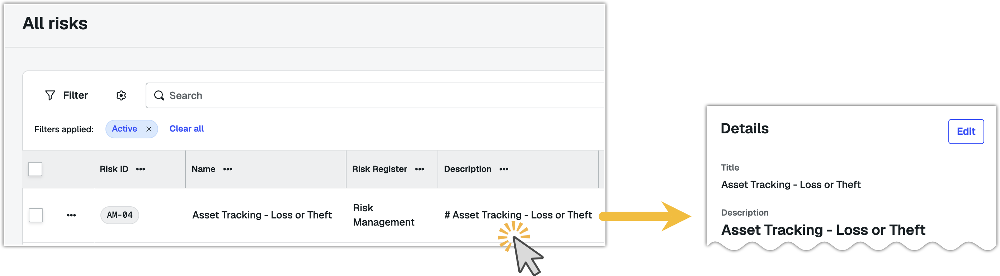

# Use Markdown formatting in supported text areas

Source: https://help.drata.com/en/articles/15170455-use-markdown-formatting-in-supported-text-areas
Collection: Getting Started › Helpful Resources
Updated: 2026-10-26
Fetched: 2026-11-22
Description: Markdown helps you add simple formatting to text so your content is easier to read and organize.

## Article text

Markdown helps you add simple formatting to text so your content is easier to read and organize. In Drata, some text areas support Markdown formatting. When a field supports Markdown, you can use supported formatting options such as line breaks and bullets to structure your content more clearly.

## Prerequisites

- Access to a text area in Drata that supports Markdown formatting
- **Required Drata roles**: Any user who can edit a supported text area can use Markdown formatting there.

## How Markdown support works

Not every input field supports Markdown. Use Markdown only in supported text areas. Your content is displayed with Markdown formatting after it is saved. If a field does not support Markdown, Markdown characters may appear as plain text instead of formatted content.

### Supported text areas

The following text areas in Drata render Markdown formatting:

| **Area** | **Field(s)** |
|---|---|
| Evidence | Description |
| Controls | Description |
| Risks | Description |
| Assets | Notes |
| Custom Monitoring tests | Description |
| Events | Internal Notes |
| Custom Framework Requirements | Description, Additional Info |
| Vendors | Provided Services, Stored Data, Additional Notes |

**Important Note: **If your organization has created custom fields using the Long Answer field type, those fields also support Markdown formatting. Markdown support is applied automatically to all Long Answer custom fields — no additional configuration is required.



### Non-supported text areas

The following do not render Markdown formatting. If you enter Markdown characters here, they may appear as plain text.

- **Short Answer (Text) custom fields**: Markdown never renders, in any view.
   
- **List/grid table views**: a field's cell shows the raw, unformatted Markdown. Open the record to view the markdown table renders correctly.
   

## Add Markdown formatted content

Use supported Markdown formatting to improve structure and readability in supported text areas. Common ways to improve text include:

- Adding line breaks to separate paragraphs
- Using headings to organize sections
- Applying only formatting that is supported in the text area you are editing
- Use Markdown tables
   ```
| Column A | Column B |
|----------|----------|
| Value 1  | Value 2  |
   ```

### Get started

1. In the supported text area, add headers, tables, bullet points, and more.
2. Save your changes.
3. Review the rendered content to confirm the heading structure is easy to follow.

**Expected outcome:** Your content displays with clearer spacing and improved readability.

### Accessibility tips for headings

When you use headings, keep them in a meaningful order. Good heading hierarchy helps readers understand how content is organized and improves accessibility by making sections easier to follow.

For best results:

- Use headings only when they help organize the content
- Keep heading levels consistent
- Avoid using headings only for visual emphasis

## Best practices

- Confirm the field supports Markdown before spending time formatting content
- Keep formatting simple and consistent
- Use line breaks to separate blocks of text
- Use headings to organize longer content
- Review rendered content to make sure it appears the way you expect

## Troubleshooting

If your formatting does not appear correctly:

- Check whether the text area supports Markdown formatting using the tables above
- Review your line breaks and heading structure
- Simplify the formatting and test again
- Confirm that the formatting option you used is supported in that text area

**Expected outcome:** You can recognize supported text areas, use Markdown formatting more confidently, and create clearer, better-structured content in Drata.

## Images

- [image 01] ../../images/ux/workflows/use-markdown-formatting-in-supported-text-areas--01.png
- [image 02] ../../images/ux/risk/use-markdown-formatting-in-supported-text-areas--02.png
- [image 03] ../../images/ux/risk/use-markdown-formatting-in-supported-text-areas--03.png

## Related articles

- [New File Format Support](new-file-format-support.md)
- [Controls and Tests Updated Between January 2024 and October 2025](controls-and-tests-updated-between-january-2024-and-october-2025.md)
- [Custom Fields Overview](custom-fields-overview.md)
- [Conducting a Security Review](conducting-a-security-review.md)
