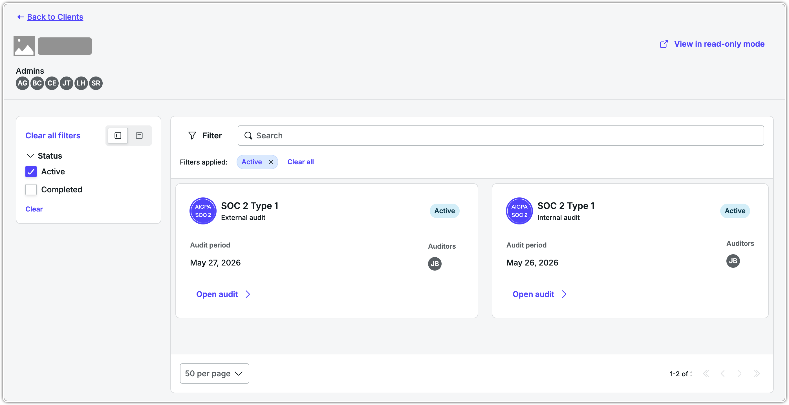
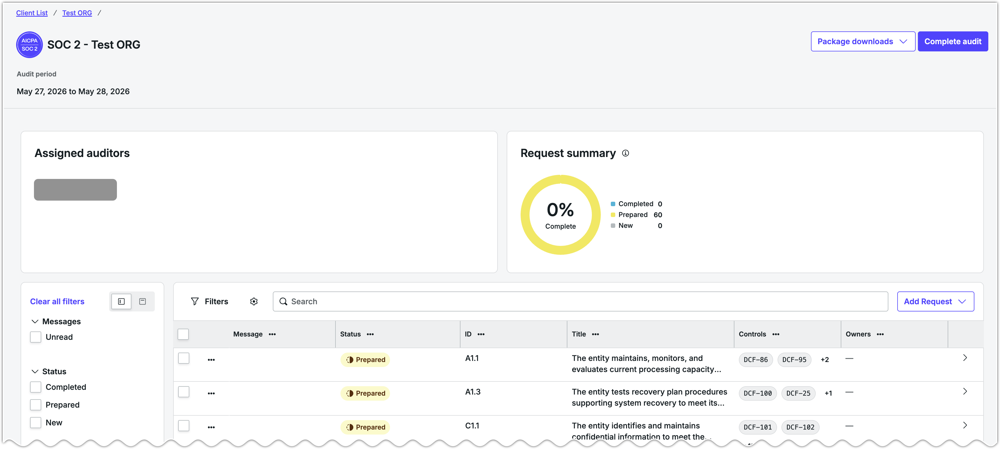
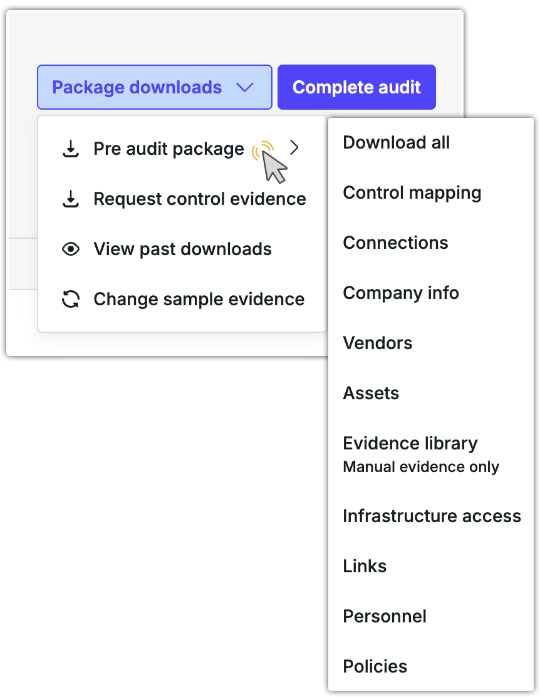
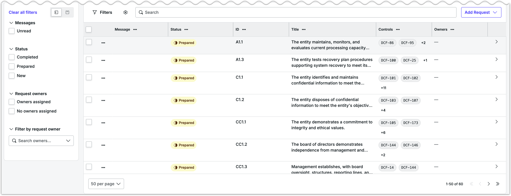
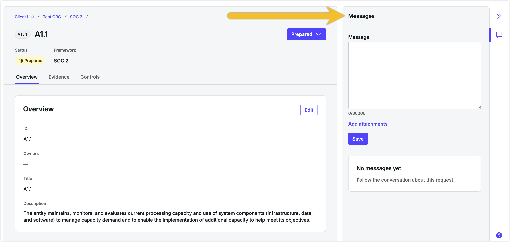

# Using the Drata Audit Portal (New Experience)

Source: https://help.drata.com/en/articles/13773092-using-the-drata-audit-portal-new-experience
Collection: The Auditor Experience
Updated: 2026-11-14
Fetched: 2026-11-22
Description: A guide for external auditors

## Article text

### 1. What the Drata Audit Portal Is

The **Drata Audit Portal** is a secure, read-focused workspace where you, as an external auditor, can review your client’s controls, evidence, and audit activity without needing full access to their Drata account.

Key points:

- Your view is **intentionally aligned** with what your client sees so you can work from the **same evidence, requests, and status** as they do.
- You can **review evidence and audit packages, set and adjust samples, create and manage requests, and mark items complete**, depending on how your client has configured the audit.
- All downloads (pre‑audit package, control evidence, etc.) are generated from the same data source for both you and your client, ensuring there are no discrepancies.

This guide is designed for auditors who receive an invitation from a shared customer and need a concise overview of how to work in the portal.

---

## 2. Access and Login

Your client invites you to their audit by adding you as an **auditor** on a specific engagement. You’ll receive an email from Drata (on behalf of the client) with:

- The **audit name and framework** (for example, “SOC 2 Type II – FY2026”)
- A **secure link** to access the Drata Audit Portal for that audit

Invitations are:

- **Email-specific**: the link is tied to the email address your client used.
- **Business-email oriented**: clients are instructed **not** to invite personal accounts (e.g., free webmail) or addresses that conflict with their own tenant domain.

If you don’t receive the invite, confirm:

- Your client used the correct email address
- Drata emails are not blocked by your spam/allow‑listing rules

### First-time access

On first access you will follow the secure link from the invitation email.

Complete any required account setup or verification (for example, setting a password or signing in through an IdP, depending on your client's configuration), and land on either:

- A **list of audits** you can access, or
- The **main page** for the specific audit you were invited to

Once signed in, click your avatar icon in the upper right and choose **Settings** to change your personal name, audit firm name, and preferred language.

Subsequent visits are typically via your **Drata Audit Portal URL** (for example, the link in your invite or bookmark), subject to your client’s configuration.

---

## 3. Navigating the Audit Portal

### Audit list (if available to you)

If your client has granted access to multiple audits in Drata, you may see a **table of audits** when you sign in. Each row generally includes:

- **Audit name**
- **Framework**
- **Audit period** (start and end dates)
- **Overall completion status**

Selecting an audit row takes you into the **main audit page** for that engagement.

### Main audit page overview

On the main page for an audit, you can typically see:

- **Audit header**
   - Audit name
   - Audit period
   - Completion state (for example, whether the audit is open or marked complete)
- **Assigned auditors**
   - A list of auditors with access to this audit, including you
- **Request summary**
   - Counts of requests by status (for example, *New, In progress, Completed*)
- **Request list / request pane**
   - A table or pane showing each **evidence request**, its status, and associated messages
- **Audit resources**
   - **Downloads** for the **pre‑audit package** and **control evidence package** (details below)
   - Other audit‑level resources, depending on configuration

---

## 4. Evidence Packages and Transparency

### Pre‑audit package

When the audit is opened, Drata generates a **pre‑audit package** for both you and your client from the *same* underlying data.

- This package typically includes **mapped evidence and audit metadata** as of the time the audit was initiated.
- The content of the ZIP file should **match exactly** between what you download and what your client downloads.

Note: The pre‑audit package is a **snapshot**. If additional evidence is mapped later, the pre‑audit package does **not** automatically update; your client would need to open a new audit to generate a new pre‑audit package.

### Control evidence package

The **control evidence package** is another ZIP created from the **same evidence data** for both you and your client.

- It includes:
   - **Control‑level evidence files**
   - **Audit metadata and mappings**
   - An **interactive evidence manifest** to help you navigate and trace evidence back to controls.
- When you (or another auditor) first **set audit samples**, Drata takes a **snapshot** of all mapped evidence at that time and uses it to build the control evidence package.

If your client later maps **new evidence** after you’ve already set samples, that new evidence will **not** appear in the existing control evidence package for either party. To include updated evidence, you must:

1. **Adjust or reset samples** for the relevant controls or time period.
2. Allow Drata to **regenerate** the control evidence package based on the new samples.

This behavior is by design to maintain a clear, auditable record of **which evidence set** supported each round of sampling.

---

## 5. Working with Audit Resources and Downloads

From the **Audit Resources** area on the main audit page, you can initiate evidence downloads (exact labels may vary). Typical options include:

- **Download pre‑audit package**
- **Download control evidence**

General behavior:

1. Select the relevant **Download** or **Request evidence** action from the resources section.
2. Drata prepares the ZIP file in the background (this can take time for large audits).
3. When ready, you receive an **email with a download link**, and the file is also accessible from within Audit Portal.

If a download fails or takes unusually long:

- Retry from the Audit Resources section.
- If issues persist, coordinate with your client so they can contact Drata Support as needed.

---

## 6. Requests and Messaging

### Viewing and filtering requests

The **request pane** shows all **audit evidence requests** associated with the engagement, typically with columns for:

- Request name or ID
- Status (for example, *New, In progress, Completed*)
- Assignee or owner
- Last activity

You can filter or search to find specific requests (for example, those tied to a control family or evidence type).

### Request statuses and system messages

As your client uploads evidence or updates request statuses from within Drata, the portal generates **system messages** within the request’s message thread. These messages:

- Indicate **what changed** (for example, “New evidence attached” or “Status updated to Completed”)
- Include a **direct link** to the request so you can quickly navigate and download attached evidence

You will also see **user‑written messages** from your client when they respond to questions or clarifications.

### Sending messages and clarifications

Within each request, you can:

- Add a **message** to ask for clarification or additional context
- Reference **specific controls, systems, or time periods** in your message so your client knows exactly what to update

Messages are visible to your client’s Drata users who have access to that audit, and they can respond directly within the same thread.

---

## 7. Requesting and Adjusting Evidence

### Requesting additional evidence

In many audits, you’ll see actions such as **“Request evidence”** at the audit or request level. Using this capability you can:

- **Manually request specific evidence** (for example, a particular log export, policy version, or ticket history)
- Include instructions or required format
- Tie the request to an existing control or requirement, depending on configuration

Your client will receive the request within Drata and can respond by:

- Uploading supporting files
- Linking existing evidence
- Updating request status

### Changing evidence samples

If you need to adjust sampling—for example, to reflect updated personnel, a different time window, or new risk considerations—you can use the **Change evidence sample** functionality where available.

At a high level, the workflow is:

1. Open the audit and locate the **audit resources** or sampling control for the framework in scope.
2. Use the **sample configuration** or **Change evidence sample** action to:
   - Adjust the **date range** or
   - Select different **personnel or assets**, depending on the test
3. Save or apply changes. Drata will:
   - Recalculate which evidence falls inside the new sample period
   - Allow you and your client to regenerate **control evidence packages** that align to the updated sampling snapshot

For **Type 1** audits, initial sampling may be limited (for example, a single personnel record), but you can repeat the process if you need to inspect additional samples.

---

## 8. Alignment with the Client’s View

A central design principle of Audit Portal is **transparency**:

- The **data, evidence, and audit packages** you see are built from the **same underlying data** as your client’s view.
- Differences are primarily in **role-based capabilities** (for example, your ability to request evidence or change request status), not in what evidence exists.

This alignment reduces:

- The risk of **mismatched evidence sets**
- Confusion about which attachments or mappings were in scope at a given point in time
- Time spent reconciling what you see vs. what your client sees during walkthroughs

---

## 9. Practical Tips for Auditors

To work efficiently in the Drata Audit Portal:

1. **Use the request list as your primary work queue.**
   - Filter by status (for example, *New* or *Needs more info*) to focus on blocking items.
2. **Leverage system messages.**
   - When Drata generates system messages about new evidence or status changes, use the embedded links to jump directly to the relevant request and download evidence.
3. **Keep sampling and downloads in sync.**
   - If you change samples, regenerate the **control evidence package** so the ZIP and manifest align exactly with your new selections.
4. **Align expectations with your client early.**
   - Confirm which frameworks, date ranges, and populations are in scope.
   - Agree on when you’ll **freeze samples** and **finalize packages** to avoid unnecessary regeneration.
5. **Escalate technical issues through your client.**
   - If you encounter access or download issues, your client can work directly with Drata Support with full context of their tenant.

---

## Summary

The Drata Audit Portal gives you a controlled, transparent view into your client’s compliance program:

- **Same data, shared context** for both you and your client
- **Structured workflows** for requests, messages, and sampling
- **Downloadable packages** that bundle evidence, mappings, and a manifest to streamline your review

Your client may share this guide alongside your invitation so you can step into the portal with a clear understanding of what to expect and how to work efficiently within Drata during the audit engagement.

## Images

- [image 01] ../../images/ux/audits/using-the-drata-audit-portal-new-experience--01.png
- [image 02] ../../images/ux/audits/using-the-drata-audit-portal-new-experience--02.png
- [image 03] ../../images/ux/audits/using-the-drata-audit-portal-new-experience--03.png
- [image 04] ../../images/ux/audits/using-the-drata-audit-portal-new-experience--04.png
- [image 05] ../../images/ux/audits/using-the-drata-audit-portal-new-experience--05.png

## Related articles

- [Audits page overview (New Experience)](audits-page-overview-new-experience.md)
- [Pre-audit evidence packages in Drata (New Experience)](pre-audit-evidence-packages-in-drata-new-experience.md)
- [Section 5: Drata for Auditors](section-5-drata-for-auditors.md)
- [What auditors can see in Audit Portal](what-auditors-can-see-in-audit-portal.md)
- [Creating and Navigating an Audit in Drata Training Video](creating-and-navigating-an-audit-in-drata-training-video.md)
