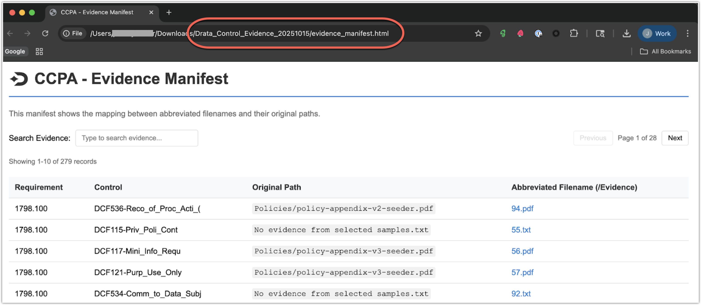

# Using the Drata Evidence Package and Manifest File

Source: https://help.drata.com/en/articles/12739202-using-the-drata-evidence-package-and-manifest-file
Collection: The Auditor Experience
Updated: 2026-02-03
Fetched: 2026-11-22

## Article text

When you download your control evidence from your audit, Drata creates a single `.zip` file that includes all your evidence. This package improves reliability and makes it easier to review and access your audit evidence.

## Package Contents

Your `.zip` file includes the following folders and files:

| **File or Folder** | **Description** |
|---|---|
| **ControlEvidence/** | Contains all evidence files, organized by control or framework. |
| **AuditInfo.txt** | Includes summary details about the audit and package metadata. |
| **Controls-to-Requirements.csv** | Lists mappings of controls to related requirements. |
| **Evidence/** | Contains all evidence files with shortened filenames for compatibility. |
| **evidence_manifest.html** | An interactive manifest for viewing, searching, and opening evidence directly in your browser. |

## Open and Use the Evidence Manifest

The `evidence_manifest.html` file is your guide to all evidence in the package.

### To open the evidence_manifest.html:

1. Unzip the downloaded `.zip` file.
2. Open `evidence_manifest.html` in any modern browser (Chrome, Edge, Safari)

The manifest displays a searchable table with these columns:

| **Column** | **Description** |
|---|---|
| **Requirement** | The relevant framework requirement or clause. |
| **Control** | The control or evidence item name. |
| **Original Path** | The file’s original location in Drata (for reference). |
| **Abbreviated Filename (/Evidence)** | A clickable link to the evidence file stored in the `/Evidence` folder. If your browser doesn’t support the file type, the file automatically downloads to your **Downloads** folder. |

### Additional Features

- **Search Field: **Type any part of a control name, file name, or keyword to quickly find specific evidence. The table filters automatically as you type.
- **Pagination: **Large audits may include hundreds of evidence items. Use the **Next** and **Previous** buttons at the bottom to move through pages of results (10 items per page).
- **Click to Open Files: **You can open evidence files directly from the manifest by clicking the file name in the **Abbreviated Filename (/Evidence)** column.
    This automatically opens the file in your browser or default app—no need to navigate through folders.
- **File Mapping: **Each entry links the abbreviated filename (e.g., 1.pdf, 6.csv) to its original Drata path, so you always know which evidence file corresponds to which control.

## Why Filenames Are Abbreviated

Some operating systems, especially Windows, limit file path lengths. To ensure every customer can download and unzip evidence successfully, Drata now uses **short, randomized filenames** inside the evidence package.

These filenames are mapped to their original names in the **manifest**, so you can easily identify and open the right files without any scripts or manual decoding.

## View and Use Evidence

1. **Unzip** the `.zip` file.
2. **Open** `evidence_manifest.html` in your browser.
3. **Search or browse** for the evidence you need.
4. **Click** the file name in the **Abbreviated Filename (/Evidence)** column to open or download it.

The manifest handles file mapping and access automatically.

## Troubleshooting

| **Issue** | **Resolution** |
|---|---|
| **File won’t unzip (Windows)** | Use Windows File Explorer or a modern unzip tool such as **7-Zip**. If the issue persists, contact Drata Support. |
| **Manifest doesn’t open** | Make sure you open the manifest in a supported browser (Chrome, Edge, Safari, or Firefox). |
| **Missing or broken files** | Re-download the evidence package to ensure you have the latest version. |

## Images

- [image 01] ../../images/documentation/using-the-drata-evidence-package-and-manifest-file--01.png

## Related articles

- [New File Format Support](new-file-format-support.md)
- [Drata Evidence Library Sync](drata-evidence-library-sync.md)
- [Manually Export Evidence Data from Drata](manually-export-evidence-data-from-drata.md)
- [Using the Drata Audit Portal (New Experience)](using-the-drata-audit-portal-new-experience.md)
- [Bulk Import Evidence](bulk-import-evidence.md)
