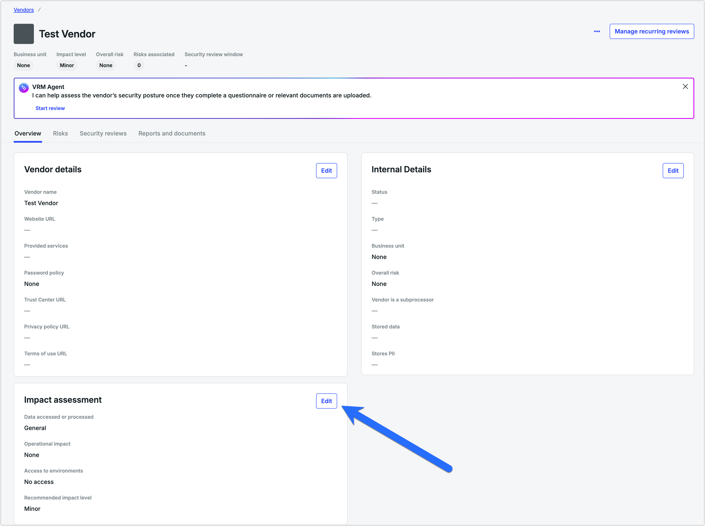

# Vendor Automated Impact Assessment

Source: https://help.drata.com/en/articles/13557339-vendor-automated-impact-assessment
Collection: Understand the Drata Platform › Vendors
Updated: 2026-11-09
Fetched: 2026-11-22

## Article text

Automated Impact Assessment helps you determine the **potential impact a vendor poses to your organization** based on how they interact with your data, operations, and environments. Drata uses this assessment to recommend an **Inherent risk** and guide appropriate security review actions.

### Availability

⚠️ **Plan requirement: **Automated Impact Assessment is available only to customers on the **TPRM Pro** plan.

---

## Why impact assessment matters

Impact assessment helps you:

- Consistently evaluate vendor risk during onboarding
- Prioritize security reviews based on vendor criticality
- Support audit requirements for vendor risk classification
- Drive downstream workflows such as review scope and risk creation

---

### When impact assessment occurs

Impact assessment is completed when you:

- Add a **prospective vendor**, or
- Add a **new vendor** and choose to assess impact

If the assessment is not completed, the vendor's **Inherent risk** is marked as **Unscored**.

---

## Complete an impact assessment

To complete an impact assessment during vendor creation:

1. Go to **Vendors**.
2. Select **Prospective vendors** or **Current vendors**.
3. Select **Add vendor**.
4. In the **Impact assessment** section, select the best-fit options for:
   - **Data accessed or processed**
   - **Operational impact**
   - **Access to environments**

Drata evaluates your selections and displays a **recommended Inherent risk**.

 (links to https://downloads.intercomcdn.com/i/o/am69aeco/2058469147/08614a3e701578c0ea4d666c9050/image.png?expires=1780056000&signature=c283c0240c7a48adf2b94d5abea76caf0e892fcd7eed1a76e6e52c172cad5f36&req=diAiHs14lIBbXvMW3nq%2BgY7sMwSAAsnHoKTYO9BuYqybmApHeA2L3wKFTa%2F4%0Ax9JnhXx7I%2FZJpiMyk%2Bua4%2FFHHvY%3D%0A)

---

### Recommended vs modified Inherent risk

- The **recommended Inherent risk** is calculated automatically based on your inputs.
- You can override this recommendation if needed.
- If overridden, the field updates to **Modified Inherent risk**.
- You can revert back to Drata's recommendation at any time.

---

### Operational impact scale

| Level | Impact | Description |
|---|---|---|
| None | 1 | No or negligible operational, financial, or reputational impact |
| Low | 2 | Limited process disruption, minimal financial or reputational impact |
| Normal | 3 | Some reduction in effectiveness, moderate financial or reputational impact |
| Important | 4 | Significant disruption to primary processes, measurable financial loss |
| Critical | 5 | Loss of mission-critical operations, severe financial and reputational damage |

---

### Inherent risk definitions

| Inherent risk | Description |
|---|---|
| **Insignificant** | Minimal loss or damage, no regulatory reporting |
| **Minor** | Minor financial loss, limited reputational impact |
| **Moderate** | Noticeable process disruption and financial loss |
| **Major** | Significant financial loss, regulatory reporting required |
| **Critical** | Severe financial loss, regulatory action, major reputational damage |
| **Unscored** | Impact assessment not completed |

## Images

- [image 01] ../../images/ux/vendors/vendor-automated-impact-assessment--01.png

## Related articles

- [Vendor risks](vendor-risks.md)
- [Terminology Updates: Inherent and Residual Risk in Vendor Risk Management](terminology-updates-inherent-and-residual-risk-in-vendor-risk-management.md)
- [Add a vendor or prospective vendor](add-a-vendor-or-prospective-vendor.md)
- [Configuring inherent risk](configuring-inherent-risk.md)
- [Customize vendor risk levels](customize-vendor-risk-levels.md)
