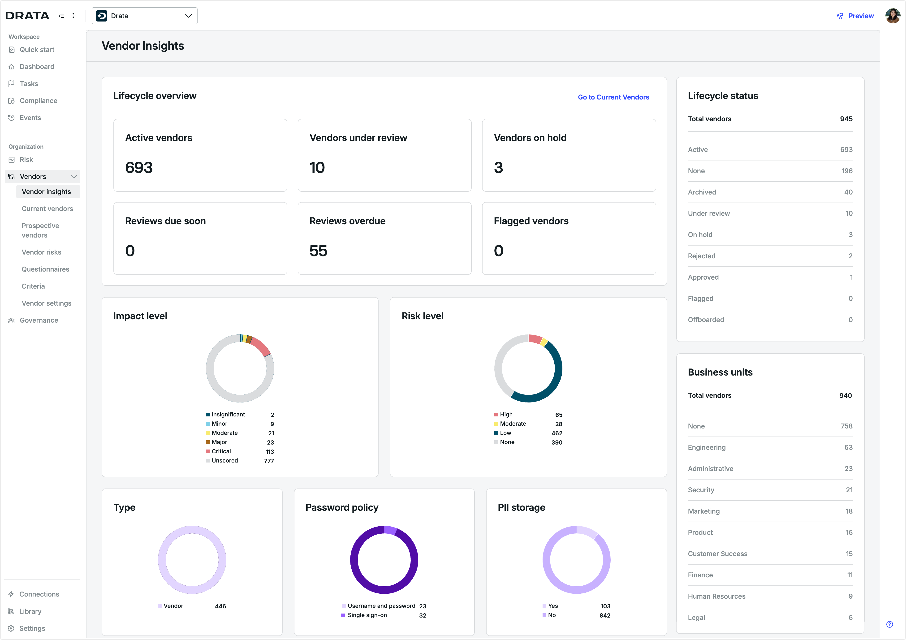

# Vendor insights

Source: https://help.drata.com/en/articles/13557232-vendor-insights
Collection: Understand the Drata Platform › Vendors
Updated: 2026-11-14
Fetched: 2026-11-22

## Article text

The **Vendor insights** dashboard provides a high-level view of your third-party risk management (TPRM) program. It helps you understand vendor risk posture, review status, and lifecycle health at a glance, and makes it easier to communicate program status to internal stakeholders and auditors.

## Prerequisites

Vendor insights are available to customers with **TPRM**.

---

## Access Vendor insights

To open the Vendor insights dashboard, select **Vendors → Vendor insights**.

The dashboard displays aggregated metrics across all vendors in your environment. Vendor insights is a **read-only overview**. It summarizes data from **Current vendors**, **Prospective vendors**, and **Vendor risks**.

 (links to https://downloads.intercomcdn.com/i/o/am69aeco/2058499312/6229b42726deed5637aaeffc4dba/image.png?expires=1780056000&signature=17c348b93f17f5426640a57f93e30287ec7af3deabf5ee07171c2489ec537f27&req=diAiHs13lIJeW%2FMW3nq%2Bgc51Tads5c23cudK3tVRxjsnhL0Qrf5XsZPxqpEd%0AkiTSODsgRqD94knqgDeGpM8nUfE%3D%0A)

---

## Lifecycle overview

The **Lifecycle overview** section shows vendor counts by lifecycle stage and review urgency. You can view:

- **Active vendors**
- **Vendors under review**
- **Vendors on hold**
- **Flagged vendors**
- **Reviews due soon**
- **Reviews overdue**

Selecting any card redirects you to **Current vendors** with the corresponding filter applied.

Use this section to quickly identify vendors that require action, such as overdue reviews or vendors currently under evaluation.

## Vendor Insights Graphs

The Vendor Insights dashboard includes several graphs that summarize vendor distribution across impact, risk, and key security attributes.

These graphs help you quickly assess overall third-party exposure and identify vendors that may require additional review.

- **Inherent risk**: Shows how vendors are grouped based on their assigned impact rating. This view helps you understand how significantly your organization could be affected if a vendor were compromised or became unavailable.
- **Risk Level**: Shows how vendors are distributed by residual risk classification. Use this graph to identify vendors that may require heightened oversight or more frequent reviews.
- **Type**: Categorizes vendors by relationship type. This helps you understand the composition of your third-party ecosystem.
- **Password Policy**: Shows how vendors authenticate users. This view can help identify vendors that may require stronger authentication controls.
- **PII Storage**: Indicates whether vendors store personally identifiable information. Vendors storing PII may require closer oversight and more frequent review.

---

## Lifecycle status and business units

The final section shows vendor counts by:

- **Lifecycle status: **Active, Under review, Approved, Rejected, On hold, Offboarded, Flagged, Archived
- **Business unit: Engineering, Product, Marketing, Sales, Legal, Finance, Administrative, Human Resources, Security**

Results are ordered by vendor count to highlight concentration areas.

## Images

- [image 01] ../../images/ux/vendors/vendor-insights--01.png

## Related articles

- [Vendor risks](vendor-risks.md)
- [Training Video: Vendor Management Overview (New Experience)](training-video-vendor-management-overview-new-experience.md)
- [TPRM Agent Autonomy Settings](tprm-agent-autonomy-settings.md)
- [Add a vendor or prospective vendor](add-a-vendor-or-prospective-vendor.md)
