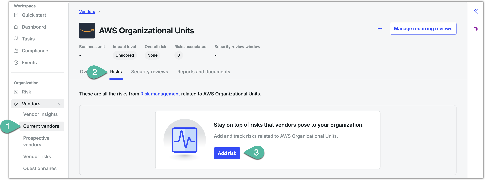
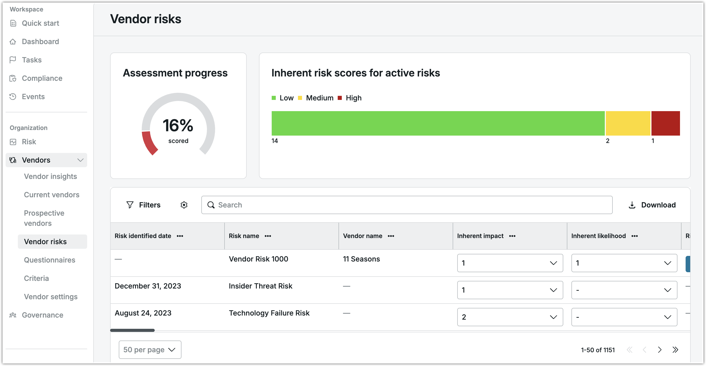

# Vendor risks

Source: https://help.drata.com/en/articles/13557213-vendor-risks
Collection: Understand the Drata Platform › Vendors
Updated: 2026-11-09
Fetched: 2026-11-22

## Article text

The **Vendor risks** page centralizes risks associated with your vendors so you can assess, track, and treat third-party risk in one place.

Vendor risk management is commonly reviewed during audits (such as SOC 2). Drata helps you document identified vendor risks, evaluate impact and likelihood, and track remediation or acceptance decisions over time.

---

## How vendor risk management works in Drata

Vendor risks represent security, compliance, or operational concerns identified during vendor reviews or ongoing monitoring. Examples include:

- Vendor does not meet internal password or MFA requirements
- Vendor does not complete penetration testing
- Vendor does not have a SOC 2 report
- Vendor lacks required security controls or device management

Each vendor risk is evaluated using **impact**, **likelihood**, and **treatment status**. Risks can be reviewed individually or across all vendors.

---

## Prerequisites

- Vendor risks are available to customers with **TPRM Pro**
- Vendors must exist in **Current vendors** before risks can be associated

---

## Access vendor risks

To view vendor risks, select **Vendors → Vendor risks**.

From this page, you can:

- View all vendor risks across your organization
- Filter risks by **status**, **impact**, **likelihood**, **risk score**, **owner**, or **vendor**
- Search for risks by name
- Download risk data for reporting or audit review

This page provides a consolidated view of your vendor risk posture.

---

## Add a vendor risk

You can add a risk from a vendor profile or directly from the Vendor risks page.

### Step 1: Add a risk from a vendor profile

1. Open **Vendors → Current vendors**.
2. Select a vendor.
3. Open the **Risks** tab.
4. Select **Add risk**.

 (links to https://downloads.intercomcdn.com/i/o/am69aeco/2058700787/070652e4d9999949879876355d49/image.png?expires=1780056000&signature=7e34e13d3ea11acb6e7f708222a322b4527d05223f453200b4132508dd9270da&req=diAiHs5%2BnYZXXvMW3nq%2Bgd58kpT8yFfbgXrGWBzEWmCJ4kPVDkpUfXxWSOQ1%0AqPkfGBUXqKRWdOctyfgvWDHFnaE%3D%0A)

---

### Step 2: Complete risk details

When adding or editing a vendor risk, provide details to help your team understand the source of the risk, assess severity, and track remediation.

1. Start by selecting whether the risk is **internal** (originating within your organization) or **external** (introduced by a third party such as a vendor or subcontractor).
2. The vendor will already be selected.
3. Choose the appropriate **risk status** to reflect its current stage.

Next, enter the core risk information, including a **title**, **description**, the date the risk was identified, and any relevant fields such as category, owner, or supporting documentation.

You can optionally complete an inherent risk assessment by selecting **impact** (the potential severity if the risk occurs) and **likelihood** (the probability of occurrence). Drata automatically calculates the Residual risk based on these values.

---

## View vendor risk status

From **Vendors → Vendor risks**, you can:

- Track active, closed, and archived risks
- Monitor overdue or untreated risks
- Review or update inherent vs residual risk levels
- Assess overall vendor risk exposure

This view helps prioritize remediation and supports audit evidence.

 (links to https://downloads.intercomcdn.com/i/o/am69aeco/2058872130/494171cb651a1fc6eb1bb7219f0c/image.png?expires=1780056000&signature=c0e222e9a23087e5eea9f254c3b90483bbfd99c86267dc949dd835e97cefbb82&req=diAiHsF5n4BcWfMW3nq%2BgXrzqMYzc3r3g7e6z10CUKdk860ssc%2Fm22ba4J3d%0A7U1bq5gTjPJWDGnnXsTYLRPn9m8%3D%0A)

## Images

- [image 01] ../../images/ux/vendors/vendor-risks--01.png
- [image 02] ../../images/ux/vendors/vendor-risks--02.png

## Related articles

- [Your First Risk Assessment: A Step-by-Step Guide (Concept Guide)](your-first-risk-assessment-a-step-by-step-guide-concept-guide.md)
- [Risk management in Drata: An overview](risk-management-in-drata-an-overview.md)
- [Terminology Updates: Inherent and Residual Risk in Vendor Risk Management](terminology-updates-inherent-and-residual-risk-in-vendor-risk-management.md)
- [Getting started with the TPRM Agent](getting-started-with-the-tprm-agent.md)
- [Customize vendor risk levels](customize-vendor-risk-levels.md)
