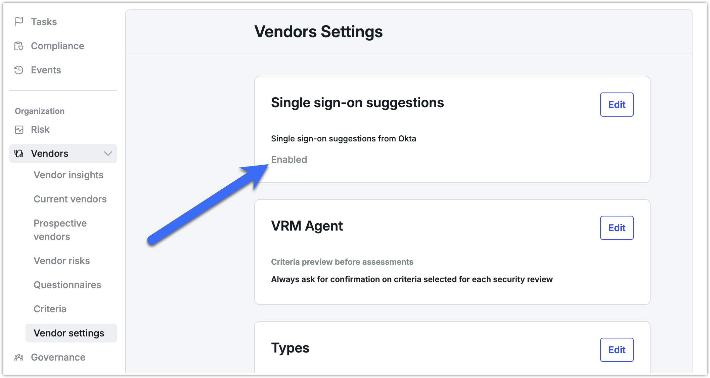

# Vendor suggestions

Source: https://help.drata.com/en/articles/13557323-vendor-suggestions
Collection: Understand the Drata Platform › Vendors
Updated: 2026-11-09
Fetched: 2026-11-22

## Article text

**Vendor suggestions** helps you identify vendors automatically based on the connections you've set up in Drata and the applications configured in your Okta SSO. This reduces manual entry and helps ensure your vendor inventory is complete.

Suggested vendors can be reviewed and added to **Current vendors** in a few clicks.

---

## Prerequisites

This feature is only available on select plans. To see which packages include this, please [visit our pricing page](https://drata.com/plans).

- To receive suggestions from Okta:
   - [Okta SSO](okta-integration-guide-identity-management-provider.md) must be configured
   - **Access reviews** must be enabled

If Okta or Access Reviews are not enabled, Okta applications are not suggested.

---

## How vendor suggestions work

Vendor suggestions are generated from:

- Active connections in **Connections**
- Applications discovered through **Okta SSO**

Suggestions appear as vendor names only. After adding a suggested vendor, you must complete the remaining vendor details.

---

## Add vendors for the first time

If no vendors exist yet:

1. Select **Vendors** from the left navigation.
2. On the **Get started** page, select **Get started**.
3. Review the suggested vendors based on your connections and Okta applications.
4. Select the vendors you want to add.
5. Continue to add them to **Current vendors**.

If Okta or Access Reviews are not enabled, Okta applications are not included in suggestions.

---

## Add additional vendors using suggestions

If you already have vendors in your directory:

1. Select **Vendors → Current vendors**.
2. Review suggested vendors displayed at the top of the page.
3. Select **Review suggestions**.
4. In the modal:
   - Select **Add** to add a vendor
   - Select **Ignore** to permanently dismiss the suggestion

Ignored vendors are not suggested again.

---

### Verify added vendors

After adding vendors through suggestions:

- You are returned to **Current vendors**
- Newly added vendors are highlighted temporarily
- The highlight disappears after refreshing the page

Only the **vendor name** is added automatically.

After adding vendor suggestions, review the vendor details to ensure everything is accurate. From there, you can assign an owner, begin the [vendor security review or risk assessment process](start-and-manage-security-reviews-for-your-vendors.md), and continue monitoring the vendor's compliance status as part of your ongoing security program.

---

### Disable vendor suggestions

To turn off vendor suggestions:

1. Select **Vendors → Vendor settings**.
2. Toggle **Single sign-on suggestions** off.

 (links to https://downloads.intercomcdn.com/i/o/am69aeco/2059213908/f2633c3303170a8f9a2a85210dd6/image.png?expires=1780056000&signature=471c8ab26eece8ec78591b61c3e9d55848e6ec4c37ae7ace7d62beefe7aa1bd2&req=diAiH8t%2FnohfUfMW3nq%2BgaPrskdreuZL8ASG%2Ba2TQB43MU6HVWZRFnSP%2FEyp%0AENaJ99CHZo3lWpJy8gtTZWfeTxM%3D%0A)

## Images

- [image 01] ../../images/ux/vendors/vendor-suggestions--01.png

## Related articles

- [Okta Integration Guide (Identity Management Provider)](okta-integration-guide-identity-management-provider.md)
- [Vendors overview in Drata](vendors-overview-in-drata.md)
- [Add a prospective vendor](add-a-prospective-vendor.md)
- [Add a vendor or prospective vendor](add-a-vendor-or-prospective-vendor.md)
- [Enterprise SCIM Integration Guide](enterprise-scim-integration-guide.md)
