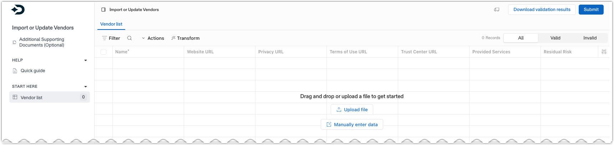
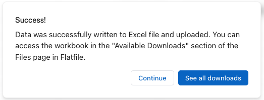

# Vendors overview in Drata

Source: https://help.drata.com/en/articles/13557179-vendors-overview-in-drata
Collection: Understand the Drata Platform › Vendors
Updated: 2026-11-09
Fetched: 2026-11-22

## Article text

The **Vendors** area centralizes third-party vendor management in Drata so you can track vendor security posture, review status, and supporting evidence.

## Understand the Vendors area

**Vendors** includes multiple pages for different workflows:

- **Vendor insights**: Dashboard-level overview (active vendors, reviews due/overdue, risk and impact breakdowns)
- **Current vendors**: Vendors you actively work with
- **Prospective vendors**: Vendors under evaluation before onboarding
- **Vendor risks**: Risks associated with vendors
- **Criteria**: Evaluation criteria used in vendor reviews
- **Vendor settings**: Defaults for reminders, recurring reviews, and vendor-facing email settings

This article focuses on managing vendors in **Current vendors**.

## Access Current vendors

Select **Vendors → Current vendors**. From **Current vendors**, you can:

- Filter vendors by fields such as **Status**, **Type**, **Inherent risk**, **Residual risk,Security review status**, **Next review deadline**, **Business unit**, and **Security owner**
- Search vendors by name
- Download the vendor list for audit review

## Add a single vendor

1. Select **Add vendor**.
2. Enter vendor details.
3. Upload supporting documentation as needed (for example, a security policy or SOC report).
4. Save your changes.

### Residual risk levels

Use risk levels to reflect how vendor failure or compromise would impact your organization:

- **High**: The vendor stores or can access sensitive data, or the business is highly dependent on the vendor's services.
- **Moderate**: The vendor has limited access to sensitive data, or service loss would be disruptive.
- **Low**: The vendor does not access sensitive data and service loss would not be disruptive.

## Add or Update Vendors in Bulk

If you manage many vendors, you can upload them in bulk using a CSV file. Bulk upload becomes available after at least one vendor exists in your directory.

### Step 1: Start the import

1. Go to **Vendors**, then open the **Current** or **Prospective** tab.
2. Select **Add vendor**, then **Add/update in bulk**.

The Flatfile import window opens.

### Step 2: Download your vendor file

1. In the import window, select **Download validation results**.
2. Select **See all downloads**. This opens **Additional Supporting Documents (Optional)** on the **Available downloads** tab.
   
3. This will redirect you to the **Additional Supporting Documents (Optional)** > **Available downloads** tab.
4. Download the CSV whose name **ends in `-vendor-bulk-update-template.csv`**. Drata adds a number to the start of the filename, so match the ending, not the whole name.

**What’s in this file:** your current vendor directory and any custom fields you’ve set up. It isn’t a blank template, so use it as the starting point for your edits.

**Ignore `flatfile-errors.xlsx`.** It appears on the same tab, but it only lists rows that failed validation. Use it only if you’re troubleshooting rejected rows.

### Step 3: Edit the file

Grab the file you downloaded in the previous step.

- **To update an existing vendor:** Edit that vendor's row. Drata matches rows to vendors by name or website URL. Leave a field blank to keep its current value—blank fields don't overwrite existing data.
- **To add a vendor:** Add a new row. Only the **Name** column is required; you can leave the other columns blank.

You don't need to delete existing rows before you add new ones.

**Note:** Save and upload the file as a CSV. Drata doesn't support Excel files, such as .xlsx.

### Step 4: Upload the file

1. In the import window, upload your edited CSV.
2. Select **Next**.
3. Review the summary of changes.
4. Confirm the import.

Drata adds your new vendors and updates the matched vendors in your directory.

### Bulk upload behavior

- Vendors with the same **name or website URL** are updated.
- Blank fields do **not** overwrite existing values.
- Bulk upload does not include certain impact assessment fields, but it does include **Inherent risk**.

---

## Bulk Upload Field Requirements (Reference)

Your CSV must include all required and optional column headers. Optional fields do not require values, but the column header must still be present in the file.

### Valid URL Format

URL fields accept either:

- A domain name (for example, `drata.com` or [`www.example.com`](http://www.example.com))
- A full URL (for example, [`https://example.com/page`](https://example.com/page))

Do not use backslashes (`\`) or incomplete values (for example, `example`).

---

### Supported Vendor Fields

| **Field name** | **Acceptable value** |
|---|---|
| Name (Required) | Open text |
| Website URL (Optional) | URL |
| Privacy URL (Optional) | URL |
| Terms Of Use URL (Optional) | URL |
| Trust Center URL (Optional) | URL |
| Provided Services (Optional) | Open text |
| Residual Risk (Optional) | `Low`, `Moderate`, `High` |
| Inherent Risk (Optional) | `Insignificant`, `Minor`, `Moderate`, `Major`, `Critical` |
| Type (Optional) | `Vendor`, `Supplier`, `Contractor`, `Partner`, `Other` |
| Status (Optional) | `Active`, `Under Review`, `Flagged`, `On Hold`, `Approved`, `Rejected`, `Offboarded`, `Archived` |
| Annual Contract Value (Optional) | `Number` |
| Additional Notes (Optional) | Open text |
| Sub-Processor (Optional) | `Yes`, `No` |
| Subprocessor Data Location (Optional) | Open text |
| Integrations (Optional) | Vendor name within your Vendor directory. |
| Business Unit (Optional) | `Engineering`, `Product`, `Marketing`, , `Sales`, `Legal`, `Finance`, `Administrative`, `Human Resources`, `Security` |
| Stores PII (Optional) | `Yes`, `No` |
| Stored Data (Optional) | Open text |
| Vendor Relationship Contact Email (Optional) | Email Ensure that the entered email is the same email that is saved in Drata. You can go to the Personnel page to view the emails that are saved for each personnel. |
| Security Owner Email (Optional) | Email Ensure that the entered email is the same email that is saved in Drata. You can go to the Personnel page to view the emails that are saved for each personnel. |
| Contact at vendor (Optional) | Open text |
| Contact email (Optional) | Valid email address |
| Password Policy (Optional) | `Username & Password`, `SSO`, `LDAP`, `Not Applicable`, `SCIM`, `Other` If you select **`Not Applicable`**, the remaining password fields do not apply. |
| Password Requires Minimum Length (Optional) | `Yes`, `No` |
| Password Minimum Length (Optional) | `6`, `7`, `8`, `9`, `10`, `11`, `12+` |
| Password Requires Number (Optional) | `Yes`, `No` |
| Password Requires Symbol (Optional) | `Yes`, `No` |
| Password MFA Enabled (Optional) | `Yes`, `No` |

---

### Upload Vendors with Custom Fields

If your account uses custom vendor fields, they are included in bulk uploads.

| Custom field type | Acceptable value |
|---|---|
| Currency | Number (with or without decimals) |
| Number | Number |
| Dropdown | Valid dropdown option |
| Short Answer | Open text (max 191 characters) |
| Long Answer | Open text (max 30,000 characters) |

If a required custom field contains an invalid value, the vendor will not be added. Invalid values for optional custom fields are ignored.

---

### Archive a vendor

Archive vendors you no longer work with but want to retain for audit history.

1. Open the vendor profile.
2. Select the **ellipsis (⋯)**.
3. Select **Archive vendor**.

### Restore a vendor

1. Open **Vendors → Current vendors**.
2. Filter by **Status → Archived**.
3. Select the vendor.
4. Select the **ellipsis (⋯)**.
5. Select **Restore vendor**.

### Delete a vendor

⚠️ **This action cannot be undone.**

Delete vendors only if they were added in error.

1. Open the vendor profile.
2. Select the **ellipsis (⋯)**.
3. Select **Delete vendor** and confirm.

> 🎓 **Want to learn more?** Dive deeper into this topic and see it in action! Check out our dedicated Vendors course over at the **[Drata Academy](https://academy.drata.com/risks-vendor-management)**.

## Images

- [image 01] ../../images/ux/vendors/vendors-overview-in-drata--01.png
- [image 02] ../../images/ux/vendors/vendors-overview-in-drata--02.png

## Related articles

- [Integrate Zip with Drata Vendor Management](integrate-zip-with-drata-vendor-management.md)
- [Vendor risks](vendor-risks.md)
- [Add a prospective vendor](add-a-prospective-vendor.md)
- [SafeBase Trust Center integration in Drata TPRM](safebase-trust-center-integration-in-drata-tprm.md)
- [Add a vendor or prospective vendor](add-a-vendor-or-prospective-vendor.md)
