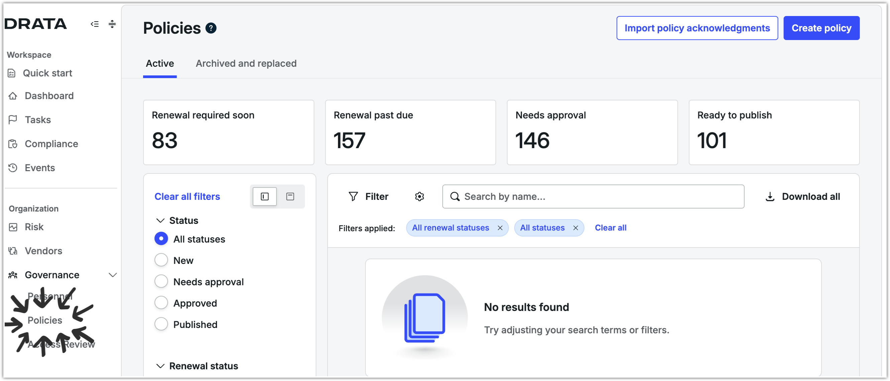
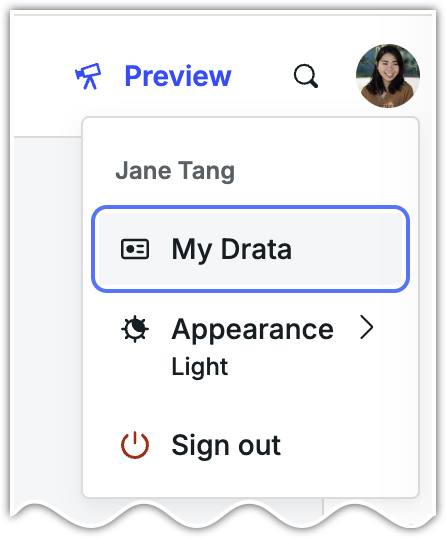
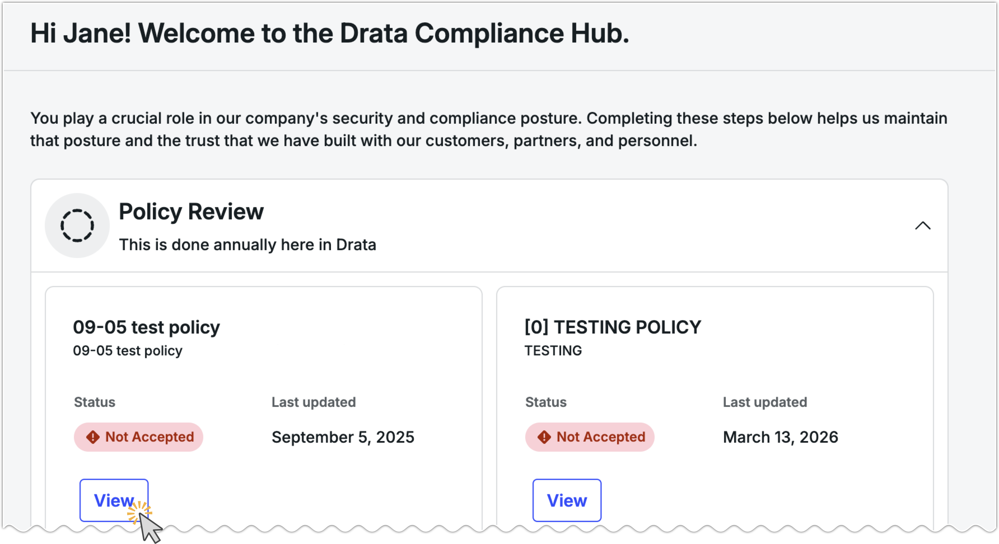
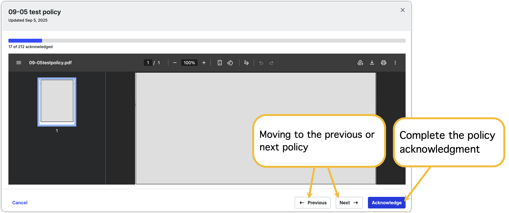
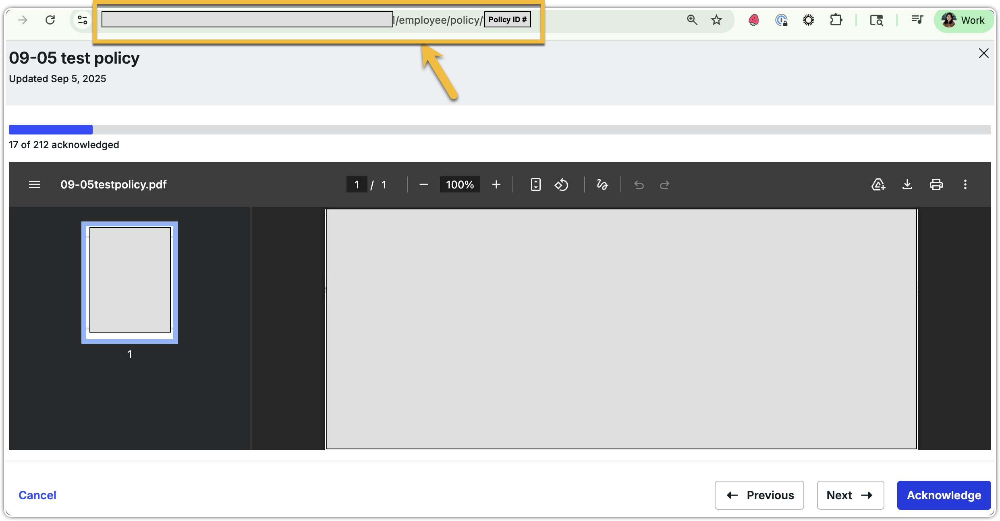
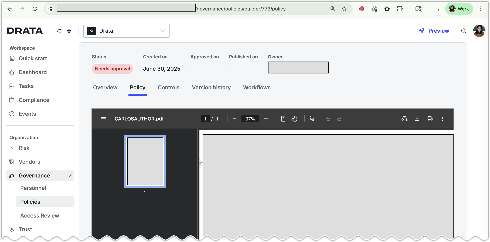
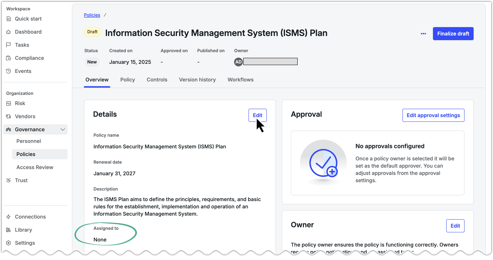
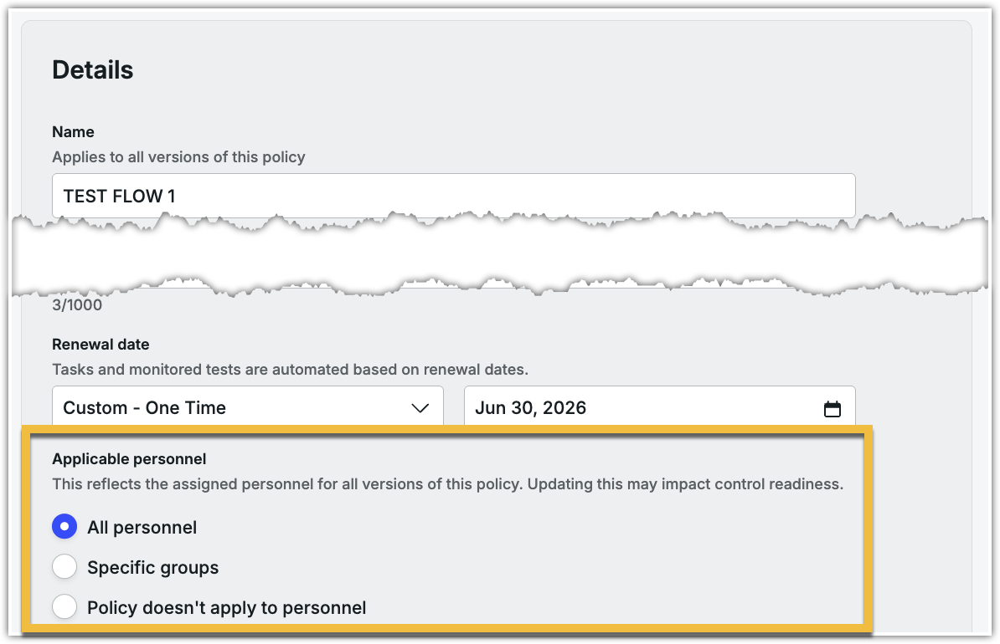
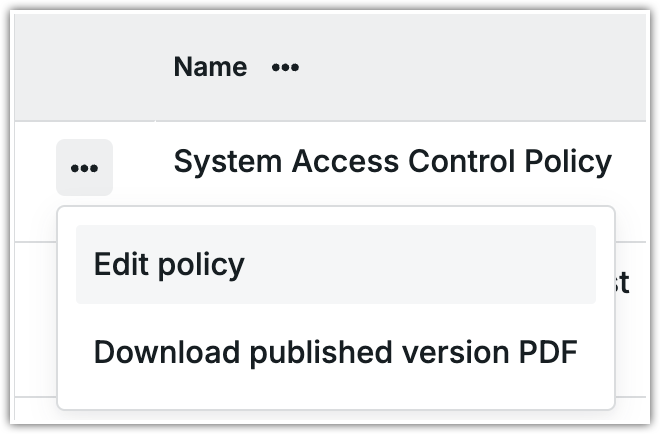
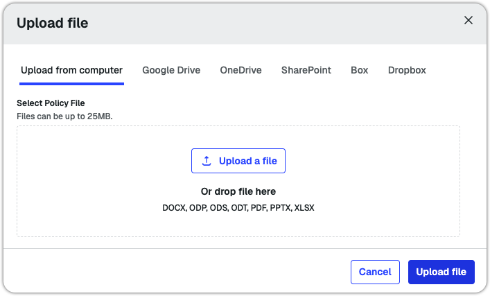

# View and edit a policy

Source: https://help.drata.com/en/articles/13549259-view-and-edit-a-policy
Collection: Understand the Drata Platform › Policies
Updated: 2026-11-09
Fetched: 2026-11-22
Description: This article explains who can edit a policy, how to make updates, and how approvals and versioning work in the new experience.

## Article text

Policies in Drata move through a defined lifecycle — Draft, Needs approval, Approved, and Published — and what you can do with a policy depends on two things: **your role** and the **policy's current status**.

This article covers:

- Who can view a policy, and where they view it
- Who can edit a policy, and what each status allows
- How to update policy content, metadata, and version history
- How to finalize, classify, and publish your changes

---

## View Policies

Where a person views a policy depends on their role and whether the policy is assigned to them.

The following roles can view policies from the **Policies** page:

- **Admin**
- **Information Security Lead**
- **Workspace Manager**
- **Policy Manager**

If you have access to the **Policies** page:

1. Go to **Governance** → **Policy**.
2. Select the policy name to open the policy details page.
3. Use the tabs to review policy information:
   - **Overview**: Policy metadata, owner, renewal date, linked controls, and frameworks
   - **Policy**: The current policy content
   - **Version History**: Previous versions, including creation, approval, and publish dates

**For users that do not have access to Policies page**

- Users in other roles, including most employees, won’t see the **Policies** page in the navigation.
- They must navigate to the **My Drata** page to review and acknowledge the policies assigned to them.

Learn more at [View as a personnel member (My Drata)](https://help.drata.com/en/articles/4826936-view-and-edit-a-policy#h_21fa7c4915) section.

## View or Acknowledge Your Policies (My Drata)

Use the **My Drata** page to review and acknowledge the policies assigned to you.

**To acknowledge your policies:**

1. Select your name in the upper-right corner, then select **My Drata**.
   
   - **Note:** Some users only have access to the **My Drata** page. If that's the case, you'll land here automatically after logging in.
2. On the **My Drata** page, expand the **Policy Review** section. Then, select **View** on the policy card to begin the acknowledgment process.
   
3. Here, you can confirm your acknowledgment of the policy.
   

> **▸ Share the direct link to a policy**
>
> To share a policy link that personnel can open, use a URL ending in `.../employee/policy/{policyId}`.
>
> The easiest way to get this link is to copy the URL from the **My Drata** after you selected which policies to view.
>
> 
>
> **Do not share** the authoring URL from the **Policies** page (for example, `.../governance/policies/builder/{id}/policy`). That URL requires role permissions, so most personnel will get an error or a blank page.
>
> 
>
> For the full walkthrough, see [Linking Directly to Specific Employee Security Policies](linking-directly-to-specific-employee-security-policies.md).

> **▸ How Policy Assignment and Acknowledgment Work**
>
> **Note**: Users with the Admin, Information Security Lead, Workspace Manager, or Policy Manager role can change which personnel are required to acknowledge a policy. Ensure that read-only access is not enabled for you to do this.
>
> Which policies a user sees and must acknowledge depends on how the policy's Personnel groups field is configured.
>
> 1. Go to **Governance → Policies**, select the policy, then scroll to the **Assigned to** field. This field controls which personnel are required to acknowledge the policy in My Drata.
>    - The following options are:
>       - **All personnel**: Every personnel member in your organization.
>       - **Specific groups**: Only members of the assigned IdP group(s).
>       - **None**: Policy doesn't apply to personnel. No personnel — the policy is stored and tracked but never surfaced for acknowledgment.
>    
> 2. Select **Edit** and then, scroll down to **Applicable personnel **to update the assigned options.
>    
>
> For more details on how assignments work, see [Group-Based Policy](https://help.drata.com/en/articles/5812756-group-based-policy).

---

## Who can edit a policy

Editing rights depend on the policy's current status.

| **Policy status** | **Who can edit** | **What happens** |
|---|---|---|
| Draft | Anyone with Policies page access.  Cannot have read-only permission enabled | Fully editable until finalized. |
| Needs approval | No one | Locked during review.   Approvers can approve or request changes. |
| Approved | Policy Owner only | Editing creates a new version. You must classify the change as material or non-material. |
| Published | Anyone with Policy Center: Write | Editing creates a new draft. The published version stays active until replaced. |

The **user must have the following roles to edit a policy:** Admin, Information Security Lead, Workspace Manager, and Policy Manager roles. Ensure that read-only permission is not enabled.

## Step 1: Start editing a policy

1. Open **Governance → Policies**.
2. Locate the policy you want to update.
3. Start editing in either of the following ways:
   - Select the **ellipsis (⋯)** and choose **Edit policy**, or
      
   - Select the policy to open it, then use the available tabs to make updates

Editing is available only when the policy is in an editable status.

## Step 2: Update policy content

You can update policy content in either of the following ways:

- **Upload a file**: Replace the policy using a supported file type (PDF, DOCX, ODT, XLSX, ODS, PPTX, or ODP, maximum 25 MB) from your computer, or import a file directly from a connected cloud storage service — Google Drive, SharePoint, OneDrive, Box, or Dropbox.
   
- **Author in Drata: **Edit the policy directly in the editor. Highlight text and add comments to provide context or request feedback.

## Step 3: Finalize and classify changes

After you finish editing:

1. Select **Finalize draft**.
2. Choose how to classify the update.

### Material changes

Use this option when the update affects the policy’s intent or scope.

- Approval is required
- The policy status changes to **Needs approval**
- Approvers are notified based on configured approval tiers
- The policy can be published after all approvals are complete

### Non-material changes

Use this option for minor wording or formatting updates.

- Approval can be skipped
- The policy can be published immediately by a Policy Owner
- You can choose whether personnel acknowledgment is required

## Step 4: Explain your changes

Use the **Explanation of changes** field to describe what was updated. This explanation appears in:

- Notifications sent to approvers
- Emails sent to personnel (if notifications are enabled)
- The policy’s version history

Clear explanations support audits and internal review.

---

## Policy header reference

At the top of the policy detail page, you'll see a summary with the following details:

| **Field** | **Description** |
|---|---|
| Version # | The policy's current version number. |
| Policy Status | Current lifecycle status: Draft, Needs approval, Approved, or Published. |
| Creation Date | The date the policy was first created. |
| Approval Date | The date the policy was approved. If approval was not required, this shows **"No approval required."** If approval is pending, it shows a blank dash (—). |
| Published Date | The date the policy was published and became live. |

---

## Version History tab

The **Version History** tab tracks every past and current version of the policy, providing transparency and audit-ready change tracking.

To open it, select the policy, then choose the **Version History** tab on the policy detail page.

The version history table includes:

| **Column** | **Description** |
|---|---|
| Version | The version number of the policy. |
| Explanation of Changes | A summary of what was updated. If no explanation was provided, this shows **"No explanation of changes was added."** |
| Policy Owners | The names of the policy owners responsible for that version. |
| Creation Date | The date the version was created. |
| Approval Date | The date the version was approved. |
| Published Date | The date the version was published. |
| Actions (⋯) | Download the version as a PDF, or — if available — view its approval history. |

> 🎓 **Want to learn more?** Dive deeper into this topic and see it in action! Check out our dedicated Policies course over at the **[Drata Academy](https://academy.drata.com/policies-course)**.

## Images

- [image 01] ../../images/ux/policies/view-and-edit-a-policy--01.png
- [image 02] ../../images/ux/personnel/view-and-edit-a-policy--02.png
- [image 03] ../../images/ux/personnel/my-drata-overview-complete-your-personal-compliance-tasks-new-experience--02.png
- [image 04] ../../images/ux/personnel/view-and-edit-a-policy--04.png
- [image 05] ../../images/ux/personnel/view-and-edit-a-policy--05.png
- [image 06] ../../images/ux/policies/view-and-edit-a-policy--06.png
- [image 07] ../../images/ux/policies/view-and-edit-a-policy--07.png
- [image 08] ../../images/ux/policies/view-and-edit-a-policy--08.png
- [image 09] ../../images/ux/policies/view-and-edit-a-policy--09.png
- [image 10] ../../images/ux/policies/view-and-edit-a-policy--10.png

## Related articles

- [Policy Center Overview](policy-center-overview.md)
- [Add comments in your policy](add-comments-in-your-policy.md)
- [Create a policy](create-a-policy.md)
- [Manage policy renewals](manage-policy-renewals.md)
- [Bulk Import Policy Acknowledgments](bulk-import-policy-acknowledgments.md)
