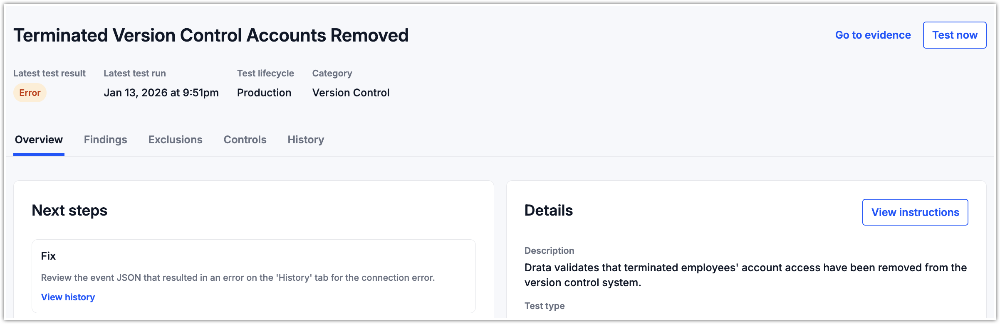
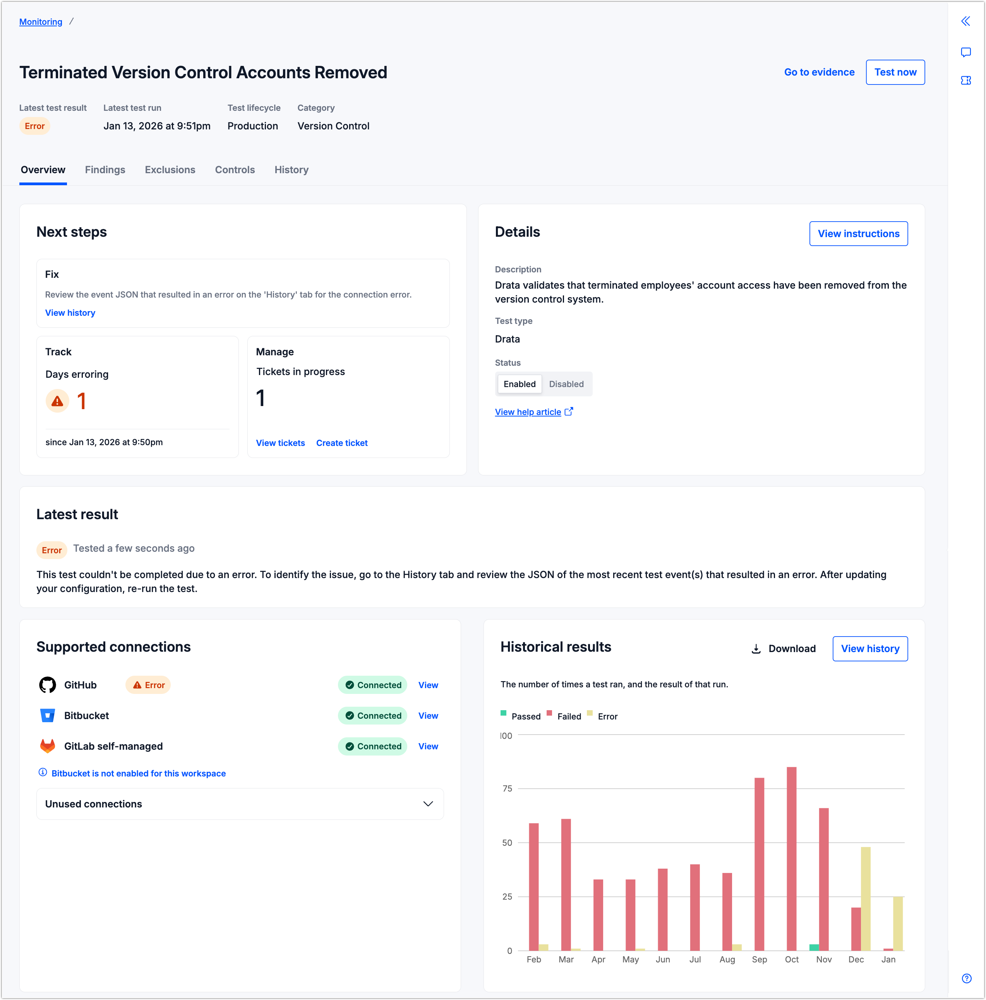
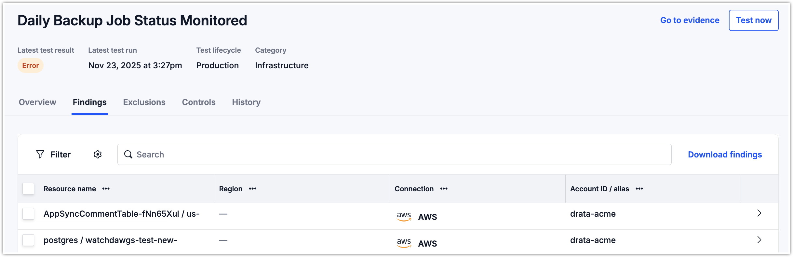
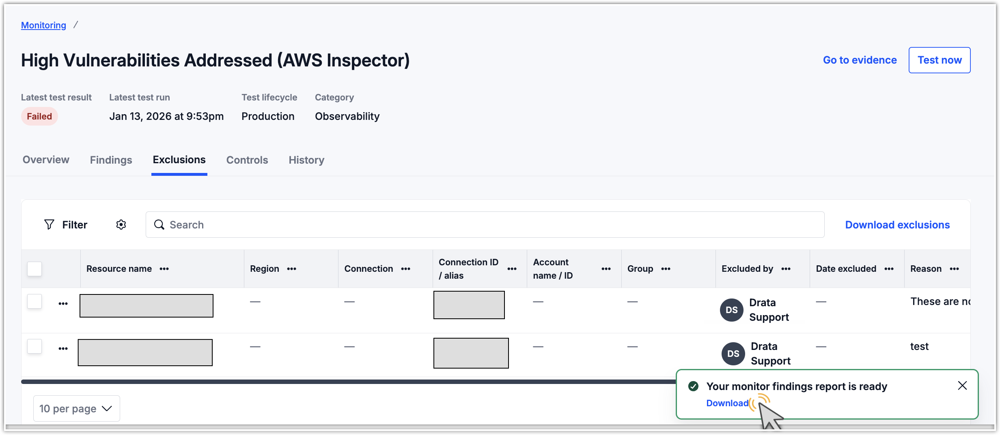
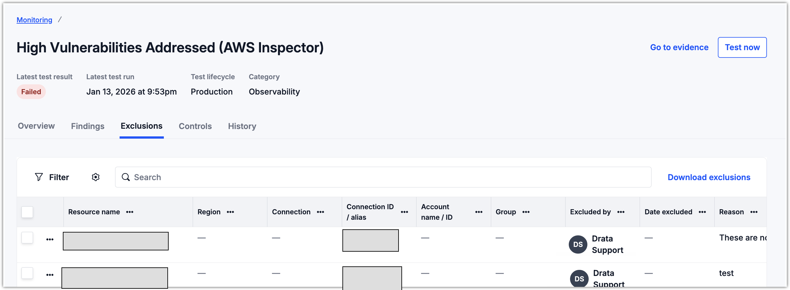
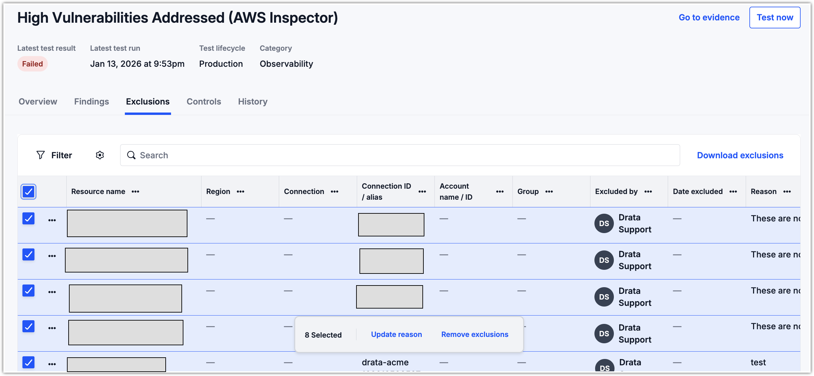

# View and Manage Test Details (New Experience)

Source: https://help.drata.com/en/articles/13392374-view-and-manage-test-details-new-experience
Collection: Understand the Drata Platform › Monitoring
Updated: 2026-11-09
Fetched: 2026-11-22
Description: Learn how to use the test details page in Drata Monitoring to investigate test results, remediate issues, manage exclusions, and understand how tests impact control readiness and compliance.

## Article text

The test details page gives you a complete view of an individual test, including its results, findings, history, and related controls. Use this page to understand why a test passed or failed, take corrective action, and maintain continuous compliance and audit readiness.

## Test details page overview

From the **Monitoring** page, select a test to open its details page.

At the top of the page, you can quickly review the test’s current state, including:

- **Test name**
- **Latest result** (Passed, Failed, or Error)
- **Last run date**
- **Status indicators** for new tests or custom draft tests

From the header, you can also take immediate action:

- Run the test
- View related evidence
- Publish or delete custom tests (if applicable)

This overview helps you quickly assess test health and take action before issues impact control readiness or audit status.

## Overview tab

The **Overview** tab provides a high-level summary of the test and its current state.

### Next steps

The **Next steps** section guides you on what to do based on the test’s results, helping you move from detection to remediation.

- **Track:** View how long the test has remained in its current state to understand consistency over time, which is often reviewed during audits.
- **Fix:** Review failures or errors to identify what needs remediation and prioritize corrective action.
- **Manage:** View the number of open tickets linked to the test to track ownership and remediation progress (requires a ticketing integration).

For custom tests, this section appears only after the test is published.

### Details

This section explains what the test is checking and how it is configured, helping you confirm scope and intent.

- **Description:** Explains what the test evaluates.
- **Test Type:** Indicates whether the test is Drata-provided or custom.
- **Status:** Shows whether the test is enabled, disabled, testing, or in another state.

For custom tests, you can edit the test name and description directly from this section to keep documentation accurate and audit-ready.

### Latest result

The **Latest result** section shows the **most recent outcome of the test and explains *why* it passed or failed.**

- Review failure or error details to understand the root cause.
- Select a test event to view additional context.
- Access raw JSON data (which is in the History tab) for deeper technical troubleshooting.

This section helps ensure issues are investigated, not just flagged.

### Supported connections

The **Supported connections** section shows which external systems the test applies to, helping you validate monitoring coverage.

- Connected systems appear with a **Connected** label.
- Systems that are not connected appear under **Unused connections**.

This section appears only for tests that monitor business systems.

For custom tests, you should also refer to the **Test logic** section for more information about the connected provider.

### Historical results

The **Historical results** section shows how the test has performed over time.

- Monthly summary of passed, failed, and errored runs
- Option to download results
- Access to all test events

This view helps you identify recurring issues or confirm long-term compliance.

### Test logic (custom tests only)

For custom tests, the **Test logic** section shows the rules that determine test behavior.

- View or edit the logic
- Understand how results are calculated

## Findings tab

The **Findings** tab shows individual items that caused the test to fail.

### When findings appear

- Findings appear only when a test fails and identifies specific issues.
- If a test passes, there are no findings to show.
- If a test errors, findings may not appear because the assessment could not complete.

If a test is in an **Error** state and no findings are shown:

- Re-run the test to see if the issue resolves, or
- Go to the **Overview** tab and review the **Next steps** or **Latest result** section for guidance on how to proceed.

### Download findings

You can download findings directly from the Findings tab.

- Available for all test categories except **In Drata** and **Policy**
- Downloads include a ZIP file containing:
   - **Remediation guide (PDF)**
   - **Findings metadata (CSV)**

To download:

1. Open the **Findings** tab.
2. Select **Download Findings**.
3. When the download is ready, a notification appears.
   - You can continue working in Drata while the file is being prepared.
   - Select the download link in the notification to download the file.
      
4. The file downloads as a **ZIP**. Save the ZIP file to your device.

⚠️ You cannot download findings while the test is running.

## Exclusions tab

Exclusions can be created when a specific item being evaluated by a test is not applicable to your environment. While exclusions are most commonly created when reviewing findings from a failed test, they can also be applied whenever an item should be intentionally excluded.

Excluding an item prevents it from being evaluated in future test runs while preserving an audit-visible business rationale. This helps you focus remediation efforts on issues that truly impact compliance, rather than addressing items that are intentionally allowed or out of scope.

### How exclusions work

- Exclusions apply to **individual items or findings**, not the entire test
- Excluded items are skipped in future test runs
- A **business rationale is required** for every exclusion
- Exclusions remain visible and auditable
- Exclusions can be updated or reversed at any time
- Some exclusions are system-designed and applied automatically by Drata. These exclusions are not user-configurable and reflect system-determined conditions, such as backup vaults with no failed jobs being excluded from evaluation.

The **Exclusions** tab lists items that were intentionally excluded from test results. The Exclusions tab is only available in the updated Monitoring interface.

Exclusions marked **N/A** no longer apply because the related resource is not part of the current test results.

### Manage exclusions

- Select one or more exclusions
- Choose to update your reason for the exclusions or remove the exclusions to re-include items

### Download exclusions

You can download exclusions as a CSV file.

- Available for all test categories except **In Drata** and **Policy**

To download:

1. Open the **Exclusions** tab.
2. Select **Download Exclusions**.
3. When the download is ready, a notification appears.
   - You can continue working in Drata while the file is being prepared.
   - Select the download link in the notification to download the file.
4. Save the CSV file.

## Controls tab

The **Controls** tab shows all controls mapped to the test. From this tab, you can:

- Map or unmap controls
- Select **View details** to review control readiness contributors such as evidence, policies, approvals, and other mapped tests

This helps you understand how test results affect control readiness.

## History tab

The **History** tab lists all test events, with the most recent event shown first.

- This replaces the previous “Last result > Test events” section from the Overview tab
- Improves clarity by separating history from current state

Select a test event to view detailed results in the event panel.

## Manage notes, tasks, and tickets

The test details page includes a right-hand panel where you can:

- Add or edit internal notes
- Create and manage tasks
- View and track linked tickets

This panel supports collaboration and remediation tracking without leaving the test.

> 🎓 **Want to learn more?** Dive deeper into this topic and see it in action! Check out our dedicated Monitoring course over at the **[Drata Academy](https://academy.drata.com/controls-monitoring-1)**.

## Images

- [image 01] ../../images/ux/monitoring/view-and-manage-test-details-new-experience--01.png
- [image 02] ../../images/ux/monitoring/view-and-manage-test-details-new-experience--02.png
- [image 03] ../../images/ux/monitoring/view-and-manage-test-details-new-experience--03.png
- [image 04] ../../images/ux/monitoring/view-and-manage-test-details-new-experience--04.png
- [image 05] ../../images/ux/monitoring/view-and-manage-test-details-new-experience--05.png
- [image 06] ../../images/ux/monitoring/view-and-manage-test-details-new-experience--06.png

## Related articles

- [Test: Backups Checked for Integrity](test-backups-checked-for-integrity.md)
- [Monitoring Overview](monitoring-overview.md)
- [Filter and search tests in Monitoring (New Experience)](filter-and-search-tests-in-monitoring-new-experience.md)
- [Drata Controls (DCFs) Training Video (New Experience)](drata-controls-dcfs-training-video-new-experience.md)
- [Understanding Monitoring in Drata Training Video (New Experience)](understanding-monitoring-in-drata-training-video-new-experience.md)
