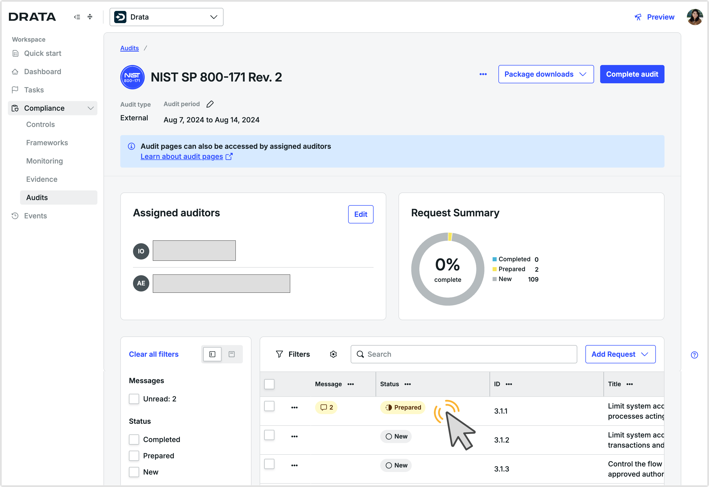
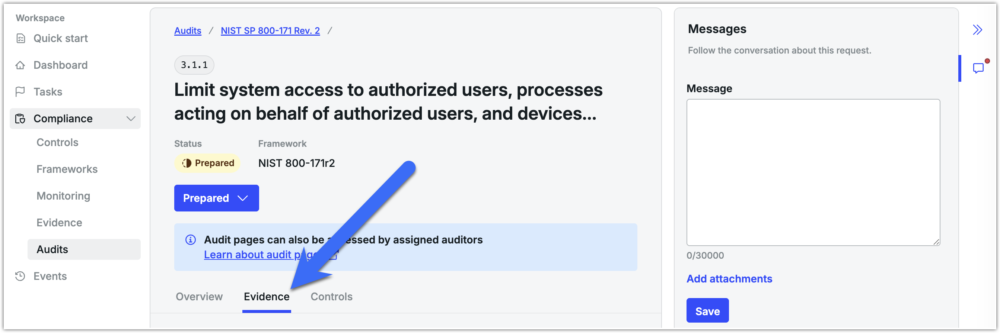

# View and Open Evidence from the Audits page (New Experience)

Source: https://help.drata.com/en/articles/13893605-view-and-open-evidence-from-the-audits-page-new-experience
Collection: The Auditor Experience
Updated: 2026-11-14
Fetched: 2026-11-22

## Article text

## Overview

The **Evidence** tab on a requirement page shows all evidence associated with that requirement in one place. From this tab, you can open, preview, and download individual evidence items or download all evidence at once.

Access to the Evidence tab follows the same permissions that control access to the requirement and its evidence.

**Required Drata roles:** Drata Admins, Internal Auditors

---

## View Evidence for a Requirement

1. Go to the **Audits** page.
2. Open the audit that contains the requirement you want to review.
3. You are redirected to the specific audit page. Scroll down and view the requirements table.
4. Select the requirement.
   
5. On the requirement page, select the **Evidence** tab.

The **Evidence** tab displays a table with the following columns:

- **Name**
- **Artifact**
- **Type**
- **Control**
- **Date**

Use search and filters at the top of the table to narrow the list.

On the evidence detail view:

- If the file type supports preview, view it directly in Drata.
- If preview is not supported, you see “Preview unavailable for this file type” and a Download option.
- If the evidence is a URL, you see “This evidence is a link to an external website” and an Open link option.

Select **Download** to save the item locally, if needed.

---

### Download All Evidence for a Requirement

On the **Evidence** tab, select **Download all** above the table to export all listed evidence as a ZIP file.

- There is no file size or file count limit for **Download all**.
- If no evidence or controls are associated with the requirement, the page displays a clear empty state message, such as **No documents** or **No controls**.

## Images

- [image 01] ../../images/ux/audits/view-and-open-evidence-from-the-audits-page-new-experience--01.png
- [image 02] ../../images/ux/audits/view-and-open-evidence-from-the-audits-page-new-experience--02.png

## Related articles

- [Using the Drata Evidence Package and Manifest File](using-the-drata-evidence-package-and-manifest-file.md)
- [Map evidence and policies to controls (New Experience)](map-evidence-and-policies-to-controls-new-experience.md)
- [Using the Drata Audit Portal (New Experience)](using-the-drata-audit-portal-new-experience.md)
- [Audits page overview (New Experience)](audits-page-overview-new-experience.md)
- [Pre-audit evidence packages in Drata (New Experience)](pre-audit-evidence-packages-in-drata-new-experience.md)
