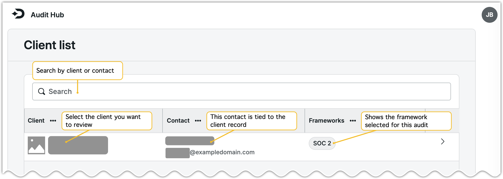
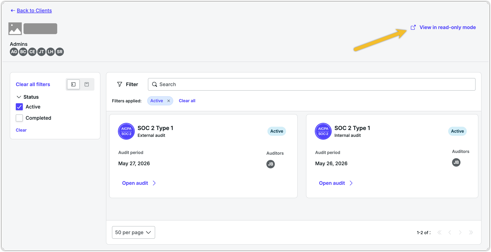
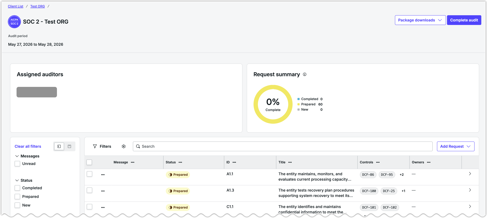

# What auditors can see in Audit Portal

Source: https://help.drata.com/en/articles/15266741-what-auditors-can-see-in-audit-portal
Collection: The Auditor Experience
Updated: 2026-11-14
Fetched: 2026-11-22
Description: A comparison guide showing what auditors can see in Audit Portal compared to what customers can see in Drata.

## Article text

This article explains what auditors can see in Audit Portal and how that compares with what customers manage in Drata. Both sides work from the same underlying audit data, evidence, and audit packages, but access and actions depend on how the audit is configured.

Use the sections below to compare the auditor view and the customer view at the same stage of the audit workflow.

## Prerequisite

- You must have an active audit within Drata
- Drata maintains a high level of data transparency between our customers and the auditors that are invited to perform audits. Control evidence, audit pre-packages, evidence requests, and request details are always the same for both parties
- Auditors can review evidence, send requests, and update the status of the audit.
- In an audit, your auditor sends you requests for evidence, such as "Provide your Q3 access review." Each one is a "request." Auditors can delete these requests.
- You cannot invite an auditor with a personal email, or an email that matches your Drata tenant domain

## Choosing the client and audit

### What the customer sees

The customer creates the audit in Drata, selects the framework and audit period, and adds the auditor to the engagement. Once the auditor is assigned, they can access the audit from the Audit Portal.

### What the auditor sees

After signing in to the Audit Portal, the auditor can view the list of assigned clients.

After selecting a client, they can see the available audits for that client and open the audit they need to review.

*Screenshot displays the View in read-only button for auditors*

## Main audit overview

### What the auditor sees

After the auditor opens a specific audit, they land on the main audit page. From there, they can typically see the audit name, audit period, completion state, assigned auditors, request summary, request list, and Audit Resources.

## What customers should keep in mind

- Customers control the framework, audit period, and auditor assignment for the audit.
- Auditors and customers work from the same underlying audit data and package sources.
- Read-only access expands what the auditor can view, but it does not allow edits.
- If a package download fails or takes longer than expected, retry it from Audit Resources. If the issue continues, contact Drata Support.

## Troubleshooting Missing Requirements in Audit Portal

1. **Verify Auditor Assignment**: Check that an auditor is assigned to the audit.
2. **Custom Request List or Default Framework**: Confirm that the auditor has uploaded a custom request list or selected the default framework requirements.
3. **Validate the Audit Period**: Ensure that the audit period is valid for accessing the requirements.
4. **Adjust Filters**: Check for filters or search criteria that might be hiding requirements. Broaden or clear filters to view all related items.

## Images

- [image 01] ../../images/ux/audits/what-auditors-can-see-in-audit-portal--01.png
- [image 02] ../../images/ux/audits/what-auditors-can-see-in-audit-portal--02.png
- [image 03] ../../images/ux/audits/using-the-drata-audit-portal-new-experience--02.png

## Related articles

- [Create and add auditors to an audit](create-and-add-auditors-to-an-audit.md)
- [Using the Drata Audit Portal (New Experience)](using-the-drata-audit-portal-new-experience.md)
- [Audits page overview (New Experience)](audits-page-overview-new-experience.md)
- [Section 5: Drata for Auditors](section-5-drata-for-auditors.md)
- [Creating and Navigating an Audit in Drata Training Video](creating-and-navigating-an-audit-in-drata-training-video.md)
