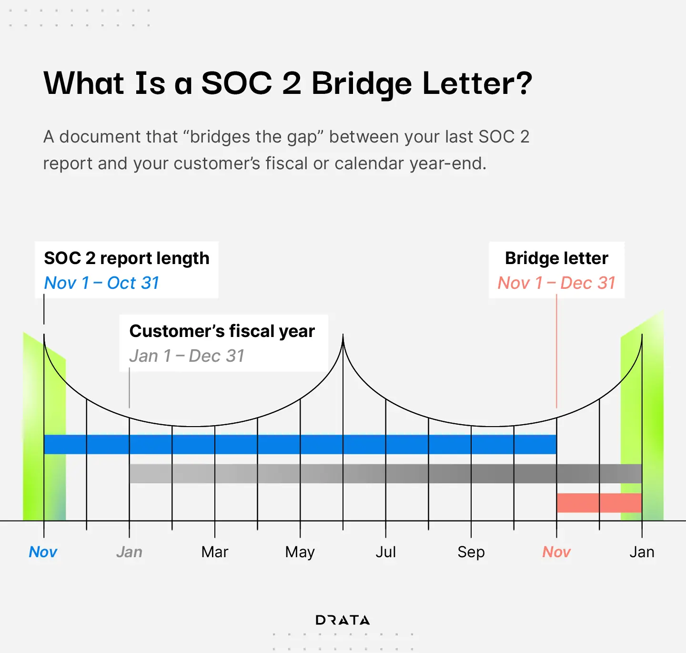

# What Is a SOC 2 Bridge Letter? [+ Template]

Source: https://help.drata.com/en/articles/10697841-what-is-a-soc-2-bridge-letter-template
Collection: Framework Information › SOC 2 2017
Updated: 2025-06-18
Fetched: 2026-11-22
Description: SOC 2 Bridge Letter Guidance and Template

## Article text

A bridge letter is a document that covers the gap between your last SOC 2 report and your customer’s calendar or fiscal year-end.

Let’s say your[SOC 2 report](https://drata.com/grc-central/soc-2/what-is-a-soc-2-report) covers the period between Oct. 1, 2024 and  Sept. 30, 2025. Your customer’s calendar year-end runs from Jan. 1, 2025 through Dec. 31, 2025. Your[SOC 2](https://drata.com/product/soc-2) report only covers nine of the 12 calendar months, which leaves a three-month coverage gap. As a service organization, how do you account for that interim period?

This is where SOC 2 bridge letters come in. A bridge letter provides assurance to your customer that you’re maintaining[internal controls](https://drata.com/blog/soc-2-controls) and provides context about any changes that may have occurred after your last reporting period ended. Below, we cover what to include within a bridge letter, who issues the bridge letter, plus a template you can use to create your own.

### What Is a Bridge Letter?

A bridge letter (also known as a gap letter) is a document that covers the gap between your last SOC 2 report and your customer’s calendar or fiscal year-end. Since SOC reports typically last for six to 12 months, your report timeframe may not perfectly overlap with your customer’s calendar or fiscal year. The letters are meant to cover a short duration—typically no more than three months.

While bridge letters don’t replace a SOC 2 report, they can help prove your[security posture](https://drata.com/blog/security-posture) to customers as you await your next[audit](https://drata.com/grc-central/soc-2/audit) process.

### Why Do Organizations Need SOC 2 Bridge Letters?

No matter how dialed-in your security program is, an annual audit and resulting SOC 2 report only capture a specific time frame. Once that period closes, a window opens between your last confirmed compliance state and the next scheduled audit.

This reporting gap leaves customers and business partners uncertain about your ongoing[security controls](https://drata.com/blog/security-controls). Without current documentation, they may question whether your internal safeguards remain as effective as they were during the assessment.

SOC 2 bridge letters address this uncertainty. They confirm that there have been no material changes to your organization’s controls since your last SOC 2 report or, if there have been, explain why they took place.

While not a regulatory requirement, these letters are often considered a best practice and a show of good faith to your customers. Providing these letters reassures stakeholders that you continue to take[data security](https://drata.com/blog/data-privacy-vs-data-security) seriously and fosters confidence in your ongoing compliance efforts—even before the ink dries on your next official SOC 2 report.

### What Is Required in a SOC 2 Bridge Letter?

What you include in your SOC 2 bridge letter will vary depending on whether or not significant changes have been made to your internal controls.

A few elements that are considered standard in a bridge letter include:

- The review period of your latest SOC report, including the start and end dates
- Any material changes to your internal control environment and an explanation of those changes (if applicable)
- A statement that you’re unaware of any material changes that might impact the opinion of the[auditor](https://drata.com/glossary/soc-2-auditor) who performed your SOC examination (if there are no material changes)
- A note that the bridge letter is not a replacement for a SOC 2 report
- A disclaimer that the letter was created only for the customer

### Who Provides a Bridge Letter?

Your organization provides the bridge letter. The CPA firm that performed your SOC examination will not create or provide a bridge letter on your behalf because they’re unaware of the operating effectiveness of your controls beyond the SOC 2 reporting period. They’re also not aware of any changes that may have been made to your internal controls.

### Bridge Letter Example + Template

To ensure you check all the boxes of what to include within your bridge letter, we’ve created two editable templates—one if you have no material changes to your internal controls and another if you have material changes to convey to your customer.

[Download SOC 2 Bridge Letter Templates](https://assets.drata.com/x3hoqyjm3c27/7qp8BX8n7aNXHKk863wvlW/f900639bd73c04f08530e7da55142531/bridge-letter-templates.pdf?_gl=1*318vg0*_gcl_aw*R0NMLjE3MzkzMTE5ODAuQ2p3S0NBaUFoNnk5QmhCUkVpd0FwQkxIQzRYWEo3QUgxRFNGY0UtMWdueldlR3FYLTN4Uzk0RlhDZXpVbVRLeU1jVVZld2lsblpKNjRob0NrdGdRQXZEX0J3RQ..*_gcl_au*MTIzODkyMzA5NC4xNzM3NDgyNzA5&_ga=2.221607128.1778719968.1741018687-1485994832.1729012854&_gac=1.25355855.1739311980.CjwKCAiAh6y9BhBREiwApBLHC4XXJ7AH1DSFcE-1gnzWeGqX-3xS94FXCezUmTKyMcUVewilnZJ64hoCktgQAvD_BwE)

*The information, content, and templates provided by Drata are not, nor intended to, constitute legal advice; instead, all information, content, and templates made available by Drata are for general informational purposes only. Drata customers should consult with their own legal counsel to obtain advice with respect to any particular legal matter.

### Continuous Compliance as a Baseline

Compliance isn’t a yearly item in your organization’s “to-do” list, and it certainly shouldn’t be top of mind only when the auditor is about to knock on your door. Rather, it’s an ongoing responsibility that keeps your operations secure and builds trust with customers and business partners year-round.

What does treating compliance as an ongoing effort look like? In a nutshell, it involves:

- **Monitoring security controls **to make sure they’re always working properly. Compliance automation tools like Drata allow you to continuously monitor and test your controls to ensure you’re compliant before and after an audit.
- **Documenting processes** to standardize how your team handles tasks like onboarding[vendors](https://drata.com/grc-central/risk/vendor-risk-management), protecting sensitive data, and[responding to incidents](https://drata.com/blog/incident-response-plan-templates).
- **Conducting regular internal reviews** to identify and resolve issues before audits or client demands arise.
- **Automating compliance workflows** to track, update, and organize evidence without relying on manual processes. With Drata,[you can get started](https://drata.com/demo) with 23+ framework templates pre-mapped with auditor-validated controls.
- **Building a compliance-focused culture** where everyone understands their role in keeping the organization secure

## Images

- [image 01] ../../images/documentation/what-is-a-soc-2-bridge-letter-template--01.png

## Related articles

- [SOC 2: All controls](soc-2-all-controls.md)
- [Reviewing Your Vendors' SOC 2 Reports Using Drata](reviewing-your-vendors-soc-2-reports-using-drata.md)
- [SOC 2 Checklist](soc-2-checklist.md)
- [Integrate Zip with Drata Vendor Management](integrate-zip-with-drata-vendor-management.md)
- [Section 2: GRC Roles & Responsibilities](section-2-grc-roles-responsibilities.md)
