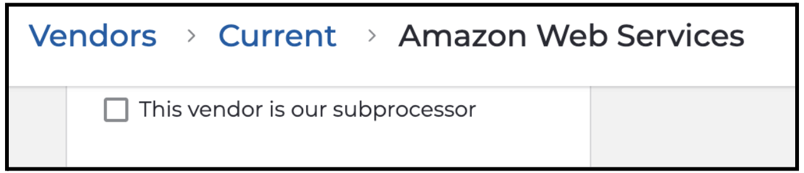

# What Is a Subprocessor?

Source: https://help.drata.com/en/articles/9792194-what-is-a-subprocessor
Collection: GRC Best Practices › Risk
Updated: 2025-08-14
Fetched: 2026-11-22
Description: An overview of how compliance frameworks use the term "subprocessor."

## Article text

## What Is a Subprocessor?

A **subprocessor** is any third-party vendor or service provider that your organization engages to perform certain tasks or services on your behalf, which involve processing, storing, or transmitting your customer’s personal data and/or customer data.

Subprocessors typically perform specific functions, such as cloud storage, payment processing, or email delivery, that require access to personal or sensitive information.

While the term “subprocessor” is not specifically defined in the General Data Protection Regulation (GDPR), it is widely used to describe third parties that process data on behalf of a data processor. This concept also applies to other privacy and security frameworks, such as CCPA, SOC 2, and ISO 27001, which also require careful monitoring of third-party data handling.

### Are All My Vendors Subprocessors?

No, not all of your vendors are considered subprocessors. A vendor is only classified as a subprocessor if they process personal data on behalf of your organization.

**Examples:**

- **Subprocessor:** Amazon Web Services (AWS) – A cloud service provider that stores and processes customer data.
- **Not a Subprocessor:** Office supply vendors or facility management services – These vendors provide services that do not involve the processing of customer data, e.g., Zoom.

### Why Do I Need to Know My Subprocessors?

Understanding who your subprocessors are and what data they process is critical for several reasons:

**Regulatory Compliance:**

- Under **GDPR (Article 28)**, you are required to inform your customers (data subjects) about any subprocessors that handle their personal data. This ensures transparency and proper data protection.
- Similarly, **CCPA (1798.130)** and** SOC 2 (CC3.1, CC3.2, CC3.3) **mandate clear documentation of data flows and how third parties manage sensitive information.

**Data Security & Risk Management:**

- Knowing who your subprocessors are helps you evaluate their security measures, reducing the risk of data breaches or compliance issues.
- It also enables you to perform proactive risk assessments and ensure their practices align with your security policies and standards.

**Data Flow Transparency:**

- It is important to know where your data is processed, stored, and transmitted. This understanding helps you assess cross-border data transfers, particularly when data moves to countries with different data protection laws.

### Your Organization’s Obligations When Engaging Subprocessors

When engaging subprocessors, your organization is responsible for ensuring they process personal data in compliance with GDPR, CCPA, SOC 2, ISO 27001, and other relevant frameworks. This includes:

**Data Processing Agreements (DPA):**

- A legally binding agreement or contract that outlines the subprocessors’ obligations regarding data handling, breach notifications, and compliance with applicable regulations.
   - Under GDPR Article 28(3) and CCPA 1798.140(v), a DPA is required.

**Due Diligence:**

- Evaluating the subprocessor’s security practices, certifications (such as ISO 27001 or SOC 2), and incident response procedures.
   - Framework requirement examples: ISO 27001 (Clause A.15.1.1) and SOC 2 (CC9.2)

**Ongoing Monitoring:**

- Regularly auditing and reviewing subprocessors to confirm they are upholding security controls and data protection measures.
   - Framework requirement examples: ISO 27001 (Clause A.15.2.1) and SOC 2 (CC9.4)

**Breach Notification Requirements:**

- Making sure subprocessors have effective processes to quickly report any unauthorized access or data breaches.
   - Framework requirement examples: GDPR (Article 33) and CCPA 1798.150

### Examples of Common Subprocessors

| **Sub Processor Examples** | **Service Provided** |
|---|---|
| Amazon Web Services (AWS), Google Cloud Services | Cloud Service Provider |
| Netsuite | Finance Management |
| SocketLabs | Email delivery solution |
| Stripe | Payment Processing |
| Cloudflare | Content Delivery Network (CDN) & Web Application Firewall (WAF) |
| Okta | Identity Management & Single Sign-On (SSO) |
| Salesforce | Customer Relationship Management (CRM) |

### How Do I Mark Our Subprocessors within Drata?

When adding a vendor in your [Vendor Directory](https://app.drata.com/risk/vendors), within the internal details, you can mark your vendor as a subprocessor by checking the “This vendor is our subprocessor” box.

For more information on subprocessors and Trust Center functionality in Drata, view our Help Center Article [here](https://help.drata.com/en/articles/8067443-subprocessors).

## Images

- [image 01] ../../images/ux/vendors/what-is-a-subprocessor--01.png

## Related articles

- [Frameworks](frameworks.md)
- [Example Evidence for Not Monitored Controls Linked to Policies](example-evidence-for-not-monitored-controls-linked-to-policies.md)
- [DCF Library Updates on 1/18/2024](dcf-library-updates-on-1-18-2024.md)
- [Scope Determination Checklist for Compliance Audits](scope-determination-checklist-for-compliance-audits.md)
- [Section 2: GRC Roles & Responsibilities](section-2-grc-roles-responsibilities.md)
