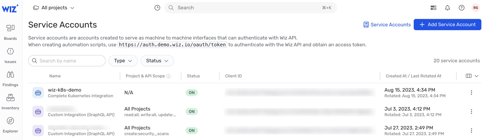

# Wiz Code Integration Guide (Vulnerability Scanning)

Source: https://help.drata.com/en/articles/11048914-wiz-code-integration-guide-vulnerability-scanning
Collection: Connection Support › Other Guidance
Updated: 2026-07-27
Fetched: 2026-11-22
Description: Instructions on how to generate credentials for Wiz Code and the required permissions.

## Article text

The Wiz Code integration enables security and compliance teams to connect Drata with Wiz for automated access to resource, vulnerability, and issue data. It connects Drata to Wiz Code so your team can continuously monitor cloud environments and gather compliance evidence from vulnerability scans and configurations.

## Key Capabilities

- **Automated Data Retrieval:** Connect to Wiz’s API to retrieve information about resources, vulnerabilities, and issues.
- **Granular Access Control:** Configure service accounts with scoped permissions to limit data exposure to specific projects.
- **Secure Authentication:** Authenticate through OAuth2 credentials (Client ID and Client Secret) for secure communication between Drata and Wiz.

## Prerequisites & Data Access

- You must have one of the following Drata roles: **Admin**, **Information Security Lead**, **DevOps Engineer**, or **Workspace Manager**.
- Access to the **Wiz dashboard** and permission to create **Service Accounts**.
- Required Wiz permissions:
   - `read:resources`
   - `read:vulnerabilities`
   - `read:issues`
- **Base URL:** Wiz Code Base URL (API endpoint in the format such as `https://api.us44.app.wiz.io/graphql`)

```
https://api..
```

- **Client ID** and **Client Secret** from Wiz (OAuth2 credentials).
   - Record the Client Secret securely. It cannot be viewed again after the credential window is closed.

### Permissions & Data Table

| **Permission / Scope** | **Why It’s Needed** | **Data Accessed (Read Only)** |
|---|---|---|
| **`read:resources`** | Allows Drata to retrieve the list of assets or resources scanned. | Asset and resource metadata. |
| **`read:vulnerabilities`** | Enables Drata to import vulnerability findings. | Vulnerability data including unique ID, title, description, severity level, discovery date, status (open/resolved), affected resource, and remediation due date. |
| **`read:issues`** | Allows Drata to access related issue or ticket information. | Issue or ticket data such as issue ID, title, description, status, assignee, creation and update timestamps, due date, and link (URL) to the ticket. |

## Step-by-Step Setup

### Step 1: Obtain Wiz Code Base URL

1. In the Wiz dashboard, navigate to your **user profile**.
2. Locate and copy the **API Endpoint URL**.

### Step 2: Obtain Client ID and Client Secret

1. In the Wiz dashboard, go to **Settings → Service Accounts**.
2. Click **Add Service Account**.
3. Enter a **name** for the new service account.
4. (Optional) Narrow the service account’s scope to specific projects.
5. Select the following permissions:
   - `read:resources`
   - `read:vulnerabilities`
   - `read:issues`
6. Click **Add Service Account**.
7. Copy the **Client ID** and **Client Secret**, and store the Client Secret securely (it cannot be viewed again once the window closes).



## Complete the Connection

In Drata’s **Connections** page, search for the **Wiz Code** connection and then:

1. **Select the following configurations:**
   - **Severity of vulnerabilities:** Choose the severity levels you want to import (Critical, High, Medium, Low).
   - **Date:** Select the date from which vulnerabilities should be pulled.
2. **Enter the following information:**

| **Drata Field** | **Wiz Code Value** |
|---|---|
| **Base URL** | `https://api.<TENANT_DATA_CENTER>.<ENVIRONMENT>` |
| **Client ID** | Your Wiz OAuth2 Client ID |
| **Client Secret** | Your Wiz OAuth2 Client Secret |

For steps on accessing and using the Connections page in Drata, refer to [The Connections Page in Drata](https://help.drata.com/en/articles/12305645-the-connections-page-in-drata).

Drata shows *findings*, which are instances of *vulnerabilities* (an individual but higher-level CVE) against specific resources. This may reflect as higher finding counts in Drata vs. your Wiz Code dashboard.

## Images

- [image 01] ../../images/integrations/wiz-code/wiz-code-integration-guide-vulnerability-scanning--01.png

## Related articles

- [Wiz (CSPM) Integration Guide](wiz-cspm-integration-guide.md)
- [Zelt Integration Guide](zelt-integration-guide.md)
- [CrowdStrike Falcon Exposure Management Integration Guide](crowdstrike-falcon-exposure-management-integration-guide.md)
- [Wiz (Vulnerability Scanning) Integration Guide](wiz-vulnerability-scanning-integration-guide.md)
- [Docebo Integration Guide](docebo-integration-guide.md)
