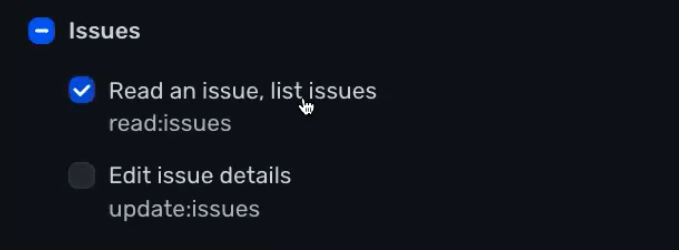
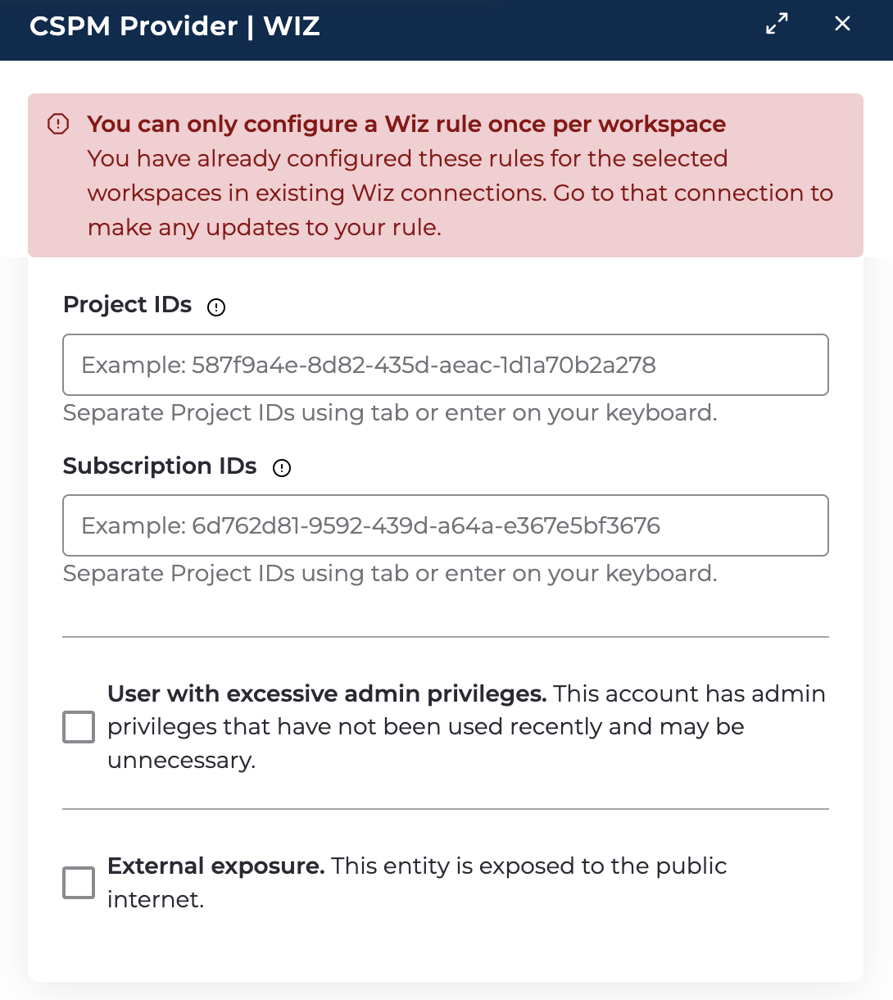
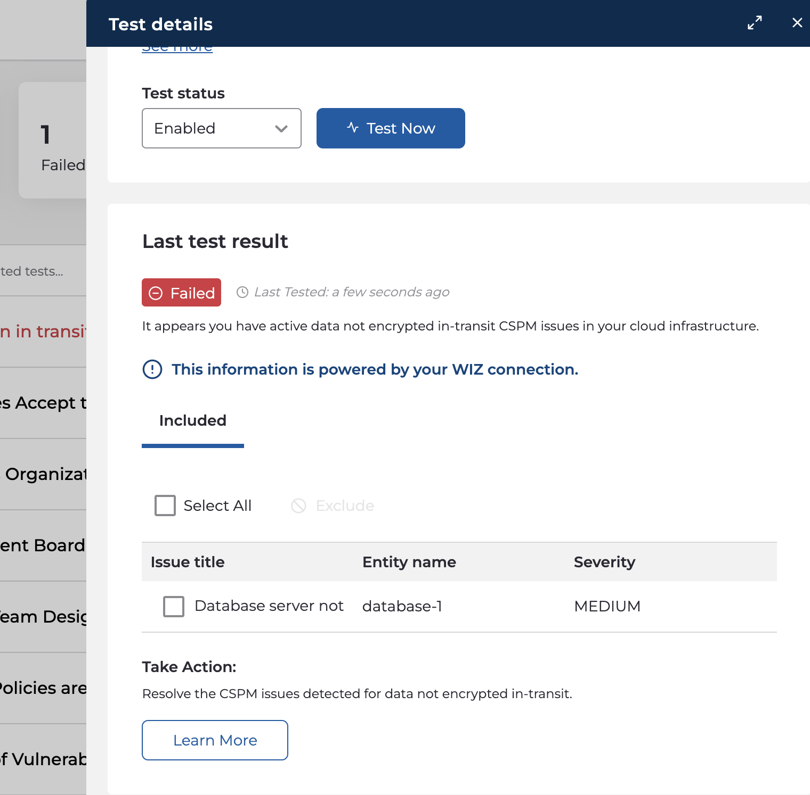

# Wiz (CSPM) Integration Guide

Source: https://help.drata.com/en/articles/8852067-wiz-cspm-integration-guide
Collection: Connection Support › Other Guidance
Updated: 2026-11-14
Fetched: 2026-11-22
Description: Learn how to connect Wiz to Drata and set up risk categories.

## Article text

Wiz is a CSPM (Cloud Security Posture Management) platform that continuously detects and remediates misconfigurations from build time to runtime across your hybrid clouds.

Connect Wiz to Drata to monitor security risks in your cloud infrastructure and display the current posture as evidence for your compliance.

## Prerequisites & Data Access

- Access to your **Wiz** tenant
- A **Wiz service account** created for API access
   A service account is required to generate the Client ID and Client Secret used for this connection.

### Permissions & Data Table

| Permission / Scope | Why It’s Needed | Data Accessed (Read Only) |
|---|---|---|
| `read:issues` | Required to retrieve Wiz issues for CSPM monitoring | Cloud security issues and metadata |

## Step-by-Step Setup

### Step 1: Create a Wiz service account

1. In Wiz, navigate to **Settings > Service Accounts**.
2. Create a new service account with the following configuration:
   - **Service account type:** Custom Integration (GraphQL API)
   - **Relevant projects:** Select applicable projects
   - **Permissions:** `read:issues`
   
3. Create the service account.

To learn how to create a Wiz service account, go to Wiz’s [Service Accounts](https://docs.wiz.io/wiz-docs/docs/service-accounts-settings#edit-permissions-for-a-service-account).

**Expected outcome:**
A Wiz service account is created.

---

### Step 2: Obtain the Server URL

1. In Wiz, navigate to **User Settings > Tenant**.
2. Copy the **API Endpoint URL**.

Ensure the URL ends with `/graphql`.

**Expected outcome:**
You have the Server URL required for the connection.

---

### Step 3: Connect Wiz in Drata

1. In Drata, navigate to **Connections**.
2. Select **Available connections**.
3. Choose the **CSPM** category or search for **Wiz**.
4. Click **Connect**.
5. In the connection drawer, enter:
   - Client ID
   - Client Secret
   - Server URL
6. Submit the connection.

**Expected outcome:**
The Wiz connection is successfully established. You can refer to [Wiz's documentation](https://app.wiz.io/login?redirect=%2Fwiz-docs%2Fdocs%2Fusing-the-wiz-api#the-graphql-endpoint) to learn more

## Configure and setup risk categories

After connecting Wiz to Drata, three (3) different Wiz issue risk categories are imported:

1. Not encrypted in-transit
2. External exposure,
3. Excessive privileges.

Each of these risk categories has pre-set filters so that the correct risk category can match the Wiz issue and have the following optional filters that the admins can add. Admins can also modify the Wiz connection, like adding another risk category.

- Pre-set filters:
   - **Search**: Name of risk category (for example: "Not encrypted in-transit” ).
   - **Status**: “Open”, ”InProgress”.

- Optional filters:
   - **Project IDs**: Add one or more Project Ids, separated by comma. If none are provided, Wiz issues from all projects are imported.
   - **Subscription IDs**: Add one or more Subscription Ids, separated by comma. If none are provided, Wiz issues from all subscriptions are imported.

### Workspace specific

Admins must create Wiz connections with different types of risk categories for each workspace.

For example, if an admin has already created a Wiz connection with ‘External exposure’ for Workspace1, you cannot create another Wiz connection on a different workspace with the same type of risk category. (View the error message in the following screenshot).

#### Multiple risk category in workspace

If you have multiple risk categories like "user with excessive admin privileges" and "external exposure", you can have another wiz connection in a different workspace with only "external exposure".

### Not encrypted in-transit risk category

**Test ID: **210

**Test name:** Encryption in transit

**Test description: **Drata collects data from your cloud security posture management (CSPM) software to determine if there are active issues related to data not being encrypted while in transit.

**Test logic (pass or fail): **If one or more issues exist, the test fails. Otherwise it passes.

**DCFs **: DCF-55

### User with excessive admin privileges risk category

**Test ID: **208

**Test name:** Excessive privileges assigned

**Test description: **Drata collects data from your cloud security posture management (CSPM) software to determine if there are active issues related to accounts with excessive administrative privileges.

**Test logic (pass or fail): **If one or more issues exist, the test fails. Otherwise it passes.

**DCFs**: DCF-59, DCF-326

### External exposure risk category

**Test ID: **209

**Test name:** External exposure for cloud resources

**Test description: **Drata collects data from your cloud security posture management (CSPM) software to determine if there are active issues related to external exposure of cloud resources.

**Test logic (pass or fail): **If one or more issues exist, the test fails. Otherwise it passes.

**DCFs**: DCF-85, DCF-218, DCF-75

### Risk categories

The 3 tests, 210, 208, and 209, have a default 'unused' state until a Wiz connection is created with the related risk category.

## Auto-pilot sync

**Note**: Wiz issues are imported into Drata once every 24 hours as part of the auto-pilot sync.

After Wiz connection is set up, the Auto-pilot syncs. Drata can import up to 200 Wiz issues for each configured risk category. The corresponding tests are triggered and can pass if no issues were detected, otherwise will fail. If the test fails, the test drawer displays the list of Wiz issues (as shown in the following image).

Admins are able to exclude and re-include Wiz issues in the test drawer on the Monitoring page.

## Delete the Wiz connection

You can delete the Wiz connection by going to the Connection page and selecting the trash icon on the drawer for the Wiz connection. All of the corresponding test for the Wiz connection will have an ‘Unused’ state for that workspace.

## Images

- [image 01] ../../images/integrations/wiz/wiz-cspm-integration-guide--01.png
- [image 02] ../../images/integrations/wiz/wiz-cspm-integration-guide--02.png
- [image 03] ../../images/ux/monitoring/wiz-cspm-integration-guide--03.png

## Related articles

- [Test 209: External Exposure of Cloud Resources](test-209-external-exposure-of-cloud-resources.md)
- [Aikido Integration Guide](aikido-integration-guide.md)
- [Zoho Desk Integration Guide (Ticketing & UAR)](zoho-desk-integration-guide-ticketing-uar.md)
- [Wiz Code Integration Guide (Vulnerability Scanning)](wiz-code-integration-guide-vulnerability-scanning.md)
- [Wiz (Vulnerability Scanning) Integration Guide](wiz-vulnerability-scanning-integration-guide.md)
