# Workday Integration Guide (HRIS)

Source: https://help.drata.com/en/articles/5523237-workday-integration-guide-hris
Collection: Connection Support › Other Guidance
Updated: 2026-09-14
Fetched: 2026-11-22
Description: Making the initial connection to Workday.

## Article text

Connecting Workday to Drata allows for automated checks and evidence collection to provide details on personnel hire and separation dates as well as their employment status.

## Key Capabilities

- **Personnel synchronization:** Syncs employment status, hire dates, and key personnel attributes from the HRIS.
- **Lifecycle classification:** Uses HRIS data to detect hire and termination events that support onboarding and offboarding compliance requirements.
- **Read-only ingestion:** Retrieves HR data using read-only access without modifying information in the HRIS system.

## Prerequisites & Data Access

Before setting up the Workday connection in Drata, make sure you have the required credentials and the appropriate Drata permissions.

### Choose an Authentication Method

You can connect to Workday using either of the following authentication methods:

1. **Use my credentials (recommended)**: Uses an Integration System User for authentication. If using "*Use my credentials (recommended)*", you must provide the following:
   - **WSDL**
   - **Workday Tenant Name**
   - **ISU Username**
   - **ISU Password**
2. **OAuth Credentials**: Uses OAuth tokens and client credentials. If Using OAuth Credentials, you must provide the following:
   - **WSDL**
   - **Workday Tenant Name**
   - **Client ID**
   - **Client Secret**
   - **Refresh Token**
   - **Token Endpoint**

---

**Required Permissions**

- Must be a Workday Admin.
- Must be assigned one of the following Drata roles: **Admin, Workspace Managers, DevOps Engineer**.
- If you have the **Access Reviewer** Drata role, you can only view the Connections page.

## Step-by-Step Setup

### Step 1: Select a Connection Method

Choose how you want to authenticate with Workday. You can connect using either:

- **Use my credentials (recommended)** — Uses an Integration System User (ISU) for authentication.
- **OAuth Credentials** — Uses OAuth client credentials and tokens.

The setup steps will vary depending on the method you select.

---

## Step-by-Step Setup (For those who use credentials)

### Step 1: Create an Integration System User (ISU)

1. In your Workday portal, log into the **Workday tenant**
2. In the **Search** field, type **Create Integration System User**
3. Select the **Create Integration System User** task
   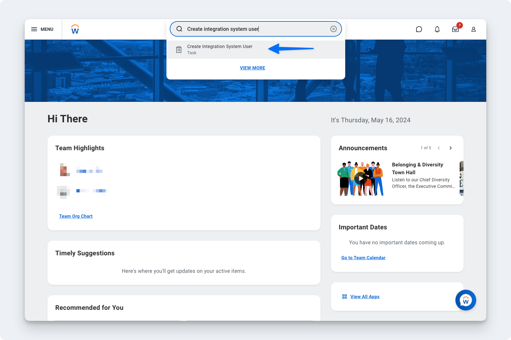
4. On the **Create Integration System User** page, in the **Account Information** section, enter a user name, and enter and confirm a password
   - **Important:"&", "", or ">"** characters **cannot **be included in the password
5. Click **OK**
   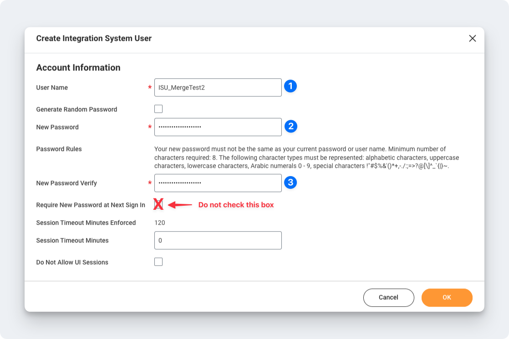
6. To ensure the password doesn't expire, you'll want to add this new user to the list of System Users.
   - To do this, search for the **Maintain Password Rules** task.
      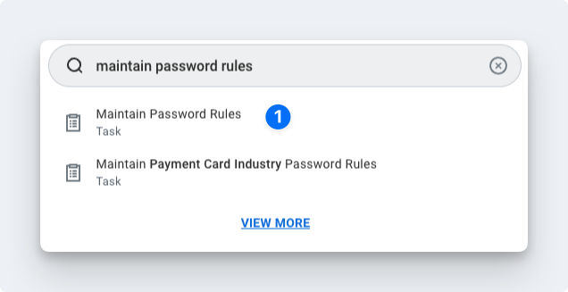
7. Add the ISU to the **System Users exempt from password expiration** field
   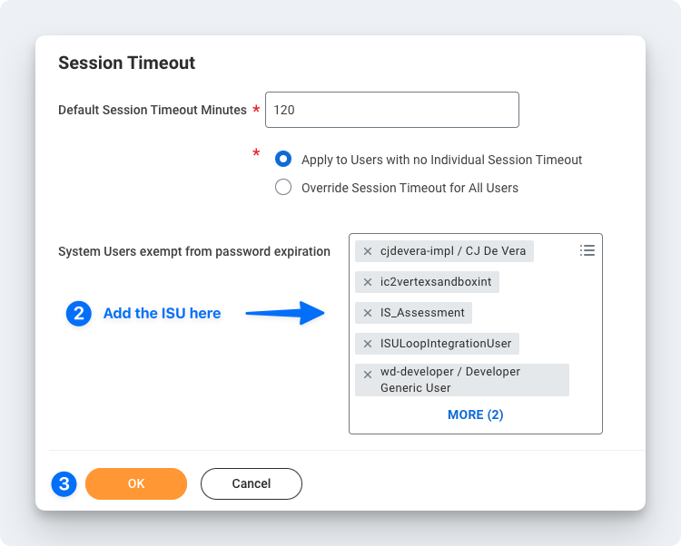
8. Enter the** Integration System Username** in the connection flow or Save the** Integration System Username** and** password**. You will need it during the connection process.

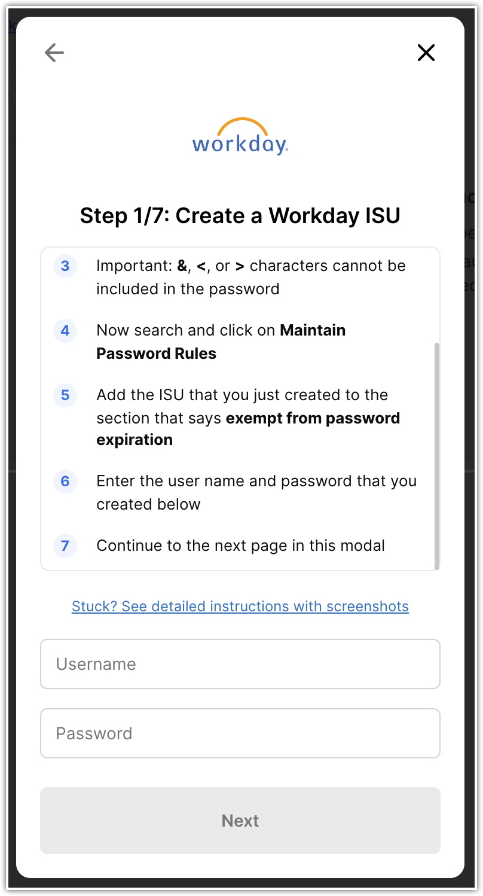

### Step 2: Create a Security Group and assign an Integration System User

1. In the **Search** field, type **Create Security Group.**
   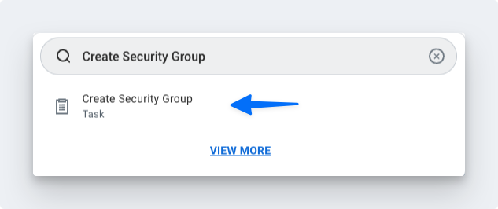
2. Select the **Create Security Group** task.
3. On the Create Security Group page, select **Integration System Security Group (Unconstrained)** from the Type of Tenanted Security Group pull-down menu.
   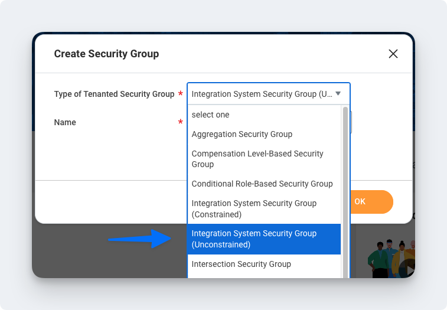
4. In the **Name** field, enter a name and select **OK.**
5. On the Edit Integration System Security Group (Unconstrained) page, in the **Integration System Users** field, enter the same name you entered when creating the ISU in the first section
   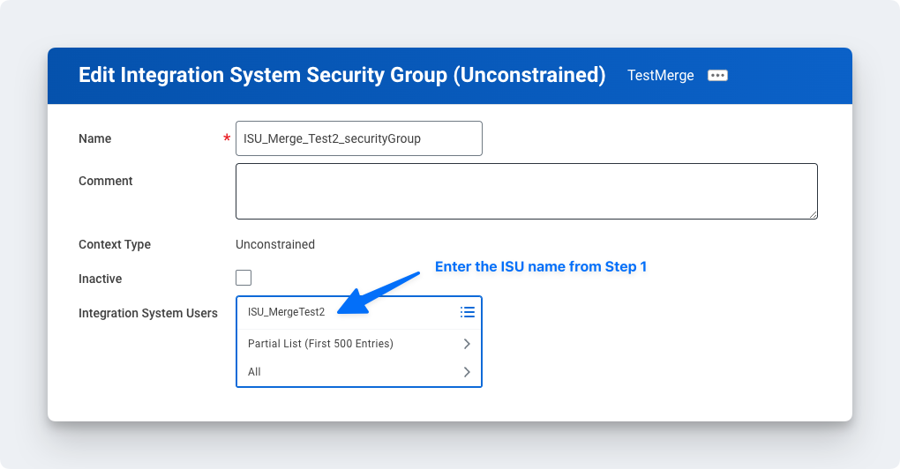
6. Click **OK**

**Expected outcome:**
The ISU is assigned to a security group that will control its access.

### Step 3: Configure domain security policy permissions

1. In the **Search** field, type **Maintain Permissions for Security Group**
   
2. Make sure the Operation is **Maintain**, and the **Source Security Group **is the same as the security group that was assigned in Step 2
   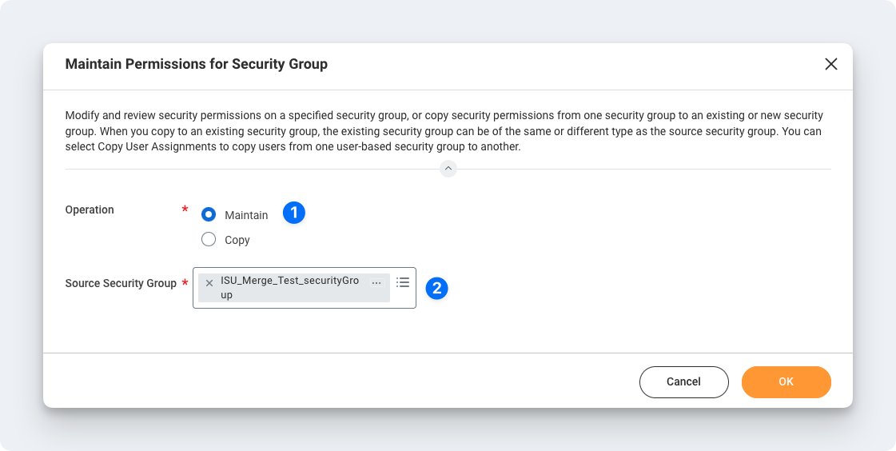
3. On the next screen, add the corresponding **Domain Security Policies **depending on your use case**:**

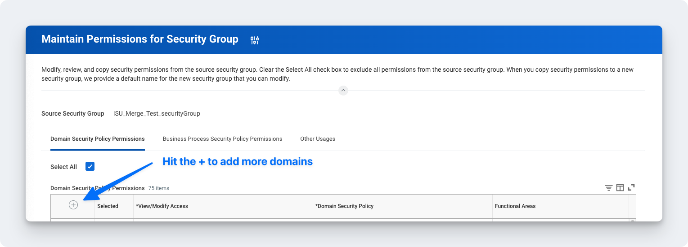

Note:

- If you are connecting to **Workday HRIS**: Follow the [Workday HRIS Permissions](https://help.merge.dev/en/articles/9176420-workday-what-permissions-do-i-need-for-hris-data) guide. **The permissions guide may list more data points than Drata requires.**
   - Drata enables access to employee information such as name, work email, employment status, hire date, start date, termination date, manager, team, groups, and employee number.
   - Drata does not request or store sensitive data such as Social Security numbers, dates of birth, ethnicity, gender, home location, marital status, phone numbers, pay groups, or work locations. Personal email addresses may be used to match personnel across integrations but are not displayed in Drata profiles.
- If you are connecting to **Workday ATS (Recruiting):  **Follow our [ATS (Recruiting) Permissions](https://help.merge.dev/en/articles/9176442-workday-what-permissions-do-i-need-for-ats-data) guide

### Step 4: Activate security policy changes

1. In the search bar, type** "Activate Pending Security Policy Changes"** to view a summary of the changes in the security policy that needs to be approved
   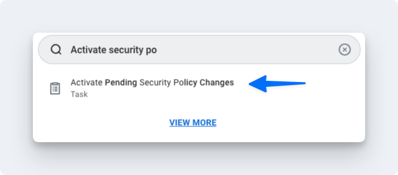
2. Add any relevant comments on the window that pops up
3. **Confirm** the changes in order to accept the changes that are being made and hit **OK**
   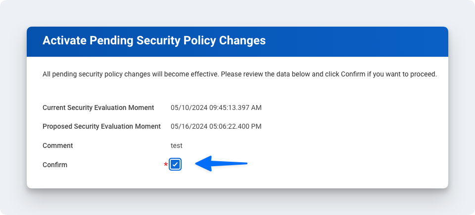

### Step 5: Validate the authentication policy is sufficient

1. Search for **Manage Authentication Policies**
   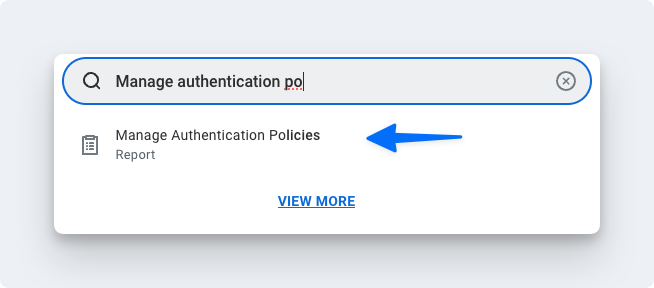
2. Click **Edit** on the authentication policy row
   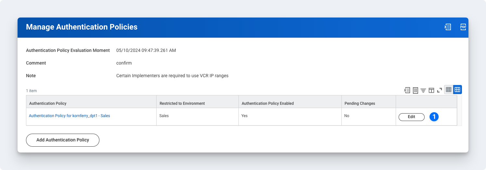
3. Create an Authentication Rule
   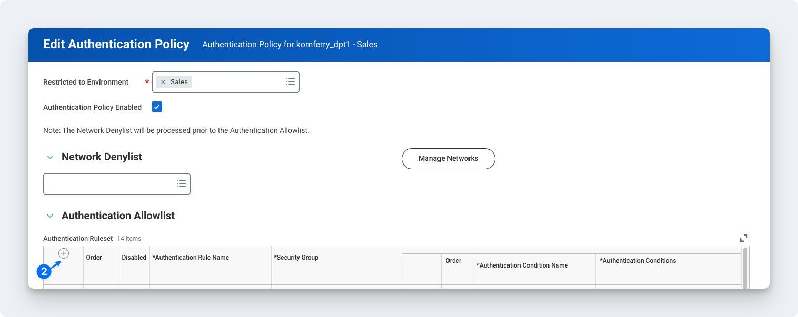
4. Enter a name, add the Security Group, and ensure **Allowed Authentication Types** is set to Specific **User Name Password **or **Any**
   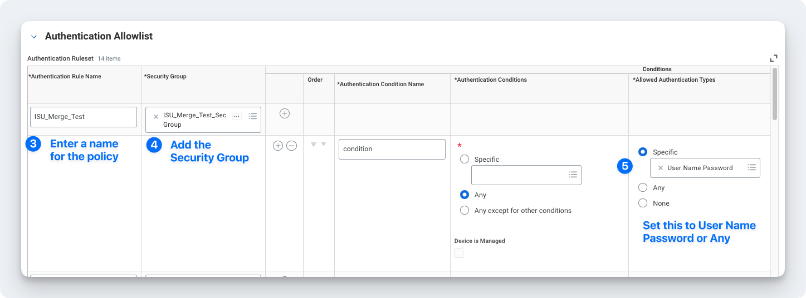

Note: You don't have to create a new Authentication Rule if you already have an existing one set to **User Name Password **or **Any. **You can add the ISU you created to that rule instead.

You will need to create a new rule if **SAML** is the only Authentication Rule you see for "Allowed Authentication Types."

### Step 6: Activate all pending authentication policy changes

1. In the search bar type, **activate all pending authentication policy changes**
   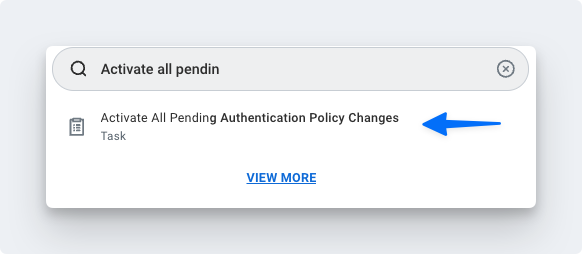
2. Proceed to the next screen and **confirm** the changes. This will save the **Authentication Policy **that was just created or edited

### Step 7: Obtain the web services endpoint URL

1. Search in Workday for **Public Web Services**
   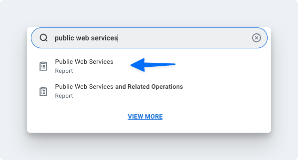
2. Find **Human Resources (Public) **if you are connecting **Workday HRIS**.
3. Find **Recruiting** if you are connecting **Workday ATS**.
4. Click the **three-dot menu (⋯)** to open the options menu, then select **Web Services → View WSDL**.
   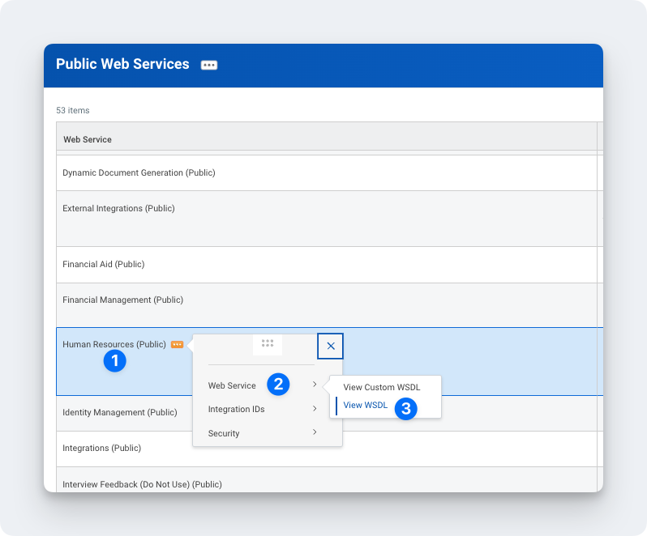
5. Navigate to the bottom of the page that opens (it may take a few seconds to load)
6. Copy the** full URL **provided under** Human_ResourcesService** (Workday HRIS) or **RecruitingService** (Workday ATS).
   - The URL will have a format similar to `https://wd2-impl-services1.workday.com/ccx/service/acme/Human_Resources/v43.0`
      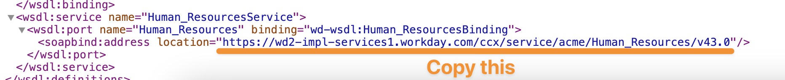
7. Enter the **Web Services Endpoint URL** into the connection flow.
   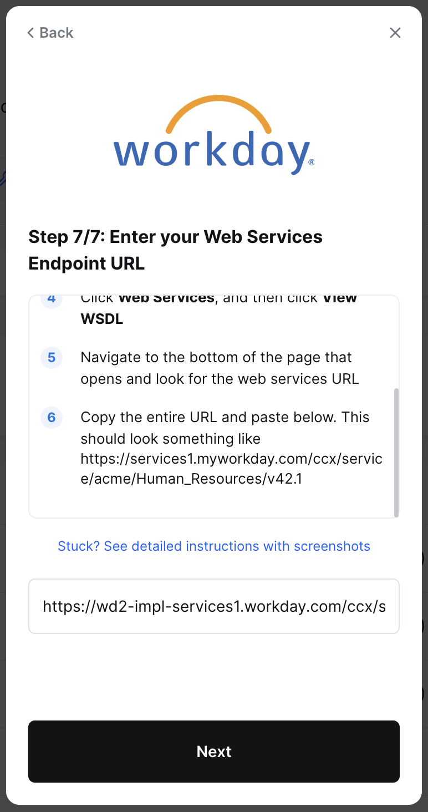

---

## Step-by-Step Setup (Using OAuth Credentials)

### Step 1: Obtain the web services endpoint URL

1. Search in Workday for **Public Web Services**
   
2. Find **Human Resources (Public) **if you are connecting **Workday HRIS**.
3. Click the **three-dot menu (⋯)** to open the options menu, then select **Web Services → View WSDL**.
   
4. Navigate to the bottom of the page that opens (it may take a few seconds to load)
5. Copy the** full URL **provided under** Human_ResourcesService** (Workday HRIS). The URL will have a format similar to `https://wd2-impl-services1.workday.com/ccx`
   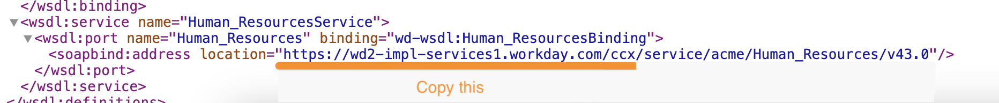
6. Enter the **Web Services Endpoint URL prefix **into the connection flow.

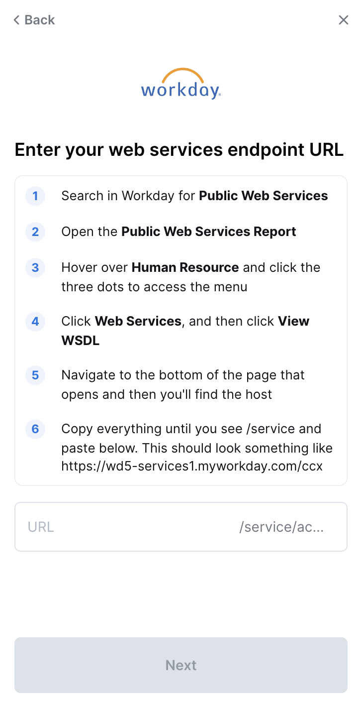

### Step 2: Enter in your tenant name (subdomain)

1. From the web services URL find your **tenant name**. In this example, the value is "acme"
   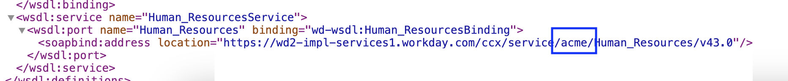
2. Enter the **tenant name** into the connection flow.
   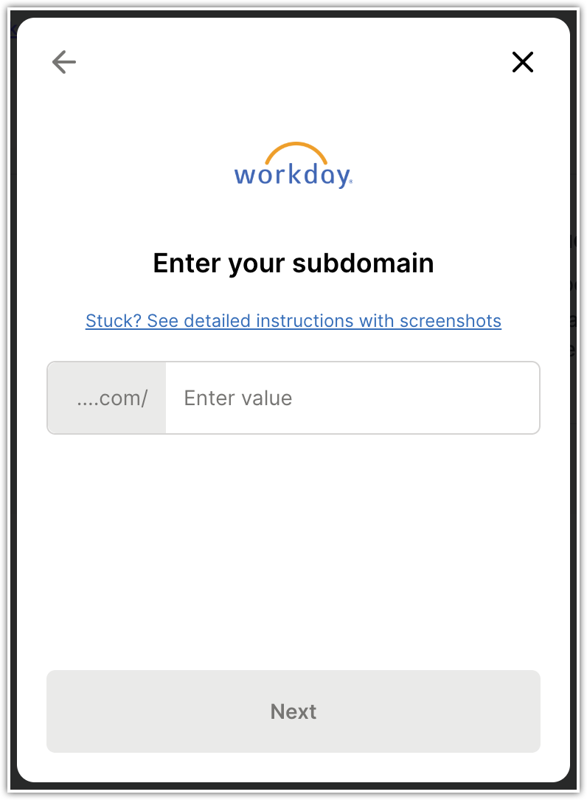

### Step 3: Register a new API Client for Integrations

1. In the **Search** field, select the **Register API Client for Integrations (Task)**.
   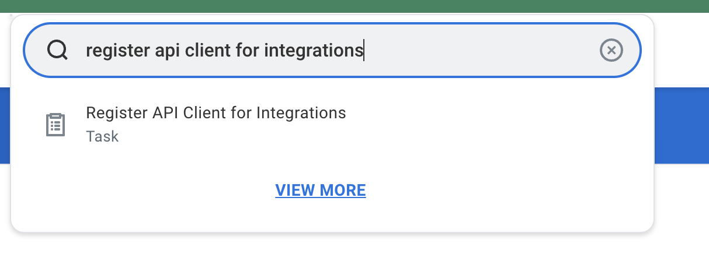
2. On the **Register API client for Integrations** page,
   - In the **Client Name** field, enter a name for the client.
   - Select **Non-Expiring Refresh Tokens**.
   - Enable **Include Workday Owned Scope**.
   - In **Scope (Functional Areas)**, select the following:
      - **Staffing**
      - **Public Data**
      - **Tenant Non-Configurable**
      - **Time Off and Leave** *(required only if you need access to Time Off data)*
      - **Contact Information**
   - 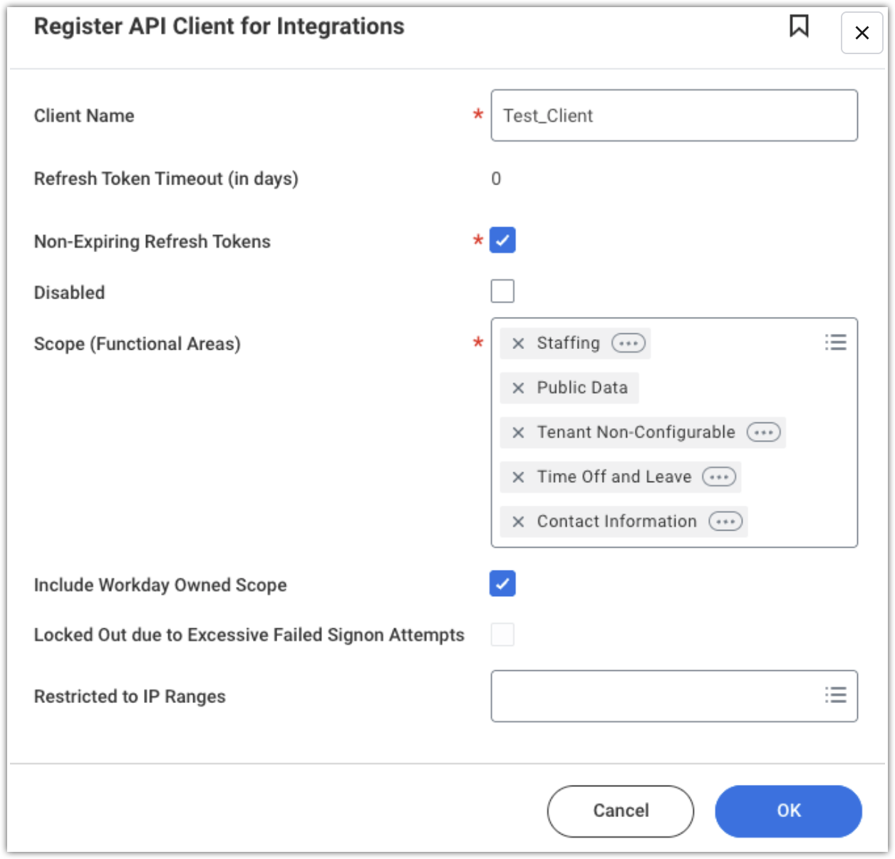
3. Click **Ok**. Save the **Client Secret** and **Client ID**. Click **Done.**
4. Enter the **Client Secret** and **Client ID** to the connection flow.

### Step 4: Generate a non-expiring Refresh Token

1. In the **Search** field, select **View API Client**.
   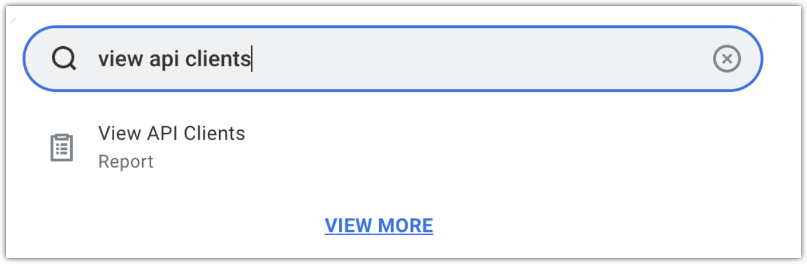
2. On the **View API Clients** page, click the **API Clients for Integrations** tab. Save your **Token Endpoint**.
   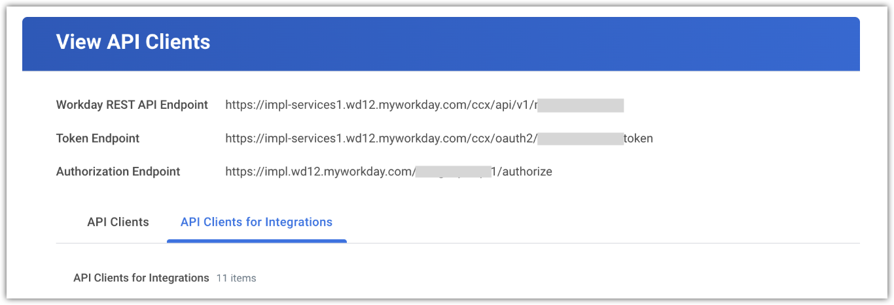
3. Click the client you created in previous step (**[Step 3: Register a new API Client for Integrations](#h_7f0fe19498))**
4. Open the three dots > API Client **> **Click on** Manage Refresh Tokens for Integrations**
   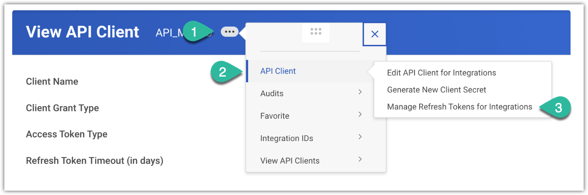
5. On the **Manage Refresh Tokens for Integrations** page, in the **Workday Account** field add a user. Save your **Refresh Token**.
   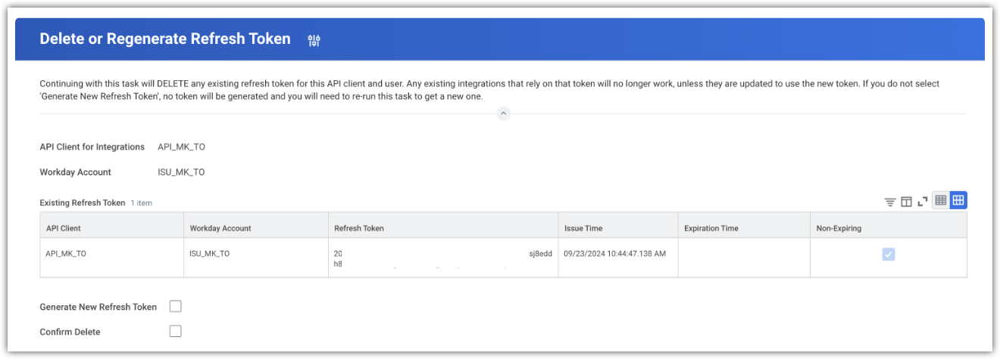
6. Add your **Token URL** and **Refresh Token** to the connection flow.

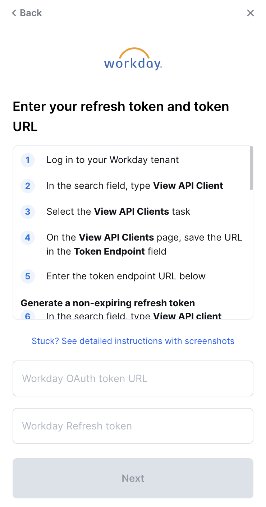

7. Click **Submit**

## Images

- [image 01] ../../images/integrations/workday/workday-integration-guide-hris--01.png
- [image 02] ../../images/integrations/workday/workday-integration-guide-hris--02.png
- [image 03] ../../images/integrations/workday/workday-integration-guide-hris--03.png
- [image 04] ../../images/integrations/workday/workday-integration-guide-hris--04.png
- [image 05] ../../images/integrations/workday/workday-integration-guide-hris--05.png
- [image 06] ../../images/integrations/workday/workday-integration-guide-hris--06.png
- [image 07] ../../images/integrations/workday/workday-integration-guide-hris--07.png
- [image 08] ../../images/integrations/workday/workday-integration-guide-hris--08.png
- [image 09] ../../images/integrations/workday/workday-integration-guide-hris--09.png
- [image 10] ../../images/integrations/workday/workday-integration-guide-hris--10.png
- [image 11] ../../images/integrations/workday/workday-integration-guide-hris--11.png
- [image 12] ../../images/integrations/workday/workday-integration-guide-hris--12.png
- [image 13] ../../images/integrations/workday/workday-integration-guide-hris--13.png
- [image 14] ../../images/integrations/workday/workday-integration-guide-hris--14.png
- [image 15] ../../images/integrations/workday/workday-integration-guide-hris--15.png
- [image 16] ../../images/integrations/workday/workday-integration-guide-hris--16.png
- [image 17] ../../images/integrations/workday/workday-integration-guide-hris--17.png
- [image 18] ../../images/integrations/workday/workday-integration-guide-hris--18.png
- [image 19] ../../images/integrations/workday/workday-integration-guide-hris--19.png
- [image 20] ../../images/integrations/workday/workday-integration-guide-hris--20.png
- [image 21] ../../images/documentation/workday-integration-guide-hris--21.png
- [image 22] ../../images/integrations/workday/workday-integration-guide-hris--22.png
- [image 23] ../../images/integrations/workday/workday-integration-guide-hris--19.png
- [image 24] ../../images/integrations/workday/workday-integration-guide-hris--20.png
- [image 25] ../../images/documentation/workday-integration-guide-hris--25.png
- [image 26] ../../images/integrations/workday/workday-integration-guide-hris--26.png
- [image 27] ../../images/documentation/workday-integration-guide-hris--27.png
- [image 28] ../../images/integrations/workday/workday-integration-guide-hris--28.png
- [image 29] ../../images/integrations/workday/workday-integration-guide-hris--29.png
- [image 30] ../../images/integrations/workday/workday-integration-guide-hris--30.png
- [image 31] ../../images/integrations/workday/workday-integration-guide-hris--31.png
- [image 32] ../../images/integrations/workday/workday-integration-guide-hris--32.png
- [image 33] ../../images/integrations/workday/workday-integration-guide-hris--33.png
- [image 34] ../../images/integrations/workday/workday-integration-guide-hris--34.png
- [image 35] ../../images/integrations/workday/workday-integration-guide-hris--35.png

## Related articles

- [KarmaCheck Integration Guide](karmacheck-integration-guide.md)
- [Rippling Integration Guide (HRIS, MDM, UAR)](rippling-integration-guide-hris-mdm-uar.md)
- [HR Cloud Integration Guide](hr-cloud-integration-guide.md)
- [Workday Learning Integration Guide](workday-learning-integration-guide.md)
- [Lattice HRIS Integration Guide](lattice-hris-integration-guide.md)
