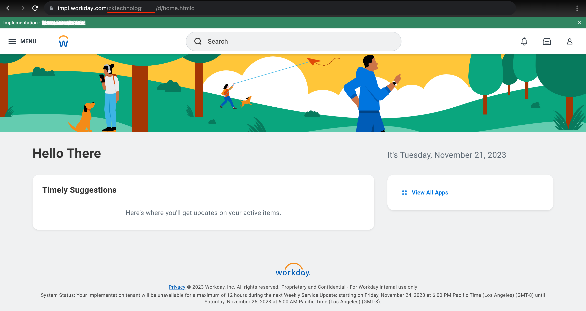
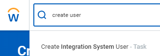
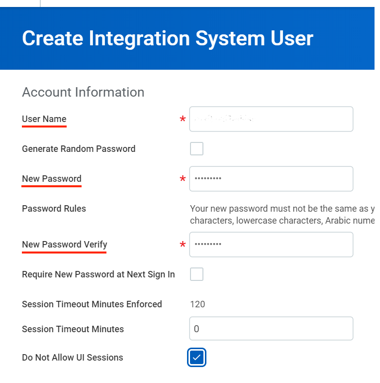

# Workday Learning Integration Guide

Source: https://help.drata.com/en/articles/12591173-workday-learning-integration-guide
Collection: Connection Support › Other Guidance
Updated: 2026-06-30
Fetched: 2026-11-22

## Article text

Connecting Workday Learning to Drata enables evidence collection and monitoring for learning- and training-related compliance requirements.

## Prerequisites

- Admin privileges for your Workday account
- Ability to create an Integration System User (ISU)
- Approval rights for security policy changes

## Step-by-Step Setup

### Step 1: Find Your Workday Tenant

1. Your Workday tenant is included in the URL you use to access Workday.
   - **Example: **`https://wd2-impl.workday.com/<tenant-name>`
2. Copy the tenant name.



**Expected outcome:** You have your Workday tenant name ready for the Drata connection setup.

### Step 2: Find the Web Services Endpoint

Drata requires the Workday Learning web service endpoint (WSDL) to establish the integration. To locate it:

1. In Workday, open the **Public Web Services** report.
2. Locate the **Learning (Public)** service.
3. Select the **ellipsis menu (⋯)** then choose **Web Service → View WSDL**
4. In the WSDL file, search for `wsdl:service` or scroll to the bottom
   
5. Find the `location` URL, which will look similar to:
   ```

   ```
6. Copy the URL **up to `/service/`**, excluding the `https://` prefix.
   For example:
   ```
wd2-impl-services1.workday.com/ccx
   ```

**Expected outcome**: You have the correct Learning web services endpoint required to complete the integration.

### Step 3: Set up an Integration System User

1. In Workday, search for Create Integration System User
   
2. Enter a username and password
   - Your password can include letters, numbers, exclamation marks (!), and commas (,). Other special characters aren't supported.
      
3. Select OK.

### Step 4: Add the Integration System User to a Security Group

1. In the Workday search field, search for and select **Create Security Group**.
2. On the **Create Security Group** page:
   - From the **Type of Tenanted Security Group** drop-down menu, select **Integration System Security Group**.
   - Enter a name in the **Name** field.
3. Click **OK**.
4. On the **Edit Integration System Security Group (Unconstrained)** page:
   - Enter the same name you used when creating the Integration System User (ISU) in the previous step.
5. Click **OK**.

**Expected outcome:** The Integration System User is now associated with an Integration System Security Group and ready for permission configuration.

### Step 5: Configure Domain Security Policy Permissions

1. Edit the **Domain Security Policy Permissions** for the Integration System Security Group.
2. For each domain listed below, add the **Get Only** operation (or **Get** where applicable) to enable integration with the **Learning Core** in Workday.

**Important:** Drata’s Workday Learning integration requires **GET-only** permissions for all listed domains. Drata does **not** require PUT or other write permissions to fetch worker records, enrollments, or course data.

| Category | Required Permissions |
|---|---|
| **Learning** | - Set Up: Learning Catalog <br>- Reports: Learning Record <br>- Manage: Learning Content |
| **Person Data** | - Personal Data (**Get only**) <br>- Name (**Get only**) <br>- Public Work Phone Integration (**Get only**) |
| **Worker Data** | - Work Contact Information (**Get only**) <br>- Work Email (**Get only**) <br>- Work Phone (**Get only**) <br>- Public Worker Records (**Get only**) |

**Note:**

- GET access is required for evidence collection and monitoring

### Step 6: Approve the Security Policy Changes

1. In Workday, search for and select **Activate Pending Security Policy Changes**
2. Review the pending changes
3. Approve to activate the policies

### Step 7: Connect Workday Account to Drata

1. In Drata, navigate to **Connections**
2. Select **Workday**
3. Enter your Tenant and Integration System User credentials

After your account is connected, you’ll configure how Workday learning content is accessed during training workflows.

### Requires Enrollment Setting

Workday allows organizations to control whether users must be enrolled in a course before accessing its content. This setting determines how Drata interacts with Workday Learning when assigning or tracking training.

You can select whether to turn this on or off via the **Requires Enrollment** field in the account linking step.

- **Require Enrollment: Yes (Default): **Matches Workday’s default behavior. Users must be enrolled in a course before they can access the content.
- **Require Enrollment: No: **Allows users to access course content without first enrolling.
   Troubleshooting

If you are having trouble linking an account or syncing learning data, it may be due to the permissions configuration. Please check the correct permissions are configured for GET of Learning Content and Learning Records.

## Images

- [image 01] ../../images/integrations/workday-learning/workday-learning-integration-guide--01.png
- [image 02] ../../images/documentation/workday-learning-integration-guide--02.png
- [image 03] ../../images/integrations/workday-learning/workday-learning-integration-guide--03.png
- [image 04] ../../images/integrations/workday-learning/workday-learning-integration-guide--04.png

## Related articles

- [Azure Integration Guide](azure-integration-guide.md)
- [Workday Integration Guide (HRIS)](workday-integration-guide-hris.md)
- [Huntress (Security Training) Integration Guide](huntress-security-training-integration-guide.md)
- [Workday Implementation Best Practices](workday-implementation-best-practices.md)
- [Microsoft Intune Integration guide](microsoft-intune-integration-guide.md)
