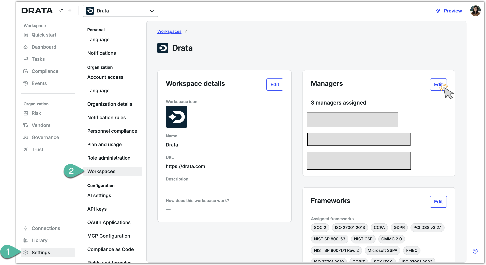

# Workspace Manager overview

Source: https://help.drata.com/en/articles/13603882-workspace-manager-overview
Collection: Settings › Role Administration
Updated: 2026-11-14
Fetched: 2026-11-22

## Article text

> ⚠️ **The Workspace Manager role cannot be combined with other roles in the same workspace.** When you assign a user the Workspace Manager role, **any other roles they hold in that workspace are automatically removed**.
>
> Note: A user can hold the Workspace Manager role in one workspace while having different roles in other workspaces.

The **Workspace Manager** role is designed for users who manage day-to-day compliance work **within specific workspaces**. Workspace Managers can oversee compliance activities only in the workspace(s) they are assigned to.

## Prerequisites

Before you can assign Workspace Managers, the following requirements must be met:

- **Workspaces must be enabled** in your Drata account
- Workspaces is an **add-on feature**
- Contact your account manager to enable Workspaces
- Only **Admins** can assign or remove Workspace Managers

## Assign a Workspace Manager

Admins can assign Workspace Managers through the Workspaces settings.

1. Go to **Settings → Workspaces**
2. Select the workspace you want to manage
3. In the **Managers** section, select **Edit**
4. Add or remove Workspace Managers as needed
   - Before assigning someone as a Workspace Manager, go to Settings > Role Administration and confirm that the user doesn't have a role assigned. If they do, remove those roles first.
5. (Optional) Enable **Read-only** permission
6. Select **Save**

 (links to https://downloads.intercomcdn.com/i/o/am69aeco/2068888054/87938327fd31fe7f912664f473ae/image.png?expires=1780120800&signature=f8c7fad3bbe6b1a1a3a60966748d5ff796033822d566f2a4831aaf478747e1f0&req=diAhHsF2lYFaXfMW3nq%2BgaptTcOOWbgCraVTzsat1BSLAdvGeHHsbCYW0mxa%0AcNTSDdMOYxWQNv4tWYJ6%2FFDutCM%3D%0A)

From this page, you can also update existing Workspace Managers, assign read-only permissions, or remove them as workspace managers.

**Notes:**

- You can assign multiple Workspace Managers to the same workspace
- A workspace does not require a Workspace Manager

## Read-Only Workspace Managers

Workspace Managers can optionally be granted **read-only access** if they should view or download information without making changes.

The table below summarizes common Workspace Manager permissions. Actual access may vary depending on enabled features and configuration.

| Permission | Standard | Read-only |
|---|---|---|
| View workspace pages (Dashboard, Controls, Frameworks, Monitoring, Audits, and more) | ✅ Yes | ✅ Yes |
| Download reports and evidence from Events, Evidence, and Audits | ✅ Yes | ✅ Yes |
| Create and edit controls | ✅ Yes | ❌ No |
| Edit frameworks and requirement scope (including custom frameworks) | ✅ Yes | ❌ No |
| Run monitoring tests and manage notifications | ✅ Yes | ❌ No |
| View events and download test evidence for their workspace(s) | ✅ Yes | ✅ Yes |
| Upload or edit evidence | ✅ Yes | ❌ No |
| Manage audits (assign auditors, send requests, create audits) | ✅ Yes | ❌ No |
| Complete and assign risk assessments | ✅ Yes | ❌ No |
| Manage risks | ✅ Yes | ❌ No |
| Manage vendors | ✅ Yes | ❌ No |
| Manage assets | ✅ Yes | ❌ No |
| View and edit personnel records | ✅ Yes | ❌ No |
| Create, edit, and manage policies | ✅ Yes | ❌ No |
| View connections that are workspace aware and re-sync findings | ✅ Yes | ❌ No |
| Create and manage tickets for controls and tests (if ticketing write access is enabled) | ✅ Yes | ❌ No |
| Create and manage tasks in their assigned workspace(s) | ✅ Yes | 👀 Yes, View only |
| Manage company-level workspace settings (create/delete workspaces, assign managers, configure frameworks) | ❌ No (Admin only) | ❌ No |

## Images

- [image 01] ../../images/ux/workspaces/workspace-manager-overview--01.png

## Related articles

- [Role Administration & RBAC](role-administration-rbac.md)
- [Create, Edit, and Manage Controls](create-edit-and-manage-controls.md)
- [Configure Workspace Details, Frameworks, and Connections](configure-workspace-details-frameworks-and-connections.md)
- [Roles and permissions overview (New Experience)](roles-and-permissions-overview-new-experience.md)
- [Section 5: Policy Owners](section-5-policy-owners.md)
