# Workspace ONE MDM Integration Guide

Source: https://help.drata.com/en/articles/7068294-workspace-one-mdm-integration-guide
Collection: Connection Support › Other Guidance
Updated: 2026-08-05
Fetched: 2026-11-22

## Article text

Having secure devices plays a major role in meeting compliance requirements. We want to support as many Mobile Device Management solutions (MDMs) as possible, in addition to providing our agent. We have heard from many of you that you use VMware Workspace ONE. This article goes over how to sync & bring all of your compliance-related information from Workspace ONE to Drata.

## Prerequisites & Data Access

1. Make sure you have admin access to your company's Workspace ONE account.
2. We currently only support desktop services. Mobile and tablet devices are not supported.
3. Only one configuration source per machine will be read, with the Drata agent taking precedence.
4. Prior to connecting Workspace ONE in Drata, please **contact your Workspace ONE** rep to ask them which access token URL is relevant for your organization. More info on the access token URL can be found in this [VMWare](https://kb.vmware.com/s/article/76967) article.
5. Mobile Device Management is not offered for the Workspace ONE Employee Essentials and Desktop Essentials plans. Please ensure your organization is using a plan that has MDM capabilities. We recommend Workspace ONE UEM.
6. For Windows devices, you need to set up compliance policies (shown below). Please make sure the names **exactly match** the names we mention in the below steps, otherwise Drata cannot sync the data.
7. For MacOS devices, you only need to set up a profile to verify that the user has a screen lock (with password) enabled. The other compliance checks (disk encryption, auto updates, password manager, and antivirus) come automatically when you set up the connection – there is no configuration on your end needed.
8. WorkspaceONE cannot natively pick up browser extensions, so if those are being used as a password manager, that compliance check will fail. Your users will need to use the equivalent installed desktop application. Ensure that this app shows on the device's Application List.

**Compliance Note**

At this time, Drata’s device compliance checks using the Workspace ONE connection confirms the following:

1. Does the policy of the required name and/or type exist?
2. Is that policy mapped to the device?
3. Is that device compliant with that policy?

If all three of the above criteria are met, Drata will show that device as passing.

### Permissions & Data Table

| Permission/Scope | Why It’s Needed | Data Accessed (Read Only) |
|---|---|---|
| Devices: Read | Allows Drata to retrieve device details and compliance states | Device inventory and compliance data |
| Groups: Read | Enables Drata to pull group identifiers for device mapping | Device group associations |
| Profiles: Read | Allows Drata to verify device profile configurations | Profile and policy assignments |
| Access Token URL | Generates OAuth tokens for Workspace ONE API access | Authentication endpoint for API calls |

## Step-by-Step Setup

### Step 1: Gather Connection Information

- Server URL: In Workspace ONE, different clients have different API sub domains (depending on the location) or custom domains
- Authentication URL: Same behavior as Server URL, and has a dependency on the location of your data in Workspace ONE
- Client Key: OAuth enabled with minimal permission
- Client Secret: OAuth enabled with minimal permission
- Account ID: This is a manual input field. You can add any identifier you like.

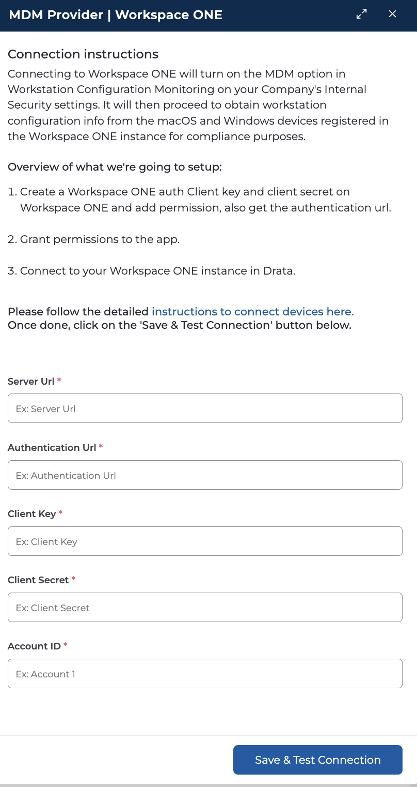

### Step 2: Obtain the Server URL

Here is how to get the server URL after logging into your Workspace ONE account:

- Navigate to **Groups & Settings > All Settings**
- Navigate to **System > Advanced > Site URLs**
- Copy and **save the REST API URL** - this will be entered into the "**Server Url**" field in Drata
- Please copy the whole field

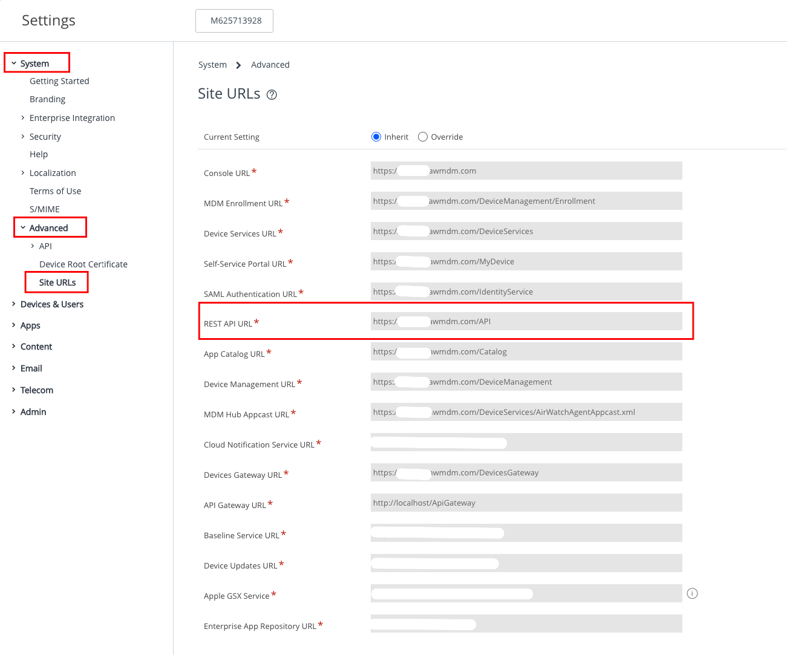

Drata will use the Workspace ONE "**Access Token URL**" is URL to pull an Authentication token to connect to Workspace ONE and pull your device data.

Available Access Token URLs can be found in this [VMWare](https://kb.vmware.com/s/article/76967) article.

| Workspace ONE Token Services Region | Workspace ONE UEM SaaS Data Center Location | Access Token URL |
|---|---|---|
| Ohio (United States) | All UAT environments | [https://uat.uemauth.vmwservices.com/connect/token](https://uat.uemauth.vmwservices.com/connect/token) |
| Virginia (United States) | United States | [https://na.uemauth.vmwservices.com/connect/token](https://na.uemauth.vmwservices.com/connect/token) |
| Virginia (United States) | Canada | [https://na.uemauth.vmwservices.com/connect/token](https://na.uemauth.vmwservices.com/connect/token) |
| Frankfurt (Germany) | United Kingdom | [https://emea.uemauth.vmwservices.com/connect/token](https://emea.uemauth.vmwservices.com/connect/token) |
| Frankfurt (Germany) | Germany | [https://emea.uemauth.vmwservices.com/connect/token](https://emea.uemauth.vmwservices.com/connect/token) |
| Tokyo (Japan) | India | [https://apac.uemauth.vmwservices.com/connect/token](https://apac.uemauth.vmwservices.com/connect/token) |
| Tokyo (Japan) | Japan | [https://apac.uemauth.vmwservices.com/connect/token](https://apac.uemauth.vmwservices.com/connect/token) |
| Tokyo (Japan) | Singapore | [https://apac.uemauth.vmwservices.com/connect/token](https://apac.uemauth.vmwservices.com/connect/token) |
| Tokyo (Japan) | Australia | [https://apac.uemauth.vmwservices.com/connect/token](https://apac.uemauth.vmwservices.com/connect/token) |
| Tokyo (Japan) | Hong Kong | [https://apac.uemauth.vmwservices.com/connect/token](https://apac.uemauth.vmwservices.com/connect/token) |

To know that you are using the correct Access Token URL, we recommend testing it with something like Postman or another tool to make HTTP requests.

| **URL** | POST [https://{{REGION}}.uemauth.vmwservices.com/connect/token](https://.uemauth.vmwservices.com/connect/token) |
|---|---|
| **Header** | No headers |
| **Body** | { grant_type = “client_credentials” client_id = {{CLIENT_ID}} client_secret = {{CLIENT_SECRET}} } |

If the response is an “`access_token`” you’ll know you have the right Access Token URL.

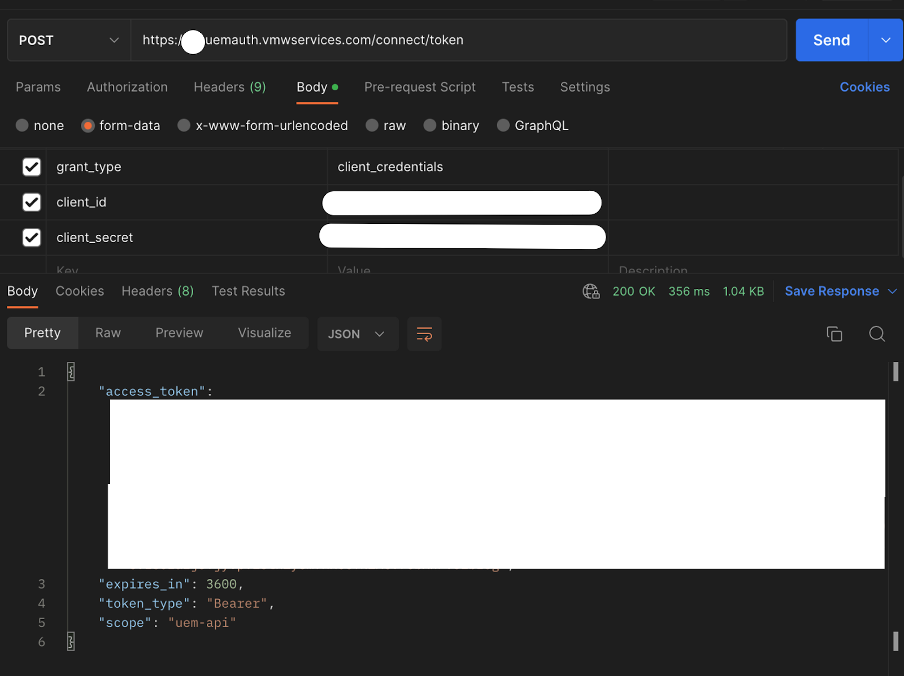

The “client_id” and the “client_secret” can be obtained in the following section.

### Step 3: Create a Custom Role and Generate OAuth Credentials

A custom role sets the access Drata will use to read Workspace ONE data. Create a new Role that will be applied to the OAuth credentials.

- Navigate to **ACCOUNTS > Administrators > Roles**
- Click on **ADD ROLE**
- Create a new role with the following permissions on the **All → API → REST section:**
   - Check the box for "Read" for "Devices," needed to read devices
   - Check the box for "Read" for "Groups," needed to pull Group ID as identification
   - Check the box for "Read" for "Profiles," needed to pull device profiles

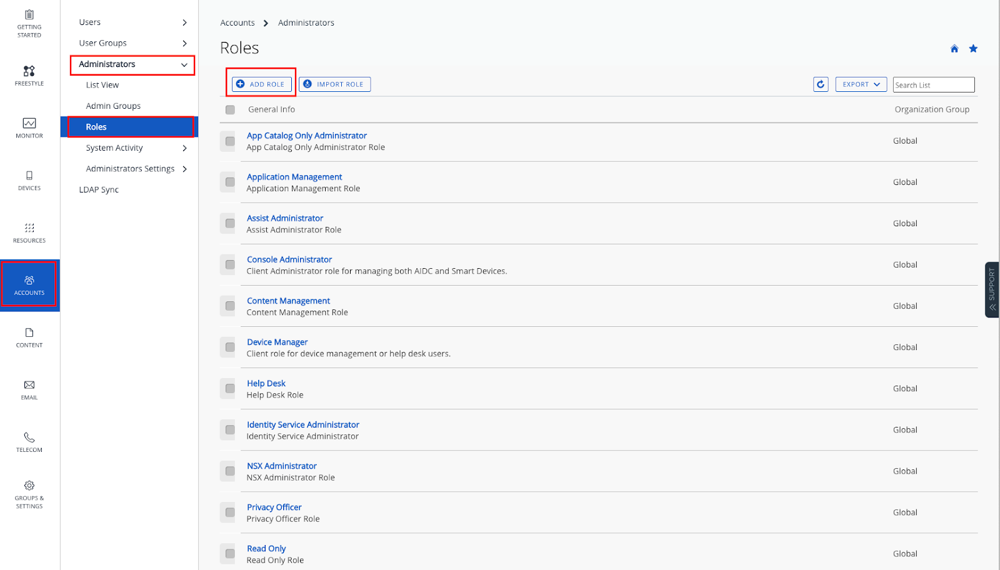

- The role may be saved with any name. This role will be used for the credentials below.

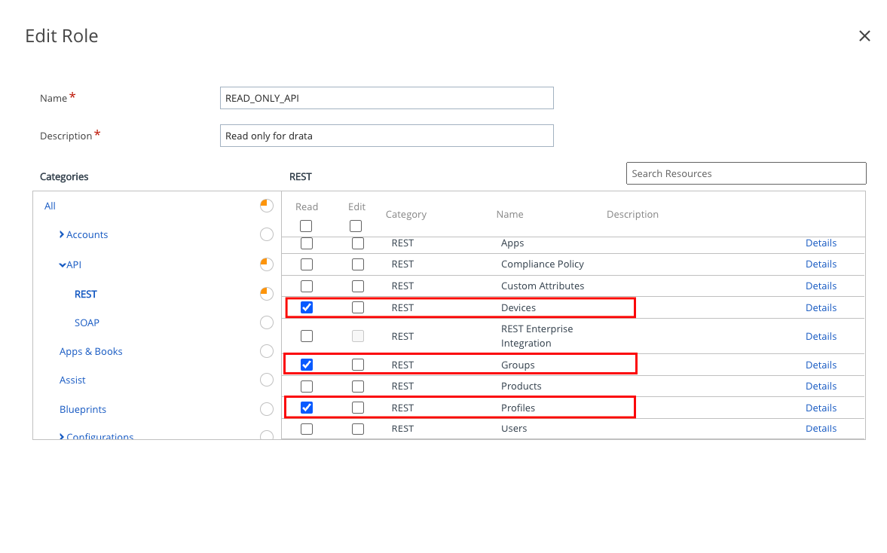

**Generate Credentials: **

- Navigate to **Groups & Settings > Configurations**
- Search for *OAuth* and select **OAuth Client Management**
- Click on **ADD button**

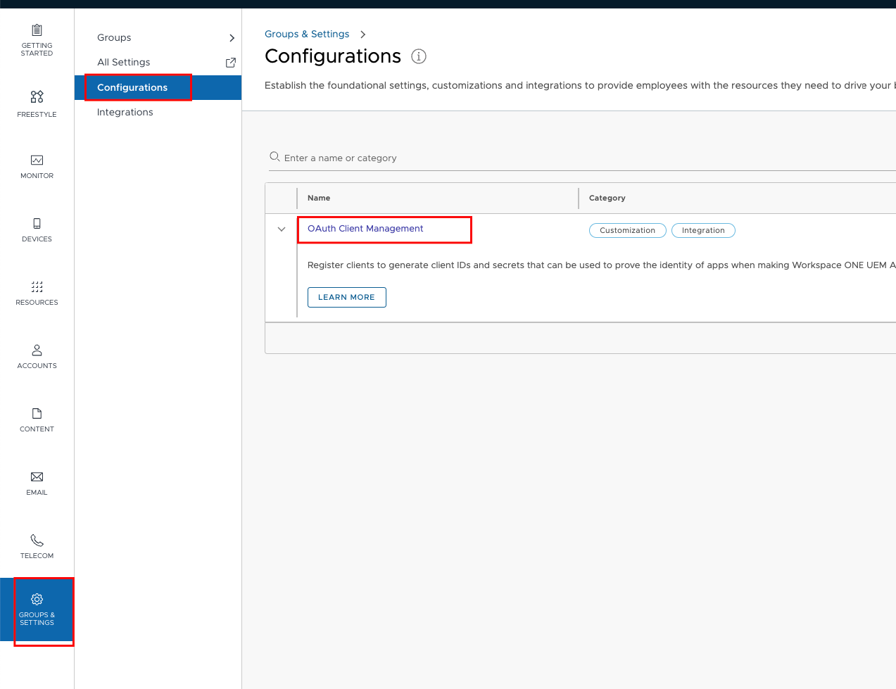

- Add any name and description that you like
- Add your organization group
- Add the custom role created in the previous step
- Click "SAVE"

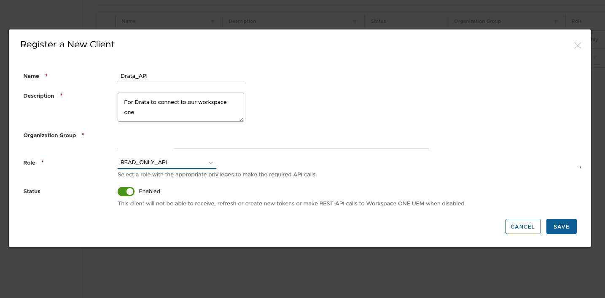

- A new window with Client ID and Client Secret will appear. Copy and save this data in a secure location. Once the window is closed, you cannot get the Client Secret again unless you re-do the above steps.

### Step 4: Configure Windows Compliance Policies

We require some policies to pull information from Windows devices. All **Compliance Policies **can be found in **DEVICES → Compliance Policies → List View**.

**Please make sure the names for the compliance policies match what we mentioned below, otherwise Drata cannot sync the data. **

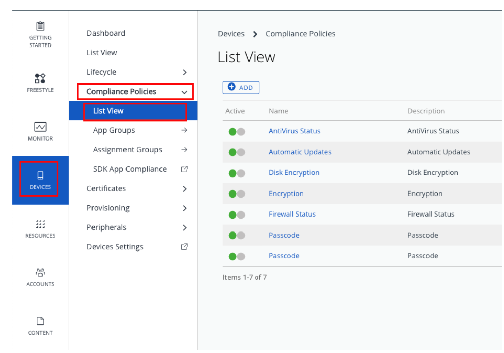

**Antivirus: **

This is used to check if a device has Antivirus. Add a new **Compliance Policy**

- Select a Windows version

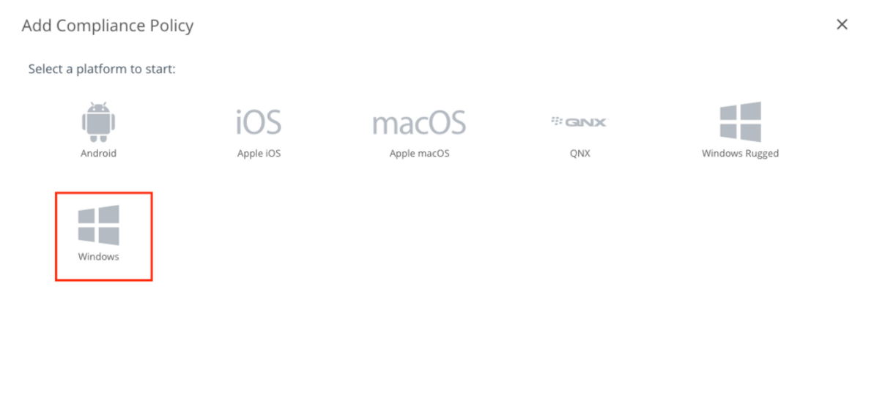

- Select platform

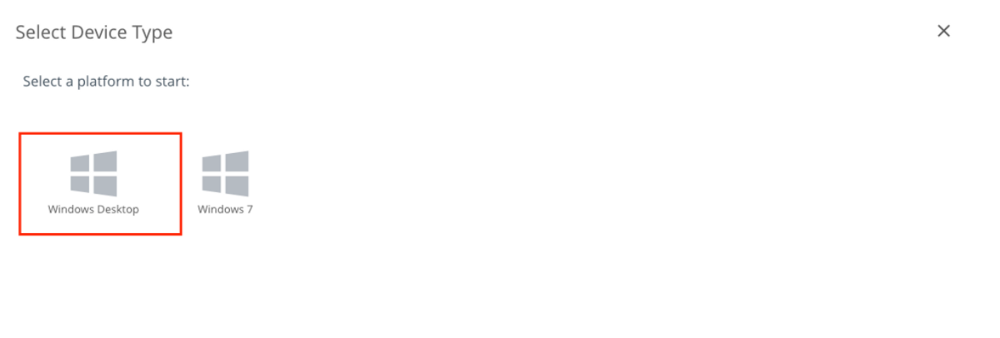

- Add the following configuration for the compliance

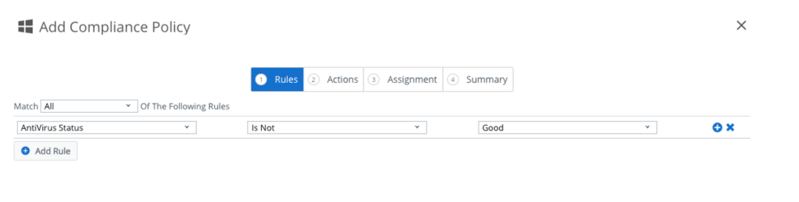

- Add **Actions** as desired
- Select a Group and Smart Groups
- Name the policy “**AntiVirus Status**” exactly. If the name does not match, Drata sync cannot read from it.
- Description can be whatever you like

**Firewall Status: **

This is used to check if the devices have an active firewall. Add the following configuration with the name “**Firewall Status**” exactly.

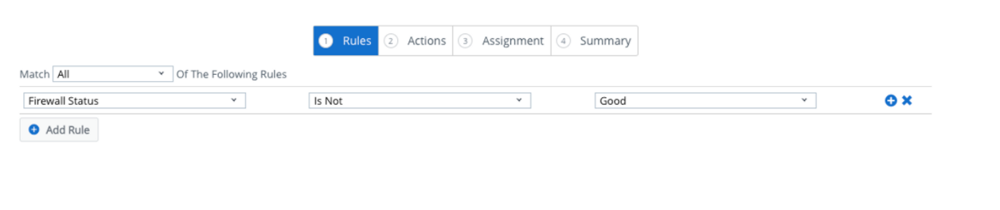

**Automatic Updates: **

This is used to check whether the devices have automatic updates enabled. Add the following configuration with the name “**Automatic Updates**” exactly.

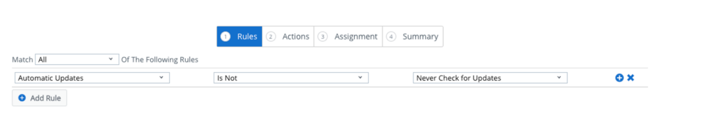

**Disk Encryption: **

This is used to check if the devices have encrypted the hard disk. Add the following configuration with the name “**Disk Encryption**” exactly.

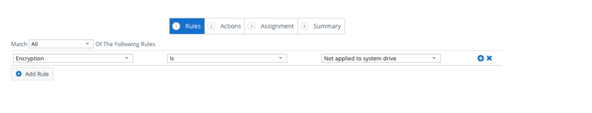

**Passcode**

This is used to check if the devices have a passcode. Add the following configuration with the name “**Passcode**” exactly.

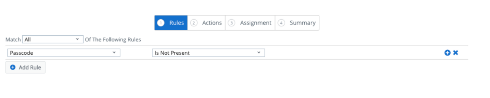

### Step 5: Configure macOS Profiles

MacOS requires a profile to verify that the user has a screen lock (with password) enabled. There is no additional configuration needed for the other compliance checks (Disk encryption, automatic updates, password manager, and antivirus) as this information will come automatically when you set up the connection.

To create a profile do the following:

- Go to **RESOURCES → Profiles & Baselines → Profiles** and click on **ADD**

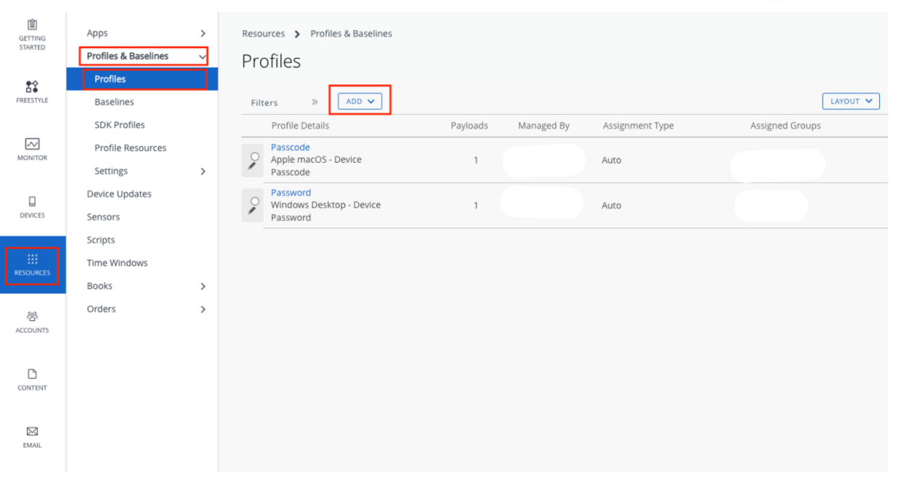

- Select a macOS version

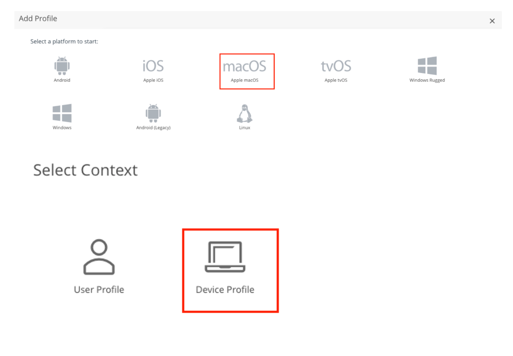

- Name must be “**Passcode**” exactly

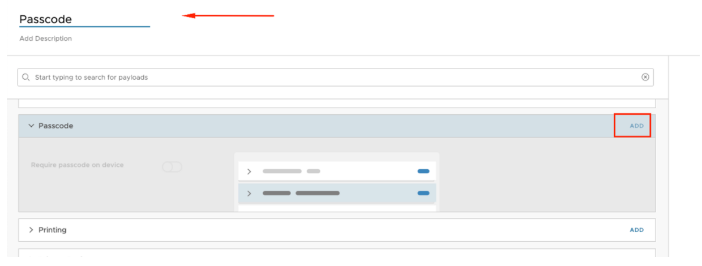

- "**Require passcode on device**" must be toggled on. Other settings can be configured as needed.

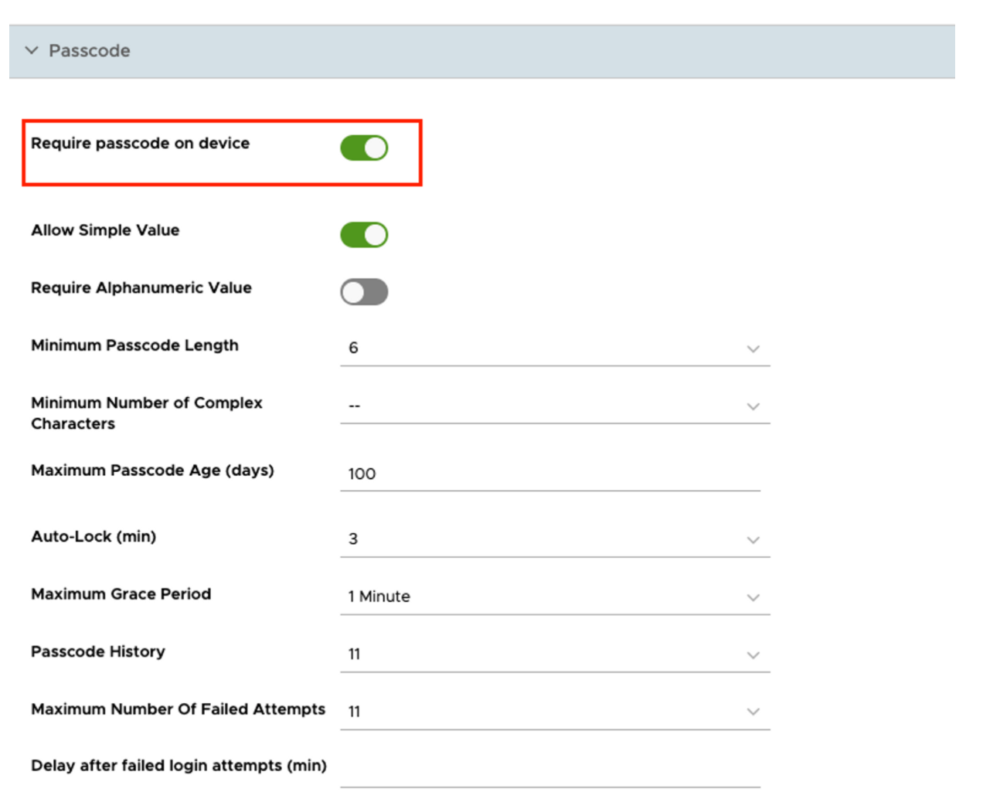

- Add a group and a type of assignment

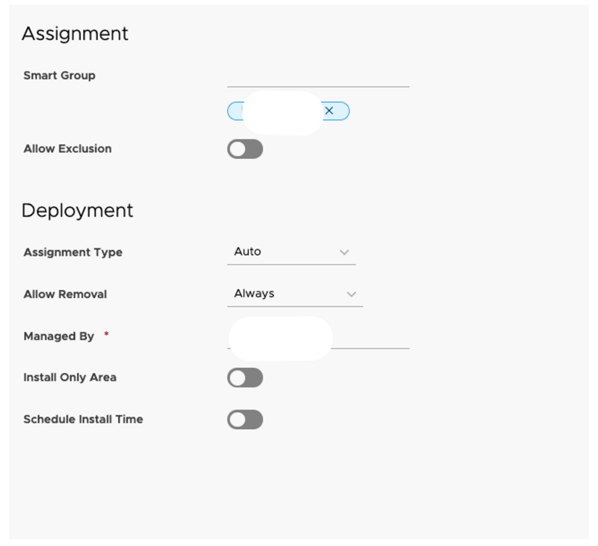

- Click on "**SAVE & PUBLISH**"

### Unlinked Devices

We will automatically unlink devices that are saved in Drata if they have an external ID and are marked as “**Unenrolled**” in Workspace ONE.

## Images

- [image 01] ../../images/integrations/workspace-one-mdm/workspace-one-mdm-integration-guide--01.png
- [image 02] ../../images/integrations/workspace-one-mdm/workspace-one-mdm-integration-guide--02.png
- [image 03] ../../images/documentation/workspace-one-mdm-integration-guide--03.png
- [image 04] ../../images/integrations/workspace-one-mdm/workspace-one-mdm-integration-guide--04.png
- [image 05] ../../images/integrations/workspace-one-mdm/workspace-one-mdm-integration-guide--05.png
- [image 06] ../../images/integrations/workspace-one-mdm/workspace-one-mdm-integration-guide--06.png
- [image 07] ../../images/integrations/workspace-one-mdm/workspace-one-mdm-integration-guide--07.png
- [image 08] ../../images/integrations/workspace-one-mdm/workspace-one-mdm-integration-guide--08.png
- [image 09] ../../images/integrations/workspace-one-mdm/workspace-one-mdm-integration-guide--09.png
- [image 10] ../../images/integrations/workspace-one-mdm/workspace-one-mdm-integration-guide--10.png
- [image 11] ../../images/integrations/workspace-one-mdm/workspace-one-mdm-integration-guide--11.png
- [image 12] ../../images/integrations/workspace-one-mdm/workspace-one-mdm-integration-guide--12.png
- [image 13] ../../images/integrations/workspace-one-mdm/workspace-one-mdm-integration-guide--13.png
- [image 14] ../../images/integrations/workspace-one-mdm/workspace-one-mdm-integration-guide--14.png
- [image 15] ../../images/integrations/workspace-one-mdm/workspace-one-mdm-integration-guide--15.png
- [image 16] ../../images/integrations/workspace-one-mdm/workspace-one-mdm-integration-guide--16.png
- [image 17] ../../images/integrations/workspace-one-mdm/workspace-one-mdm-integration-guide--17.png
- [image 18] ../../images/integrations/workspace-one-mdm/workspace-one-mdm-integration-guide--18.png
- [image 19] ../../images/integrations/workspace-one-mdm/workspace-one-mdm-integration-guide--19.png
- [image 20] ../../images/integrations/workspace-one-mdm/workspace-one-mdm-integration-guide--20.png

## Related articles

- [Kandji (now Iru) Integration Guide (MDM)](kandji-now-iru-integration-guide-mdm.md)
- [JumpCloud Integration Guide (MDM)](jumpcloud-integration-guide-mdm.md)
- [Hexnode UEM (Windows) Integration Guide](hexnode-uem-windows-integration-guide.md)
- [CyberArk Integration Guide](cyberark-integration-guide.md)
- [Smartsheet Integration Guide](smartsheet-integration-guide.md)
