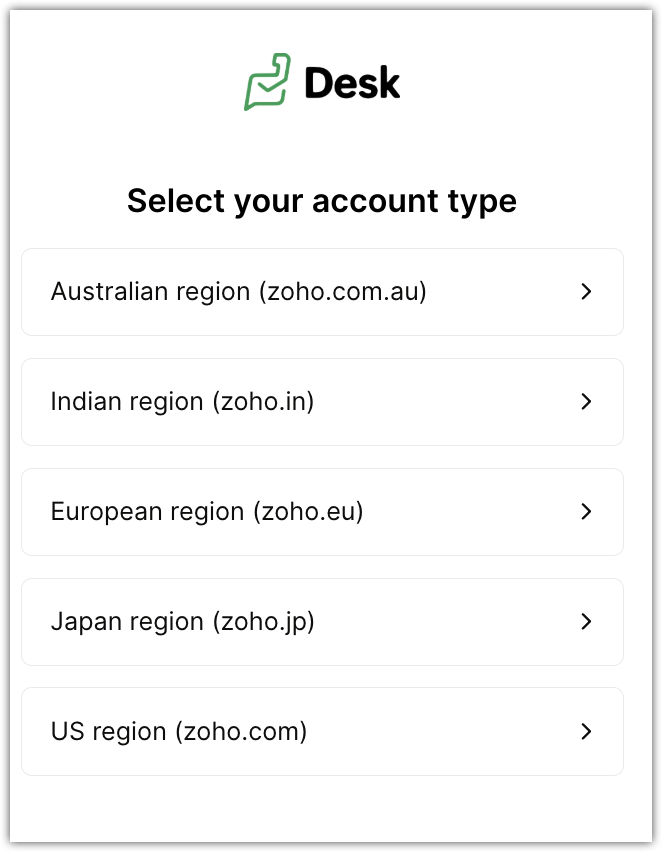
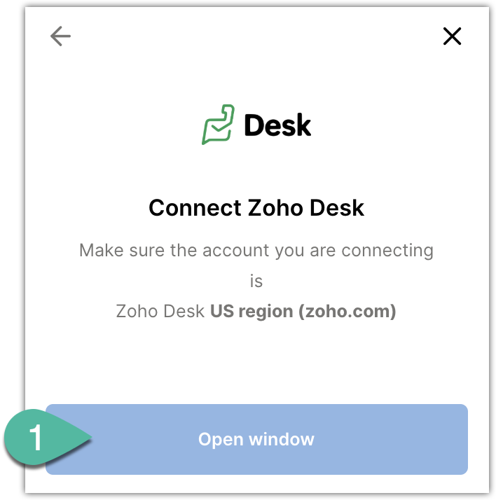
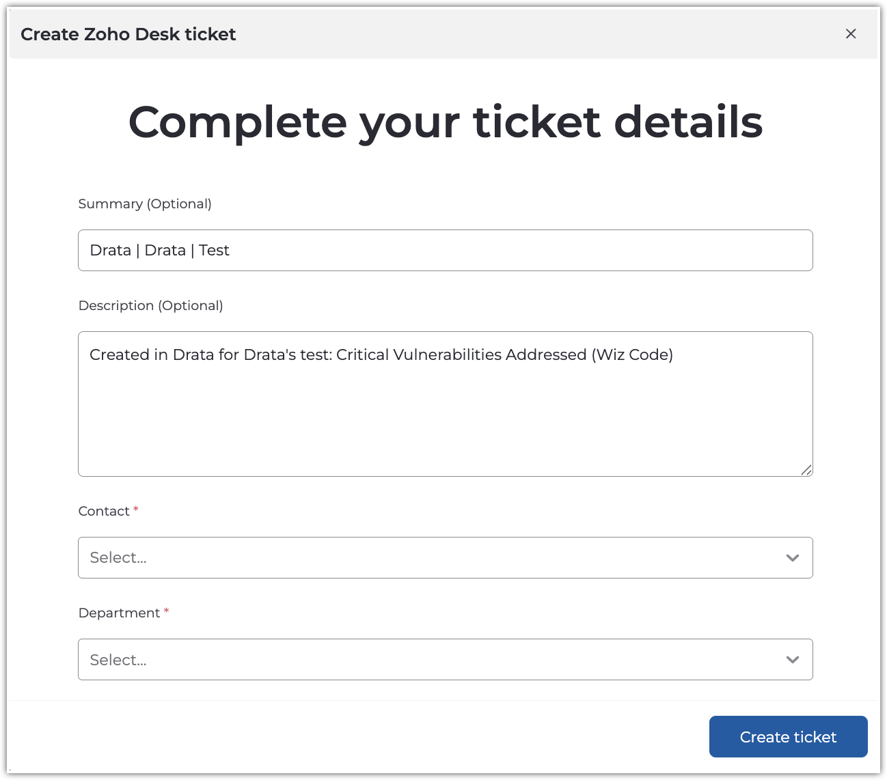

# Zoho Desk Integration Guide (Ticketing & UAR)

Source: https://help.drata.com/en/articles/10984714-zoho-desk-integration-guide-ticketing-uar
Collection: Connection Support › Ticketing Guidance
Updated: 2025-10-22
Fetched: 2026-11-22
Description: Create Zoho Desk tickets through Drata associated with risks, controls, or tests.

## Article text

The Zoho Desk integration allows security and compliance teams to create and manage tickets directly from Drata. By connecting Drata to Zoho Desk, your team can track and resolve issues related to controls, tests, and risks—while maintaining full visibility in both systems.

## Key Capabilities

- **Ticketing Automation:** Create Zoho Desk tickets for controls (both DCF and custom), tests, and risks in Risk Management directly from Drata.
- **Cross-Platform Visibility:** Tickets created in Drata are visible and accessible from your Zoho Desk account.
- **Workflow Efficiency:** Manage, view, and unlink tickets from Drata while maintaining data synchronization with Zoho Desk.

## Prerequisites & Data Access

- You must have one of the following Drata roles: **Admin**, **Information Security Lead**, **DevOps Engineer**, or **Workspace Manager**.
- A **Zoho Organization ID** is required.
- Choose the appropriate **Zoho Desk region** during setup.

## Step-by-Step Setup

### Step 1: Copy your Zoho Organization ID

1. Sign in to your Zoho account.
2. Click the **Settings** gear icon in the top-right corner.
3. Under **Developer Space**, select **API**.
4. Scroll to the bottom of the page to find your **Organization ID**.
5. Copy the ID.

## Complete the Connection

1. In Drata, go to **Connections** and search for **Zoho Desk**.
2. Enter your **Account Alias** and select the **workspace** where this connection will apply.
3. Select your **account type (region)**.
   
4. Enter your **Zoho Desk Organization ID**, then click **Next**.
5. Click **Open Window** to be redirected to Zoho Desk for authentication.
   
6. Sign in to your Zoho Desk account.

For steps on accessing and using the Connections page in Drata, refer to[The Connections Page in Drata](https://help.drata.com/en/articles/12305645-the-connections-page-in-drata).

## Create Zoho Desk Tickets from Drata

With write access enabled, you can create Zoho Desk tickets directly from within Drata’s:

- **Control Details**
- **Test Details**
- **Risk Details** (within Risk Management)

If no tickets are associated yet, you'll be prompted to create one.

To create a ticket:

1. Select the relevant Control, Test, or Risk items.
2. Enter the ticket details.
   - Note: The title and description fields are auto-filled but can be edited.
3. Select **Create ticket**.

## View Zoho Desk Tickets

Tickets linked to a specific Control, Test, or Risk appear in their respective drawers. The most recent ticket appears at the top.

- A maximum of **three "In Progress"** tickets appear in the drawer.
- To view all tickets, select **View all tasks**. A modal window will display two categories:

### Ticket Categories

- **In Progress** – Any ticket in an open state (based on your Zoho Desk configuration)
- **Completed** – Tickets marked as completed in Zoho Desk (for example, Closed, Done, etc.)

**Important:**
Only tickets created through Drata will appear in Drata. Tickets created directly in Zoho Desk are **not pulled into Drata** for ticket management.

## Manage Zoho Desk Tickets

- To manage a ticket, select **Manage ticket**. You'll be redirected to Zoho Desk.
- To download ticket details, click the **Save** icon. This downloads a `.zip` file containing a `.pdf` of the ticket.
- To unlink a ticket, select the **Trash** icon. This only removes the link in Drata. It does **not** delete the ticket in Zoho Desk.
   **Note:** Once unlinked, a ticket cannot be re-associated with the same item.

## Images

- [image 01] ../../images/integrations/zoho-desk/zoho-desk-integration-guide-ticketing-uar--01.png
- [image 02] ../../images/integrations/zoho-desk/zoho-desk-integration-guide-ticketing-uar--02.png
- [image 03] ../../images/ux/tickets/zoho-desk-integration-guide-ticketing-uar--03.png

## Related articles

- [Zoho Bug Tracker Integration Guide](zoho-bug-tracker-integration-guide.md)
- [Azure Boards (DevOps) Integration Guide](azure-boards-devops-integration-guide.md)
- [ClickUp Integration Guide](clickup-integration-guide.md)
- [Ticket Automation (Jira-only) (New experience)](ticket-automation-jira-only-new-experience.md)
- [Create and Manage Workspace Tickets](create-and-manage-workspace-tickets.md)
