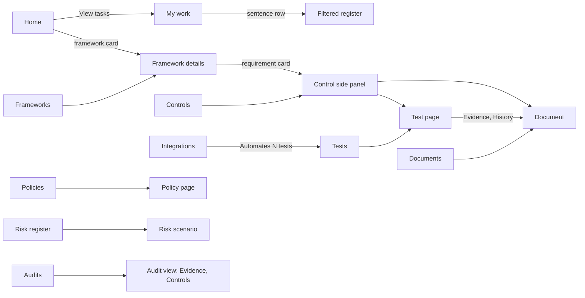

# Vanta: pages and flow, read for Program Assurance

Researched 2026-11-17 from Vanta's public help center (the Navigation collection, the Getting Started Hub, and the articles for the pages those leave out).

**What's in this folder:**
- 29 notes in `pages/`, one per article.
- `journey.md`, the end-to-end path.
- 165 screenshots in `images/` (90 MB).
- `style.md`: Vanta's visual language, and the direction "Ledger, pushed toward Vanta" in Ledger's token terms.
- `help-center/`: the whole help center, crawled on 2026-11-17.
- `images/`: every help-center image, sorted on 2026-11-17 into Vanta's product screens by area, integration setup by integration, documentation, and not product. See `images/README.md`.
  - `index.md`: 753 articles in 56 collections.
  - `articles/`: each article's text.
  - `images/`: 2,724 images (784 MB).
  - `notes/`: every article in a line, plus each product surface in depth, in four notes: `integrations.md`, `optimizing-your-workflow.md`, `grc-core.md`, `platform-trust-team-risk.md`.

The whole folder is gitignored and the repository is public: Vanta's images stay on this machine, never committed. To look at a screenshot, open the note that names it.

## What makes it feel simple

1. **One number first, then what needs attention.** Every page opens with a completion card ("Controls OK 18% · 8 of 44", "OK 289 of 3,283") beside a Needs attention card split by when (Overdue 183 · Due soon 24 · No SLA 2,787). Each line is a filter.
2. **One page shape everywhere.** The order is always the same:
   - header with its title, one primary and More;
   - one or two summary cards;
   - a category rail with counts;
   - one filter row;
   - the table;
   - a selection bar while rows are chosen.
   Documents, Controls, Tests, Policies, Vendors and Vulnerabilities all look alike.
3. **A flat nav by domain, one workspace at a time.** The nav reads:
   - Home, My work, Tests, Reports;
   - Compliance (Frameworks, Controls, Policies, Documents, Audits);
   - Customer Trust, Risk, Vendors, Assets, Personnel, Integrations.

   A workspace switcher sits in the top bar, not in the sidebar.
4. **Records open beside the list.** A control or a piece of evidence opens in a side panel over the register. Only records with their own work (a test, a policy, a vendor) get a page, and that page has counted tabs: Results, Evidence, History, Tasks (13), Controls (44).
5. **Work arrives by urgency, as sentences.** My work groups Urgent (31), Coming soon (362), Unscheduled and Waiting on others. A row reads "Review 9 policies pending your approval" and opens the register already filtered. Collaborators land on My work, administrators on Home.
6. **Automation is the spine.** Integrations feed tests, tests and documents satisfy controls, and controls fill frameworks. One line tells the chain: "Automates 2 tests and 25 controls".
7. **The audit is a mode.** A dark audit band (framework, external or internal, status, window) replaces the top bar. Evidence then carries the auditor's statuses: Not ready, Flagged, Ready, Accepted, Not applicable. They show as one stacked bar and as counted tabs.

## The journey (from `journey.md`)

The timeline is 30 days to plan, 60 days to the first passing tests, 90 days audit-ready, and 6 months to an audit.

| # | Stage | Where | Done when |
|---|---|---|---|
| 1 | Plan | Settings: roles, notifications | Owners named per area |
| 2 | Workspaces (several entities) | Workspace console | Each workspace's % shows |
| 3 | Connect | Empty Home's one button: Connect identity provider; then Integrations | People synced, tests running |
| 4 | Bring in the existing program | Excel template → Review & finalize → Import | "Successfully uploaded N controls" |
| 5 | Scope frameworks | Framework › Scope (systems, people) | Each source In scope / Out of scope |
| 6 | Controls and tests | Framework record, control side panel, Tests | Owners on every control, first passing test |
| 7 | Evidence | Documents (Needs document since …) | Evidence mapped |
| 8 | Policies | Policies: approver, acceptance N/M | Approved, both policy tests OK |
| 9 | People and access | Personnel, Access reviews | First access review complete |
| 10 | Vendors and risk | Vendors, Risk register, library, treatment | Every risk owned and treated |
| 11 | Work loop | Alerts, digests ("6 tests need attention"), Home | Counts fall, % rises |
| 12 | Audit | Audits → Add a new audit (3 steps) → Audit View | Audit in progress |

## The page map

## Mapped to Program Assurance

| Vanta | Program Assurance today | What would change |
|---|---|---|
| Workspace switcher in the top bar | Two-scope side nav (Organization, then a program's Work) | The program is the workspace: switch it in the top bar and keep one flat nav |
| Home: a card per framework (%, bar, N of M), integration banner, View tasks | Portfolio as a tree (wave 9) | Home: one card per program (controls satisfied %, N of M), one banner for broken feeds, View my work |
| My work by urgency, sentence rows | My work: Tasks and Attention tabs | Group by Overdue, Due soon, Unscheduled, Waiting on others. One sentence per kind and state ("Review 9 evidence versions"), opening the filtered register |
| Frameworks: Evidence % and Control % per row, Active / Available | Programs register, Library › Frameworks | Programs register with two completion numbers, the assessment end date and a state chip |
| Framework details: category rail, completion card split by test / document, requirement cards | Controls › Status (wave 10: band, ladder counts, family bars) | Family rail with counts, then one completion card split by what stands behind it (requirements, evidence, assessment). Replaces the band and ladder |
| Controls: Assignment donut, Completion card, register, side panel | Control record as a full page with 5 tabs and a rail (wave 10) | The control opens beside the list as sections (requirements, evidence, findings, risks), each with its add and its empty line. The full page only for deep work |
| Tests: OK card, Needs attention (Overdue, Due soon, No SLA), SLAs | No automated tests; evidence reviews, scans, POA&M due dates | Evidence and POA&M registers open with OK n of N and Needs attention by due. POA&M deadlines by severity, set in one place |
| Documents: what's owed, Renew by, two statuses | Evidence register (what was uploaded) | Evidence as owed items: one row per required artifact, Owner, Renew by |
| Integrations: Connected / Errors, "Automates N tests and M controls" | Ingestion (scans) | An Errors count first, and "supports N controls" per source |
| Vulnerabilities by asset or by vulnerability, against SLAs | Findings & assets, CVEs on components | The same two takes, with due by severity |
| Risk: register, library, action tracker, snapshots | Risk register, POA&M & risk | Dated snapshots: what the AO saw at decision time |
| Audits: audit band, evidence statuses | Assessment campaigns | A campaign is a mode: the SCA sees a band and evidence by Not ready / Flagged / Ready / Accepted |
| Comments: one inbox, internal vs auditor-visible | Discussions, Review queue | One inbox, with the auditor-visible line drawn |
| Policies, Computers, Access reviews, Personnel | None (outside RMF's core) | Leave out, or later |

## What this says about our last two waves

The waves built the boards faithfully: bands, trays, ladders, strips, rails, five-tab records. Vanta's answer to the same questions is fewer, plainer parts repeated everywhere:
- one completion card and one Needs attention card;
- one register shape;
- side panels before pages;
- urgency before kind.

The next build should be a reshape on those four rules, not more screens.

## Not to copy

- Vanta's name, logo, colours, illustrations, "Vanta Agent", or any copy text word for word.
- Integration-driven tests as the main evidence. RMF evidence is documents, assessments and scans, so the chain stays controls → requirements → evidence → findings → POA&M → risk.
